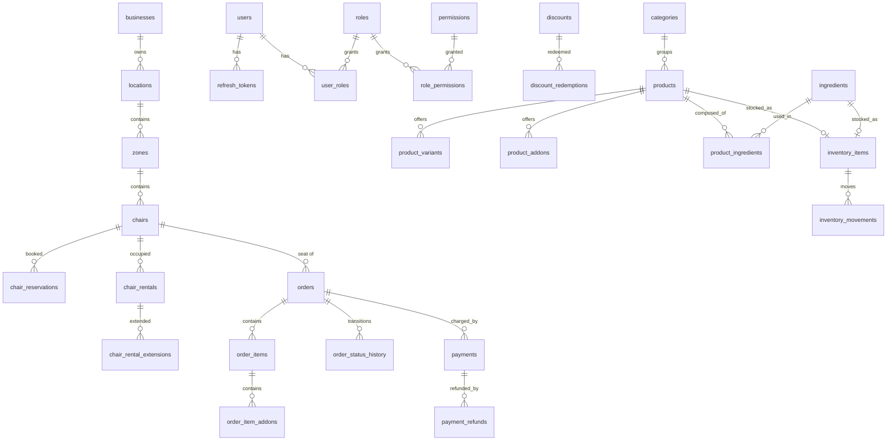

# Base de datos

Guía operativa del esquema y del motor. **No es el contrato**: el detalle
columna por columna de las 34 tablas está en [`DESIGN.md`](./DESIGN.md) §4 y
esta página resume, explica el porqué y enlaza.

---

## 1. Motor y filosofía

| Aspecto | Decisión |
|---|---|
| Motor | **SQLite** vía `better-sqlite3` 13.0.3 |
| Fichero | `backend/data/lattecoffe.sqlite` (configurable con `DATABASE_PATH`) |
| Tipo de conexión | **Síncrona** y singleton por proceso: una instancia, nunca una por petición |
| Puerto a PostgreSQL | Diseñado para ello desde el DDL. `DESIGN.md` §10 tiene la lista de adaptaciones |

`better-sqlite3` es síncrono y single-threaded. Dentro de un proceso Node el
event loop ya serializa las escrituras, así que los repositorios pueden usar
SQL directo sin pool ni `await`. La concurrencia **sí** existe entre procesos
(varias réplicas, o el backend y el CLI de SQLite), y ahí SQLite aplica un lock
de escritura a nivel de archivo.

La portabilidad no es accidental: PK `INTEGER PRIMARY KEY AUTOINCREMENT`
(equivale a `BIGSERIAL`), dinero en `INTEGER` de centavos, fechas en `TEXT`
ISO-8601 UTC y CHECK de enum tienen sintaxis casi idéntica en ambos motores. El
dominio y los services no importan ni `better-sqlite3` ni `pg`.

Código: [`src/shared/database/connection.ts`](../backend/src/shared/database/connection.ts),
[`src/shared/database/unit-of-work.ts`](../backend/src/shared/database/unit-of-work.ts).

---

## 2. PRAGMA configurados

Se aplican al abrir la conexión, en este orden (`connection.ts:47-50`):

| PRAGMA | Valor | Qué aporta |
|---|---|---|
| `journal_mode` | `WAL` | **Write-Ahead Logging**: los lectores no bloquean al escritor ni al revés. Va primero porque escribe en la cabecera del fichero |
| `foreign_keys` | `ON` | **Crítico.** En SQLite las claves foráneas están **apagadas por defecto**. Sin esto las 74 FK del esquema serían decorativas y `DELETE` en cascada no existiría |
| `busy_timeout` | `DATABASE_BUSY_TIMEOUT_MS`, **5000 ms** por defecto | Ante un lock ocupado, **espera** en vez de fallar. Al agotarse se traduce a `409 RESOURCE_BUSY`, no a un 500 |
| `synchronous` | `NORMAL` | Equilibrio correcto con WAL: sin riesgo de corrupción ante caída, con menos fsync que `FULL` |

`foreign_keys = ON` merece la pena subrayarlo: es un PRAGMA de conexión, no de
base de datos. Una conexión nueva nace con las FK apagadas, y `PRAGMA
foreign_keys` es **inocuo dentro de una transacción**: puesto a `OFF` entre
`BEGIN IMMEDIATE` y `COMMIT`, la lectura sigue devolviendo `1`. Por eso
`0003_card_terminal_provider.sql` no puede usar el procedimiento oficial de
12 pasos de SQLite para recrear `payments`; está documentado en el propio
fichero de la migración.

Al apagar se hace `wal_checkpoint(TRUNCATE)` y se revierte cualquier
transacción abierta antes de cerrar, para no dejar ficheros `-wal` huérfanos.

---

## 3. Migraciones versionadas

El esquema **nunca** se crea al arrancar el servidor. Es un comando explícito.

```bash
npm run migrate            # aplica las pendientes (idempotente)
npm run migrate:status     # aplicadas / pendientes / ALTERADAS, con checksum
npm run migrate:rollback   # revierte la última usando su .down.sql
```

### Cómo funciona

1. Lee `src/database/migrations/*.sql` en **orden lexicográfico**.
2. Calcula el **SHA-256** del contenido de cada fichero.
3. Registra las aplicadas en la tabla de control `_migrations`
   (`id, name, checksum, applied_at, execution_ms`).
4. **Si una migración ya aplicada tiene un checksum distinto, ABORTA.** Editar
   una migración aplicada está prohibido: se corrige con una migración nueva.
   `status` sí muestra la divergencia (`ALTERADA`) para poder diagnosticarla.
5. Cada migración se aplica en su **propia transacción** (`BEGIN IMMEDIATE`):
   entra entera o no entra nada.

Reglas de los `.sql`: prohibido `BEGIN`/`COMMIT`/`ROLLBACK`/`SAVEPOINT` (el
runner controla la transacción) y permitido `PRAGMA` (son sentencias
independientes). El runner analiza el "esqueleto" del SQL —sin comentarios ni
literales— para no confundirse con un `BEGIN` de cuerpo de trigger.

`rollback` ejecuta el `NNNN_nombre.down.sql` de la última aplicada y borra su
fila, de modo que `migrate` puede volver a aplicarla. **Sin fichero `down`,
falla con un mensaje explícito** en vez de adivinar un `DROP`.

### Las tres migraciones que existen

| Fichero | Propósito |
|---|---|
| `0001_init.sql` | El esquema completo: **34 tablas**, sus índices, sus CHECK y sus triggers de `updated_at` |
| `0002_fix_chair_reservation_index.sql` | **Corrige un defecto de diseño** de `0001`: el índice único `ux_chair_res_active (chair_id) WHERE status IN ('CONFIRMED','ACTIVE')` no incluía la ventana horaria, así que una silla sólo admitía **una** reserva confirmada en toda la historia de la base. Se elimina y se sustituye por `idx_chair_res_overlap_lookup (chair_id, status, start_at, end_at)`, que acelera la comprobación de solapamiento sin prohibir huecos legítimos. La garantía de no-doble-reserva vive en la transacción, no en el índice |
| `0003_card_terminal_provider.sql` | Añade `CARD_TERMINAL` a los valores legales de `payments.provider`. `0001` sólo admitía cinco pasarelas online, y el sistema **no tiene ninguna**: se cobra en el mostrador. Como SQLite no tiene `ALTER TABLE ... DROP CONSTRAINT`, hay que recrear la tabla entera, y el runner no permite apagar las FK. La migración reconstruye tabla, índices, trigger, `sqlite_sequence` y datos, y acaba con autoguardas `CHECK (ok = 1)` |

Hay un test dedicado a la tercera: [`tests/migration-0003.spec.ts`](../backend/tests/migration-0003.spec.ts)
verifica paridad de esquema, que el CHECK nuevo acepta un pago de datáfono y que
la reversión aborta sin dejar la tabla a medias.

`GET /api/v1/health` publica `database.migrationsPending`: un despliegue con
pendientes se ve en el health sin necesidad de entrar al servidor.

Código: [`src/shared/database/migrator.ts`](../backend/src/shared/database/migrator.ts),
[`src/database/cli.ts`](../backend/src/database/cli.ts).

---

## 4. Catálogo de las 34 tablas

Columnas, tipos, constraints e índices: [`DESIGN.md`](./DESIGN.md) §4. Esta tabla
es el índice: qué es cada tabla y qué módulos la tocan.

### Identidad y RBAC (6)

| Tabla | Qué representa | Módulos que la tocan |
|---|---|---|
| `roles` | Los 6 roles del sistema | auth, users, todos (vía `requirePermission`) |
| `permissions` | Catálogo de claves `modulo:accion` | auth, users, `meta/roles` |
| `role_permissions` | Matriz rol × permiso (RBAC) | users, todos los protegidos |
| `users` | Cuentas de personal y de clientes. **No hay tabla `customers`**: un cliente es un `users` con rol `CUSTOMER` | auth, users, customers, todos |
| `user_roles` | Asignación de roles a usuarios (N:M) | auth, users, customers |
| `refresh_tokens` | Sesiones: un refresh opaco hasheado por sesión | auth |

### Negocio (4)

| Tabla | Qué representa | Módulos que la tocan |
|---|---|---|
| `businesses` | Negocio singleton (`id = 1` en v1) | business, todos (`business_id` de la fila de auditoría) |
| `locations` | Sedes | locations, spaces, business |
| `business_hours` | Horario por día de la semana | business, business.hours |
| `business_holidays` | Días festivos | business |

### Espacios (5)

| Tabla | Qué representa | Módulos que la tocan |
|---|---|---|
| `zones` | Zonas de una sede. **No hay tabla `tables`**: las mesas son `chairs` con `kind = 'TABLE'` | spaces |
| `chairs` | Sillas y mesas: precio por hora, estado, rejilla | spaces, reservations, rentals, orders |
| `chair_reservations` | Reservas con ventana horaria y precio congelado | reservations, orders, rentals |
| `chair_rentals` | Alquileres materializados (check-in) | rentals, orders, reports |
| `chair_rental_extensions` | Extensiones. **Inmutable**: es un libro de MOVES | rentals |

### Catálogo (6)

| Tabla | Qué representa | Módulos que la tocan |
|---|---|---|
| `categories` | Categorías del menú | catalog, orders |
| `products` | Productos con precio base, promoción y disponibilidad | catalog, orders, inventory, discounts |
| `product_variants` | Variantes (tamaños, undecies) | catalog, orders |
| `product_addons` | Complementos por producto | catalog, orders |
| `ingredients` | Insumos | catalog, inventory |
| `product_ingredients` | Receta: coste de una unidad | catalog, inventory |

### Pedidos (4)

| Tabla | Qué representa | Módulos que la tocan |
|---|---|---|
| `orders` | Une las dos líneas de negocio: `TAKEAWAY`, `DINE_IN`, `CHAIR_RENTAL` | orders, payments, discounts, reports |
| `order_items` | Líneas con **snapshots** de precio. El recibo sale de aquí, no del catálogo | orders, reports |
| `order_item_addons` | Complementos de cada línea, también con snapshot | orders |
| `order_status_history` | Transiciones. **Histórico**: no se edita ni se borra | orders |

### Pagos (2) y descuentos (2)

| Tabla | Qué representa | Módulos que la tocan |
|---|---|---|
| `payments` | Cobros con `Idempotency-Key` en índice parcial sobre `json_extract` | payments, orders, reports |
| `payment_refunds` | Reembolsos parciales y totales. **Inmutable** | payments |
| `discounts` | Cupones `PERCENT` / `FIXED` con ventana y ámbito | discounts, orders |
| `discount_redemptions` | Uso de cupón por cliente y pedido. **Inmutable** | discounts, orders |

### Inventario (2), notificaciones (2) y auditoría (1)

| Tabla | Qué representa | Módulos que la tocan |
|---|---|---|
| `inventory_items` | Saldo por producto o insumo | inventory, orders, catalog |
| `inventory_movements` | Libro de movimientos. **Inmutable**: el saldo se corrige con `ADJUSTMENT` | inventory, orders |
| `notifications` | Bandeja (in-app) y cola de canales externos | notifications |
| `notification_preferences` | Preferencias y franja silenciosa por usuario | notifications |
| `audit_logs` | **Append-only**. Toda acción sensible deja fila | `shared/database/audit.repository.ts`, todos |

---

## 5. Relaciones

Simplificado por dominios. La versión completa con todas las FK está en
[`DESIGN.md`](./DESIGN.md) §5.



---

## 6. Decisiones clave y por qué

| Decisión | Alternativa descartada | Motivo |
|---|---|---|
| **Dinero en `INTEGER` de centavos** (`*_minor`) | `REAL` / `float` | Un POS no puede tener un céntimo de diferencia. `0.1 + 0.2 !== 0.3` en IEEE-754; 100 líneas de café a $0.10 guardadas en `float` y sumadas al final dan un total que **no cuadra con la caja**. En enteros, cada operación es exacta y el único redondeo es el explícito y testeable (`DESIGN.md` §7.2) |
| **Fechas en `TEXT` ISO-8601 UTC** | `TIMESTAMPTZ` nativo | El orden lexicográfico coincide con el cronológico, así que `WHERE start_at <= :now` funciona igual en SQLite y en PostgreSQL. El día del negocio, en cambio, **se corta en hora local** (`America/Bogota`), y eso lo resuelve [`reports.tz.ts`](../backend/src/modules/reports/reports.tz.ts), no el tipo de la columna |
| **PK `INTEGER PRIMARY KEY AUTOINCREMENT`** | `UUID` o `rowid` pelado | `AUTOINCREMENT` equivale a `BIGSERIAL` en PostgreSQL y garantiza que un id **nunca** se reutiliza tras un borrado. Con `INTEGER`, el tipo TypeScript sigue siendo `number` y en Dart `int` |
| **Soft delete** (`deleted_at`) | `DELETE` físico | Un producto que se withdraw no puede desaparecer del histórico de pedidos. **13 tablas** lo tienen; las de histórico e inmutables no, porque no se editan |
| **`CHECK` constraints como última línea de defensa** | Validación sólo en el service | Si el dominio tiene un bug, el CHECK aborta la escritura. `payments.refunded_minor <= amount_minor`, `inventory_movements.quantity != 0`, `ck_orders_discount` son redes que no dependen de que nadie se acuerde |
| **Índices UNIQUE parciales** | Columnas calculadas o `NULL` como centinela | `ux_payments_idempotency ON payments (json_extract(metadata,'$.idempotency_key')) WHERE ... IS NOT NULL` deja vivir miles de pagos sin clave sin inflar el índice. PostgreSQL los soporta idénticamente, y fue el motivo de elegirlos |
| **`updated_at` por trigger** | Que cada service se acuerde | 22 triggers `trg_<tabla>_updated_at`. Ningún código de aplicación toca ese campo |

Dinero en enteros no es sólo una decisión de esquema: hay una suite entera de
31 tests unitarios en
[`src/shared/utils/money.spec.ts`](../backend/src/shared/utils/money.spec.ts) que
cubre `roundHalfUp` (`0.4 → 0`, `0.5 → 1`, `0.6 → 1`, `-0.5 → 0`), el prorrateo
de descuentos y el formateo.

---

## 7. Concurrencia

### `BEGIN IMMEDIATE`, no `BEGIN DEFERRED`

`unit-of-work.ts` abre **siempre** con `BEGIN IMMEDIATE`:

| Modo | Toma el lock | Consecuencia |
|---|---|---|
| `DEFERRED` (el default de `better-sqlite3`) | En el primer `SELECT` o `WRITE` | **Peligroso.** Dos transacciones leen el mismo snapshot, ambas ven la silla libre, ambas insertan; la segunda revienta en el `COMMIT`. El negocio creyó que reservó y el cliente ve un error |
| `IMMEDIATE` | En el `BEGIN` | Correcto. La segunda transacción espera (`busy_timeout`) y serializa desde el primer `SELECT`. Si agota, `409 RESOURCE_BUSY` |
| `EXCLUSIVE` | En el `BEGIN`, y además bloquea lectores | Innecesario: nadie más lee el fichero en v1 |

`BEGIN EXCLUSIVE` no se usa. `DESIGN.md` §8.2 tiene la tabla completa.

### Cómo se evita la doble reserva

La garantía vive en la **transacción**, no en un índice. SQLite no tiene índices
por rango ni exclusión tipo `EXCLUDE USING gist` de PostgreSQL, así que un
índice único no puede expresar "único por silla dentro de una ventana" (de ahí
la migración `0002`).

```
BEGIN IMMEDIATE
  1. Se relee la silla y se valida que sea reservable
  2. findOverlapping: NOT (r.end_at <= :startAt OR r.start_at >= :endAt)
     sobre BLOCKING_RESERVATION_STATUSES (PENDING, CONFIRMED, ACTIVE)
  3. Si hay solape -> ConflictError CHAIR_ALREADY_RESERVED -> ROLLBACK
  4. INSERT de la reserva
COMMIT
```

Como el lock se toma al abrir y se mantiene hasta el final, el caso de los dos
clientes que reservan la misma silla a la misma hora no puede colarse: el
segundo ve la fila del primero.

Otros detalles del diseño transaccional:

- **Nada de `await` dentro** de `runInTransactionSync`. `better-sqlite3` es
  síncrono; un salto al event loop dejaría el lock retenido mientras otra
  petición entra en la misma conexión. Los efectos externos (correo, push) se
  ejecutan **después** del commit.
- Las anidadas usan `SAVEPOINT`: sólo la más externa decide confirmar o revertir.
- Una transacción abierta **sin contexto** se revierte y lanza `DatabaseError`:
  falla ruidosamente en vez de confirmar trabajo ajeno.
- `SQLITE_BUSY` / `SQLITE_LOCKED` se traducen a `409 CONFLICT_ERROR` con
  `details.code = 'RESOURCE_BUSY'`.

### Cómo se prueba

En [`tests/reservations.spec.ts`](../backend/tests/reservations.spec.ts) hay
un bloque `Doble reserva: el caso de los dos clientes` que cubre la segunda
reserva solapada (409 con el código ganador), las dos que no se solapan, los
extremos que se tocan, el `PENDING` que también bloquea y la regresión del
índice `0002`. Ver [`TESTING.md`](./TESTING.md) para el detalle.

---

## 8. Semillas

`npm run seed` (`src/database/cli.ts seed`) ejecuta
[`src/database/seeds/index.ts`](../backend/src/database/seeds/index.ts) en este
orden, dentro de **una sola transacción** (`BEGIN IMMEDIATE`):

| # | Semilla | Qué crea |
|---|---|---|
| 1 | `roles-permissions.seed.ts` | 6 roles, **83** permisos y la matriz completa de `DESIGN.md` §9.3. Es la fuente de verdad de la autorización |
| 2 | `development-accounts.seed.ts` | Negocio singleton (`businesses.id = 1`) y las 4 cuentas de sistema: `owner@`, `admin@`, `manager@`, `cajero@lattecoffe.co` |
| 3 | `spaces-demo.seed.ts` | 1 sede, 5 zonas y 25 sillas de demostración |
| 4 | `catalog-demo.seed.ts` | 6 categorías, 24 productos, variantes, complementos, recetas e inventario |
| 5 | `discounts-demo.seed.ts` | 5 cupones (uno de categoría, por eso va **después** del catálogo) |
| 6 | `operations-demo.seed.ts` | Empleados, clientes, horario del local, reservas, alquileres y 18 pedidos con historial y cobros |

El orden lo imponen las claves foráneas, no es una preferencia: sin negocio no
hay sede, y sin sede no hay zonas.

**Idempotente**: `npm run seed` dos veces no duplica nada, no toca contraseñas ya
cambiadas y no pisa la matriz de RBAC si ya es correcta. Los pasos 3 a 6 usan
códigos **deterministas** (`ORD-900001`, `RES-900001`, `RENT-900001`,
`PAY-900001`): un humano distingue de un vistazo qué filas son de demostración.

### Base limpia (sin datos de demostración)

```bash
SEED_DEMO_DATA=false npm run seed
```

Deja **sólo la estructura**: roles, permisos, matriz RBAC, negocio, sede, zonas,
sillas y las 4 cuentas de sistema. En `APP_ENV=production` los datos de demo se
ignoran aunque valga `true` (regla dura en `demo-support.ts`), y la semilla de
cuentas de sistema también se desactiva: una contraseña compartida en el
repositorio es una puerta abierta.

Sin `npm run seed` la API **arranca**, pero `GET /api/v1/meta/roles` responde
**503** y ningún endpoint protegido deja pasar a nadie.

La comprobación de coherencia aritmética de los 18 pedidos sembrados vive en
[`tests/seed.spec.ts`](../backend/tests/seed.spec.ts).

---

## 9. Migrar a PostgreSQL

El **dominio no cambia**: ni una entidad, ni un tipo, ni una máquina de estado,
ni un service, ni un controller, ni una ruta, ni una línea de Dart. Ese es el
test de que la separación por capas se aplicó de verdad.

### Lo que hay que cambiar

| Cambio | Dónde |
|---|---|
| `AUTOINCREMENT` → `BIGSERIAL` | Sólo el DDL de migraciones |
| `last_insert_rowid()` → `RETURNING id` | Todas las inserciones. El cambio más invasivo, confinado a los repositorios |
| `strftime(...)` → `to_char(now() AT TIME ZONE 'UTC', ...)` | Defaults y trigger de `updated_at` |
| Triggers de `updated_at` → `CREATE FUNCTION` + un trigger por tabla | Sólo migraciones |
| `PRAGMA foreign_keys` / `journal_mode` / `busy_timeout` | Desaparecen. El pool `pg` no los necesita |
| `BEGIN IMMEDIATE` → `BEGIN` | `unit-of-work.ts`. La interfaz no cambia |
| `CHECK (json_valid(x))` | **No existe** en PostgreSQL. Se valida en el service o se migra a `JSONB` |
| `json_extract(x,'$.k')` → `x->>'k'` | Índice de idempotencia de pagos |
| `strftime`/`date()` → `to_char`/`date_trunc`/`generate_series` | `reports.repository.sqlite.ts` y `reports.tz.ts` |
| `GROUP_CONCAT` → `string_agg` | Listados y exportaciones |
| `LIKE` sin distinción → `ILIKE` o `LOWER(...)` | Búsquedas por nombre |
| `SQLITE_CONSTRAINT_*` → `23505` / `23503` / `23514` | `shared/errors/constraint-errors.ts`, un solo fichero |
| `REAL` para stock → `NUMERIC(14,3)` | Mapeadores |
| Conexión síncrona → pool asíncrono | El `UnitOfWork.run` pasa a `async`: **único cambio de firma** en toda la base |

### Lo que NO cambia

- Los índices parciales: PostgreSQL los soporta igual. Fue el motivo de elegirlos
  en vez de columnas calculadas.
- Los CHECK de enum, los índices compuestos, los `snake_case`.
- El dinero en enteros de centavos: `INT`/`BIGINT` en ambos. El dominio no
  distingue.
- Las fechas en `TEXT` ISO-8601 UTC, con las mismas comparaciones lexicográficas.
- Todas las entidades, todos los services, todos los endpoints, todo el frontend.

La lista completa de 15 pasos está en [`DESIGN.md`](./DESIGN.md) §10.3. El
paso 15 es el obligatorio: comparar la salida de los endpoints de reportes entre
ambos motores con el mismo dataset.
