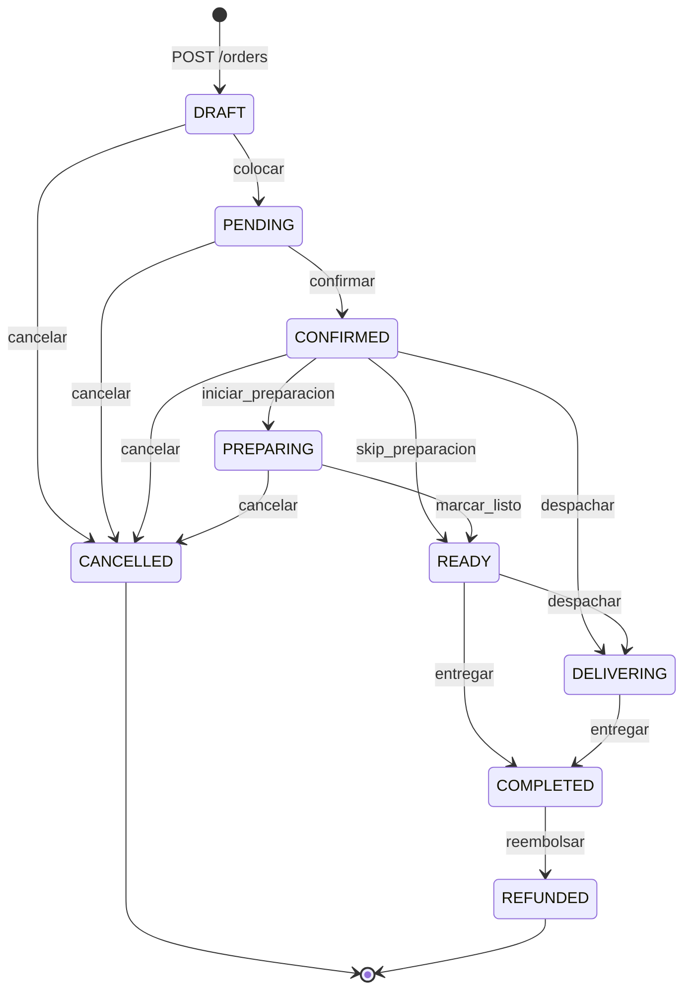
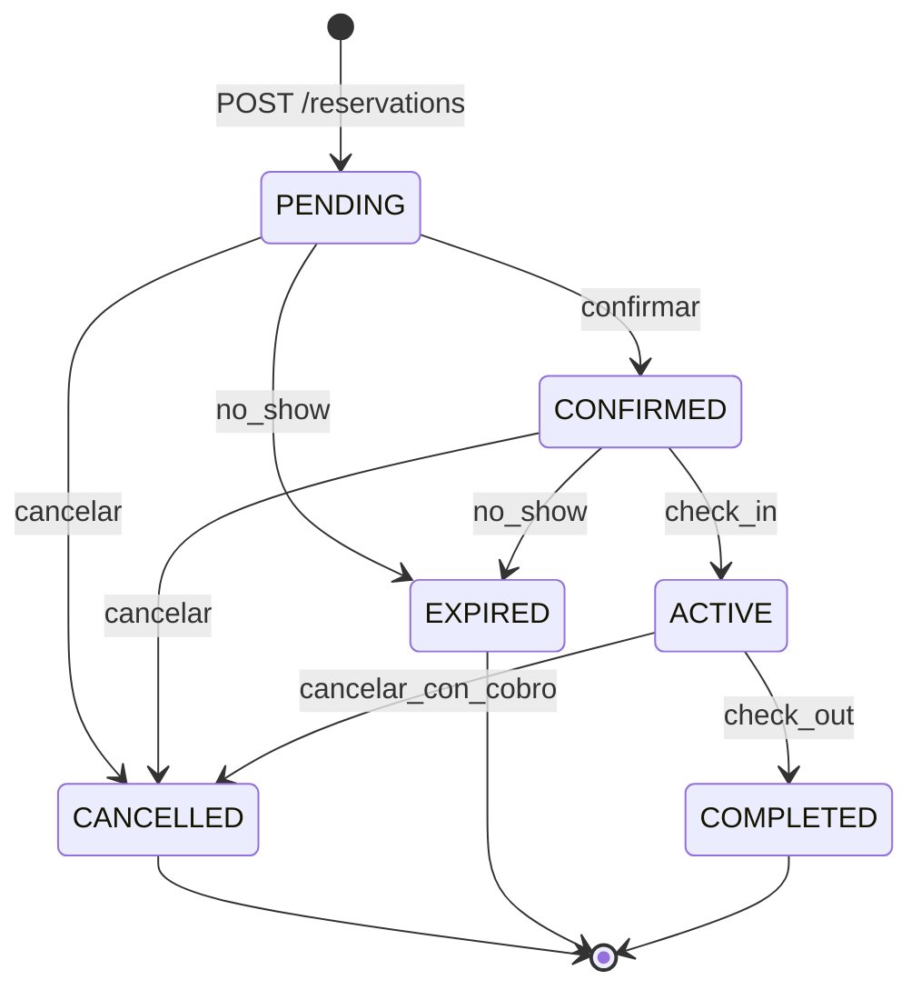
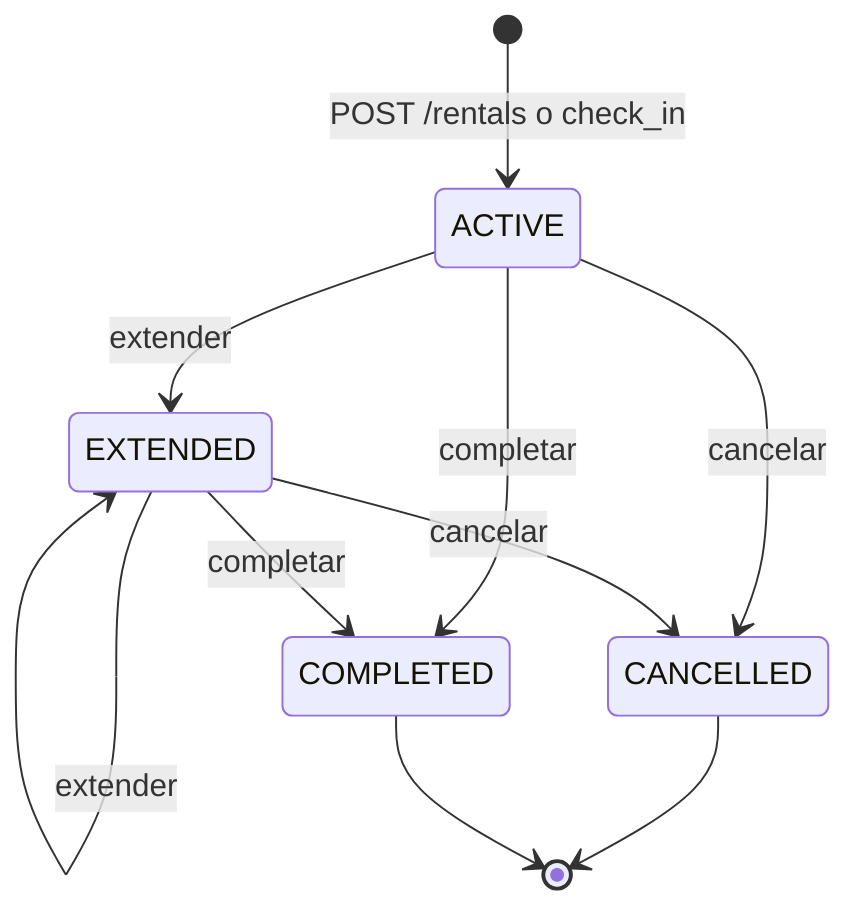
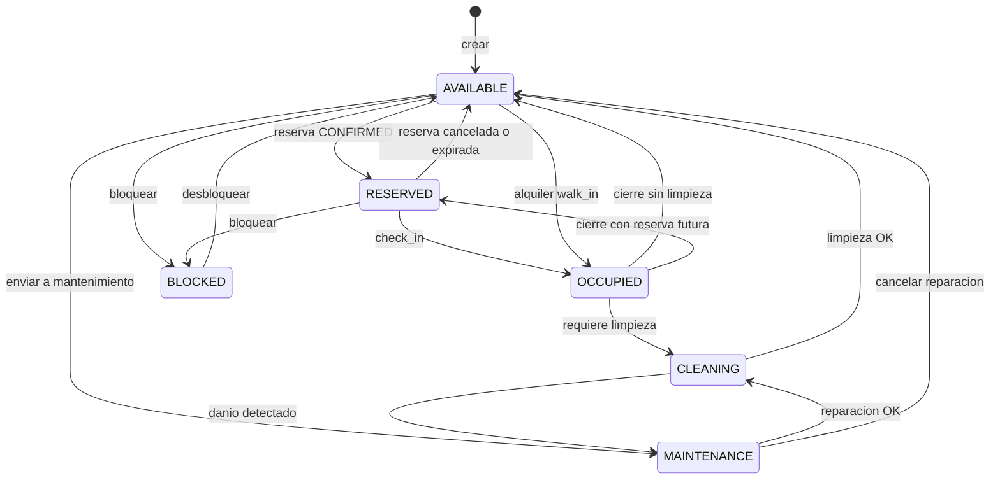
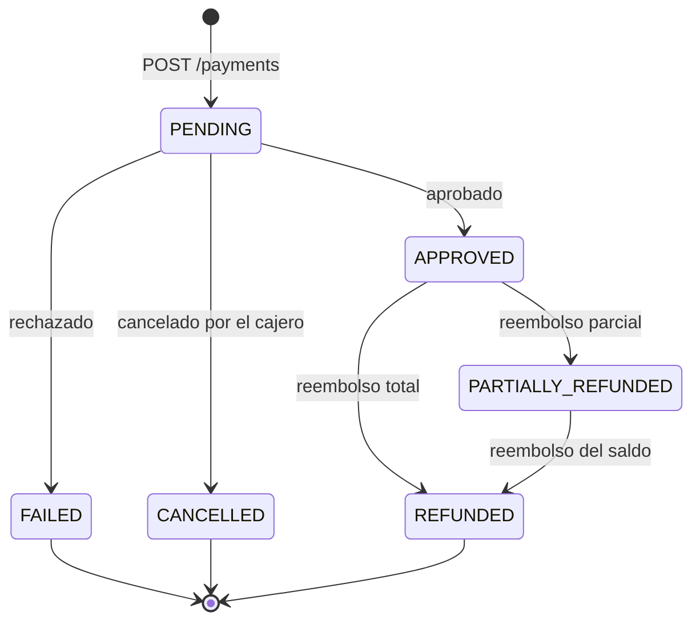

# LatteCoffe POS — Documento de Diseño Técnico

Version del documento: 1.0.0
Estado: CONGELADO (contrato técnico normativo)
Stack: Node.js 22+ / TypeScript / Express 5.2.1 / better-sqlite3 13.0.3 / zod 4.6.5 / Flutter + Riverpod 2 / SQLite

> Este documento es de implementación literal. Si el código difiere de lo aquí escrito, el código es incorrecto.
> Toda desviación debe registrarse en la sección 13 (Decisiones y desviaciones).

---

## Tabla de contenidos

1. Visión y principios
2. Estructura de directorios
3. Arquitectura por capas del backend
4. Modelo de datos
5. Diagrama de relaciones
6. Máquinas de estado
7. Reglas de negocio
8. Concurrencia y transacciones
9. RBAC
10. Estrategia de migración a PostgreSQL
11. Seguridad
12. Logging estructurado
13. Decisiones y desviaciones

---

## 1. Visión y principios

### 1.1 Qué es el sistema

LatteCoffe es un POS (punto de venta) para una cafetería que opera con dos líneas de negocio simultáneas:

- **Venta de productos**: café, bebidas, comida, con variantes, complementos, impuestos, descuentos e inventario.
- **Alquiler de espacio**: sillas, mesas, barra y salones alquilables por tiempo, con reservas previas, alquileres walk-in, extensiones y cobro por sobretiempo.

Ambas líneas comparten el mismo carrito, el mismo pedido (`orders`) y el mismo motor de pagos. Un pedido de tipo `CHAIR_RENTAL` es un pedido normal cuyo `order_type` apunta a un alquiler.

### 1.2 Principios rectores

| # | Principio | Significado concreto |
|---|---|---|
| P1 | **Una sola fuente de verdad** | El backend es la única autoridad sobre precios, totales, disponibilidad, stock y estado. El frontend NUNCA calcula totales finales; solo puede previsualizar. |
| P2 | **Dominio desacoplado del motor de persistencia** | Ninguna entidad, tipo de dominio ni regla de negocio importa `better-sqlite3`, `express` o `zod`. El dominio es TypeScript puro. |
| P3 | **Capas con dependencia hacia adentro** | `API -> Controller -> Service -> Repository interface -> Repository impl -> Database`. Ninguna capa apunta hacia afuera. |
| P4 | **El dinero es un entero** | Todos los montos son `INTEGER` en la unidad mínima (centavos). Prohibido `float` para dinero en dominio, servicio, repositorio y base de datos. |
| P5 | **El tiempo es UTC ISO-8601** | Columnas `TEXT` con formato `YYYY-MM-DDTHH:MM:SS.sssZ`. Se formatea a zona local solo en el borde de presentación. |
| P6 | **Todo cambio de estado deja rastro** | `order_status_history`, `audit_logs` y `refresh_tokens.replaced_by_id` son obligatorios. No se borra historia. |
| P7 | **La concurrencia se resuelve con transacciones, no con aplicación** | Ningún requisito se resuelve con un check fuera de transacción seguido de un write. |
| P8 | **Fail loud en desarrollo, fail safe en producción** | En producción nunca se devuelve stack trace, nombre de tabla ni mensaje de driver al cliente. |
| P9 | **Ids uniformes** | `INTEGER PRIMARY KEY AUTOINCREMENT` hoy, `BIGSERIAL` mañana, `number` en TypeScript, `int` en Dart. Nunca se filtra un id de base de datos como string. |
| P10 | **Localización primero** | Moneda, impuesto, zona horaria y formato viven en la tabla `businesses`, no en el código. |

### 1.3 Criterios de prioridad

Cuando dos criterios chocan, se resuelve en este orden. Es un orden de prelación, no una escala de calidad.

| Prioridad | Criterio | Definición operativa | Ejemplo de conflicto |
|---|---|---|---|
| 1 | **CORRECTNESS** | El total cobrado coincide con el total calculado; no se cobra dos veces; no se pierde dinero ni se regala. | Cachear el precio para "optimizar" y cobrar el precio viejo: rechazado. |
| 2 | **SECURITY** | No hay fuga de datos entre negocios, no hay escalada de privilegios, no hay inyección SQL, no se filtran secretos. | Un endpoint "read-only" sin permiso: rechazado, aunque evite una consulta. |
| 3 | **MAINTAINABILITY** | La regla de negocio está en un solo lugar, nombrada, testeada y documentada. | Duplicar el cálculo de impuesto en el service y en el report: rechazado. |
| 4 | **UX** | Respuestas de error accionables, paginación estable, mensajes en español, latencia percibida baja. | Mostrar un error técnico en vez de uno de negocio: rechazado. |
| 5 | **PERFORMANCE** | Consultas indexadas, `N+1` eliminadas, paginación obligatoria en listados. | Un índice más rápido que permite leer datos de otro negocio: rechazado. |
| 6 | **SCALABILITY** | Índices disponibles, consultas preparables, posibilidad de migrar de motor. | Desnormalizar la verdad de una tabla para ganar lectura: rechazado. |

Regla de desempate práctica: si una optimización viola CORRECTNESS o SECURITY, no es una optimización, es un bug.

### 1.4 Unidades y convenciones globales

| Concepto | Representación | Ejemplo |
|---|---|---|
| Dinero | `INTEGER` centavos | `500000` = $5.000 COP |
| Porcentaje / tasa | `INTEGER` basis points (`1 bp = 0.01%`) | `1900` = 19.00% |
| Fechas instants | `TEXT` ISO-8601 UTC | `2026-03-14T15:04:05.000Z` |
| Horas locales del negocio | `TEXT` `HH:MM` 24h | `08:00`, `22:30` |
| Duraciones | `INTEGER` minutos | `90` = 1h30 |
| Cantidades de producto | `REAL` (permite pesajes, ej. 0.25 kg) | `1.5` |
| Booleos | `INTEGER` 0/1 en SQLite | `1` |
| JSON | `TEXT` con `JSON.stringify` / `CHECK(json_valid(...))` | `["wifi","mesa"]` |
| Ids | `INTEGER` | `42` |

`quantity` es `REAL` a propósito: una cafetería vende 0.5 kg de queso y 250 g de espresso. El precio sigue siendo entero; solo la cantidad es fraccionaria. El redondeo de dinero se aplica al final, nunca sobre la cantidad.

---

## 2. Estructura de directorios

### 2.1 Raíz del repositorio

```
LatteCoffe/
├── backend/
│   ├── src/
│   ├── tests/
│   ├── .env.example
│   ├── package.json
│   ├── tsconfig.json
│   ├── vitest.config.ts
│   └── README.md
├── frontend/
│   ├── lib/
│   ├── test/
│   ├── pubspec.yaml
│   └── README.md
├── tests/
│   └── e2e/
├── docs/
│   ├── DESIGN.md
│   ├── API.md
│   └── README.md
├── .gitignore
├── README.md
└── package.json            (workspace root, scripts de orquestación)
```

### 2.2 Backend

```
backend/src/
├── config/
│   ├── env.ts                 # zod: valida process.env al arrancar; aborta si falta algo
│   ├── logger.ts              # instancia pino base (nivel según NODE_ENV)
│   ├── constants.ts           # PAGINATION_MAX, RENTAL_MIN_MINUTES, JWT_TTL...
│   └── container.ts           # construcción manual de dependencias (sin framework DI)
├── shared/
│   ├── errors/
│   │   ├── AppError.ts        # clase base: code, httpStatus, message, details
│   │   ├── codes.ts           # catálogo de códigos (ver API.md)
│   │   └── index.ts
│   ├── http/
│   │   ├── ok.ts              # helpers sendOk / sendCreated / sendNoContent
│   │   ├── asyncHandler.ts    # wrapper de promesas para Express 5
│   │   └── pagination.ts      # zod schema de page/pageSize/sort/order
│   ├── money/
│   │   ├── money.ts           # add, sub, mulQuantity, applyBp, roundHalfUp, format
│   │   └── money.spec.ts
│   ├── dates/
│   │   ├── dates.ts           # nowIso, parseIso, addMinutes, isOverlap, toLocal
│   │   └── dates.spec.ts
│   ├── ids/
│   │   └── codes.ts           # generateOrderNumber, generateReservationCode, generateRentalCode
│   └── types/
│       └── result.ts          # Result<T, E> para operaciones de dominio puras
├── db/
│   ├── connection.ts          # better-sqlite3 Database, PRAGMA, singleton
│   ├── migrator.ts            # runner de migraciones + tabla schema_migrations
│   ├── migrations/
│   │   ├── 001_identity.sql
│   │   ├── 002_business.sql
│   │   ├── 003_spaces.sql
│   │   ├── 004_catalog.sql
│   │   ├── 005_orders.sql
│   │   ├── 006_payments.sql
│   │   ├── 007_inventory.sql
│   │   ├── 008_notifications_audit.sql
│   │   └── 009_seed_roles_permissions.sql
│   └── seeds/
│       └── dev.ts
├── domain/
│   ├── enums/
│   │   ├── index.ts           # Role, PermissionKey, OrderStatus, ReservationStatus, RentalStatus, ChairStatus, PaymentStatus, ...
│   │   └── transitions.ts     # tablas de transición (fuente única para services y /meta/enums)
│   ├── entities/
│   │   ├── user.entity.ts
│   │   ├── business.entity.ts
│   │   ├── chair.entity.ts
│   │   ├── chair-reservation.entity.ts
│   │   ├── chair-rental.entity.ts
│   │   ├── product.entity.ts
│   │   ├── order.entity.ts
│   │   ├── payment.entity.ts
│   │   ├── discount.entity.ts
│   │   └── inventory-item.entity.ts
│   ├── pricing/
│   │   ├── line-pricing.ts    # BR-PRICE-*: precio de línea
│   │   ├── tax.ts             # BR-TAX-*
│   │   ├── totals.ts          # orden de aplicación: linea -> descuento -> impuesto -> total
│   │   └── rental-pricing.ts  # BR-RENTAL-*: precio de alquiler y overage
│   ├── state-machines/
│   │   ├── order.sm.ts
│   │   ├── reservation.sm.ts
│   │   ├── rental.sm.ts
│   │   ├── chair.sm.ts
│   │   └── payment.sm.ts
│   ├── invariants/
│   │   ├── order.invariants.ts
│   │   ├── reservation.invariants.ts
│   │   ├── rental.invariants.ts
│   │   └── inventory.invariants.ts
│   └── events/
│       └── domain-events.ts  # OrderPlaced, ReservationConfirmed, PaymentApproved...
├── repositories/
│   ├── interfaces/
│   │   ├── unit-of-work.ts
│   │   ├── user.repository.ts
│   │   ├── business.repository.ts
│   │   ├── chair.repository.ts
│   │   ├── reservation.repository.ts
│   │   ├── rental.repository.ts
│   │   ├── product.repository.ts
│   │   ├── order.repository.ts
│   │   ├── payment.repository.ts
│   │   ├── discount.repository.ts
│   │   ├── inventory.repository.ts
│   │   ├── notification.repository.ts
│   │   └── audit.repository.ts
│   └── sqlite/
│       ├── sqlite-unit-of-work.ts
│       ├── sqlite-user.repository.ts
│       ├── ... (una implementación por interfaz)
│       └── mappers/           # row -> entity (convierte INTEGER 0/1 a boolean, TEXT a Date)
├── services/
│   ├── auth.service.ts
│   ├── user.service.ts
│   ├── customer.service.ts
│   ├── business.service.ts
│   ├── location.service.ts
│   ├── zone.service.ts
│   ├── chair.service.ts
│   ├── reservation.service.ts
│   ├── rental.service.ts
│   ├── category.service.ts
│   ├── product.service.ts
│   ├── order.service.ts
│   ├── payment.service.ts
│   ├── discount.service.ts
│   ├── inventory.service.ts
│   ├── notification.service.ts
│   ├── report.service.ts
│   ├── audit.service.ts
│   └── system.service.ts
├── controllers/
│   ├── auth.controller.ts
│   ├── ... (uno por resource)
├── routes/
│   ├── v1/
│   │   ├── index.ts           # monta /api/v1/*
│   │   ├── auth.routes.ts
│   │   ├── ... (uno por resource)
│   └── health.routes.ts
├── middleware/
│   ├── authenticate.ts        # Bearer -> req.auth
│   ├── authorize.ts           # requirePermission('products:create')
│   ├── requireRole.ts
│   ├── businessScope.ts       # inyecta businessId; multi-tenant guard
│   ├── errorHandler.ts        # ÚLTIMO middleware
│   ├── notFound.ts
│   ├── requestId.ts
│   ├── rateLimit.ts
│   ├── validate.ts            # zod: req.body/query/params -> 400 VALIDATION_ERROR
│   └── audit.ts
├── openapi/
│   └── generate.ts
├── app.ts                     # buildApp(): Express, sin listen
├── server.ts                  # bootstrap: migrate, listen, graceful shutdown
└── worker/
    ├── scheduler.ts           # expiración de reservas, recordatorios
    └── jobs/
        ├── expire-reservations.ts
        ├── reservation-reminders.ts
        └── low-stock-check.ts
```

### 2.3 Frontend (Flutter)

```
frontend/lib/
├── main.dart
├── app.dart
├── core/
│   ├── config/
│   │   ├── api_config.dart
│   │   └── env.dart
│   ├── network/
│   │   ├── api_client.dart          # dio + interceptores
│   │   ├── auth_interceptor.dart    # inyecta Bearer, refresca en 401 (una sola vez)
│   │   ├── error_mapper.dart        # code -> mensaje/acción en español
│   │   └── connectivity.dart
│   ├── storage/
│   │   ├── secure_store.dart        # access/refresh token
│   │   └── prefs.dart               # shared_preferences (negocio cacheado, tema)
│   ├── money/
│   │   ├── money.dart               # int minor units + formatCOP desde /api/v1/meta/enums
│   │   └── money_input_field.dart
│   ├── theme/
│   │   ├── app_theme.dart
│   │   ├── app_colors.dart
│   │   └── app_spacing.dart
│   └── utils/
│       ├── result.dart
│       ├── formatters.dart
│       └── validators.dart
├── routing/
│   ├── app_router.dart              # go_router + guards por rol
│   ├── routes.dart                  # nombres de ruta constantes
│   └── redirect.dart
├── shared/
│   ├── widgets/                     # design system (botones, cards, dialogs, estados vacío/error)
│   └── providers/                   # providers globales (session, business, connectivity)
├── features/
│   ├── auth/
│   │   ├── data/ (auth_repository.dart, auth_dto.dart)
│   │   ├── domain/
│   │   ├── presentation/ (login_page, register_page, forgot_password_page, ...)
│   │   └── providers/
│   ├── pos/
│   │   ├── data/
│   │   ├── domain/
│   │   ├── presentation/ (pos_page, cart, product_grid, checkout_sheet, payment_sheet)
│   │   └── providers/
│   ├── orders/
│   ├── spaces/                      # mapa de sillas/reservas/alquileres
│   │   ├── data/
│   │   ├── domain/
│   │   ├── presentation/ (floor_map_page, chair_detail_sheet, reservation_page, rental_page)
│   │   └── providers/
│   ├── catalog/
│   ├── customers/
│   ├── inventory/
│   ├── reports/                     # fl_chart
│   ├── notifications/
│   └── settings/
└── l10n/                            # opcional, es_CO por defecto
```

Regla de estructura en Flutter: `features/<x>/{data,domain,presentation,providers}`. `core/` y `shared/` no importan de `features/`. Ningún `feature` importa otro `feature` directamente (se comunican por `core` o por providers).

### 2.4 tests/

```
tests/e2e/
├── helpers/
│   ├── app.ts              # buildApp() con DB en memoria
│   ├── auth.ts             # loginAs(role)
│   ├── factories.ts        # makeBusiness, makeChair, makeProduct
│   └── money.ts
├── auth.e2e.spec.ts
├── orders.e2e.spec.ts
├── concurrency.e2e.spec.ts
├── reservations.e2e.spec.ts
├── rentals.e2e.spec.ts
└── payments.e2e.spec.ts
```

`backend/tests/` contiene unitarios de dominio (`money`, `dates`, `pricing`, state machines) y de integración de repositorios. `tests/e2e/` contiene pruebas de contrato HTTP contra la app completa.

---

## 3. Arquitectura por capas del backend

### 3.1 Capas y dependencias

```
   HTTP (request/response)
        |
   [ Routes ]  declaracion de path, metodo, middleware, permiso
        |
   [ Middleware: authenticate -> businessScope -> validate -> rateLimit -> audit ]
        |
   [ Controllers ]  parseo tipado, delegan, NO contienen logica
        |
   [ Services ]  casos de uso, orquestacion, transacciones, permisos de negocio
        |
   [ Domain ]  entidades, enums, maquinas de estado, pricing, invariantes
        |
   [ Repository INTERFACES ]  contratos de persistencia (sin SQL)
        |
   [ Repository IMPL (sqlite) ]  SQL, mapeo de filas, transacciones
        |
   [ Database (SQLite / futuro PostgreSQL) ]
```

Regla de dependencia estricta: **las flechas solo apuntan hacia abajo**. Un `domain/entities/order.entity.ts` no importa nada de `repositories/`. Un `controllers/order.controller.ts` no importa nada de `repositories/`.

### 3.2 Responsabilidad por capa

| Capa | Puede hacer | NO puede hacer |
|---|---|---|
| **Route** | Declarar `router.post('/x', requirePermission('y'), validate(body), controller.fn)` | Contener lógica, leer `req.body` sin validar, importar repositorios |
| **Middleware** | Autenticar, autorizar, validar esquema, limitar tasa, inyectar contexto, loguear | Mutar datos de negocio, escribir en base de datos de dominio |
| **Controller** | Traducir `req` -> argumentos tipados del service, formatear respuesta, delegar al service | SQL, decisiones de negocio, `try/catch` para silenciar errores, cálculos de dinero |
| **Service** | Orquestar casos de uso, abrir/cerrar transacciones, invocar repositorios vía UnitOfWork, emitir eventos, disparar notificaciones, escribir auditoría | Escribir SQL, conocer Express, conocer SQLite, calcular fórmulas duplicadas del dominio |
| **Domain** | Tipos, enums, entidades, invariantes, máquinas de estado, fórmulas de precio y taxes (funciones puras) | Conocer DB, Express, sistema de archivos, reloj global (el tiempo entra como parámetro) |
| **Repository interface** | Declarar métodos de lectura/escritura por agregado | SQL, transacciones, reglas de negocio |
| **Repository impl** | SQL parametrizado, mapeo fila -> entidad, respetar la transacción activa | Reglas de negocio, decisiones de flujo, llamadas a otros repositorios, abrir su propia transacción |
| **Database** | Almacenar, imponer constraints | Contener lógica de aplicación |

### 3.3 Prohibiciones explícitas

1. **Los services NUNCA escriben SQL.** Ni `SELECT`, ni `INSERT`, ni `db.prepare`. Un service queNeeds leer datos llama a `uow.orderRepo.findById(id)`.
2. **Los repositorios NUNCA contienen reglas de negocio ni transacciones compuestas.** Un repositorio hace una cosa por llamada. Si necesita dos escrituras inseparables (borrar item + recalcular total), eso es un caso de uso del service, no un método "transaccional" del repo.
3. **Los repositorios NUNCA abren ni cierran transacciones.** Solo reciben la conexión que el UnitOfWork les da. Si se necesita atomicidad, la inicia el service.
4. **Los controllers NUNCA abren transacciones.** Solo delegan.
5. **Ningún módulo importa singletons de repositorio.** No existe `getOrderRepository()` global. Ver 3.4.

### 3.4 Unidad de trabajo explícita (Unit of Work)

El patrón central de orquestación transaccional. Se define la interfaz en `domain-independent` (puede vivir en `repositories/interfaces/unit-of-work.ts`) y se implementa en `repositories/sqlite/sqlite-unit-of-work.ts`.

```ts
// repositories/interfaces/unit-of-work.ts
export interface IUnitOfWork {
  run<T>(fn: (uow: IRepositoryRegistry) => T): T;
  // Si fn lanza, ROLLBACK total y el error se propaga.
}

export interface IRepositoryRegistry {
  users: IUserRepository;
  businesses: IBusinessRepository;
  chairs: IChairRepository;
  reservations: IReservationRepository;
  rentals: IRentalRepository;
  products: IProductRepository;
  orders: IOrderRepository;
  payments: IPaymentRepository;
  discounts: IDiscountRepository;
  inventory: IInventoryRepository;
  notifications: INotificationRepository;
  audit: IAuditRepository;
}
```

Implementación SQLite:

```ts
// repositories/sqlite/sqlite-unit-of-work.ts
import Database from 'better-sqlite3';

export class SqliteUnitOfWork implements IUnitOfWork {
  private depth = 0;

  constructor(private readonly db: Database) {}

  run<T>(fn: (uow: IRepositoryRegistry) => T): T {
    const nested = this.depth > 0;
    if (!nested) {
      // IMMEDIATE: toma el lock de escritura al inicio, no al primer write.
      // Ver seccion 8: es la unica defensa real contra el caso de los dos clientes.
      this.db.exec('BEGIN IMMEDIATE');
    }
    this.depth += 1;
    try {
      const registry = this.buildRegistry();
      const result = fn(registry);
      this.depth -= 1;
      if (!nested) this.db.exec('COMMIT');
      return result;
    } catch (error) {
      this.depth -= 1;
      if (!nested) {
        this.db.exec('ROLLBACK');
      }
      throw error;
    }
  }
  // ...
}
```

Properties de la implementación:

- **`BEGIN IMMEDIATE`**: acquire el reserved lock de escritura de SQLite en el momento de abrir. Con `BEGIN DEFERRED` dos transacciones pueden leer el mismo snapshot y ambas intentar escribir; la segunda recibe `SQLITE_BUSY` en el commit y el usuario ve un error en vez de un overbooking. `IMMEDIATE` serializa desde el inicio.
- **Reentrant**: los services que llaman a otros services reutilizan la transacción abierta (profundidad > 0). Solo el service más externo decide commit/rollback.
- **Una única conexión**: `better-sqlite3` es síncrono y single-threaded; el UnitOfWork entrega la misma `Database` a todos los repositorios dentro de la transacción.
- **Repositorios sin UnitOfWork fuera de transacción**: para lecturas simples se usa `SqliteUnitOfWork.run()` también (es barato); no se expone la `Database` cruda.

### 3.5 Anatomía de un caso de uso

Ejemplo real: crear un pedido.

```ts
// services/order.service.ts  (extracto)
export class OrderService {
  constructor(
    private readonly uow: IUnitOfWork,
    private readonly pricing: PricingService,     // puro, sin DB
    private readonly inventory: InventoryService,
    private readonly notifications: NotificationService,
    private readonly audit: AuditService,
  ) {}

  async create(input: CreateOrderInput, actor: AuthContext): Promise<Order> {
    return this.uow.run((uow) => {
      // 1. Cargar contexto (lecturas dentro de la misma transaccion)
      const business = uow.businesses.requireById(actor.businessId);
      const products = uow.products.findManyByIds(input.items.map(i => i.productId));

      // 2. Dominio puro: calcular precios (sin DB, testeable, reutilizable)
      const priced = this.pricing.priceOrder(input.items, products, business);

      // 3. Invariantes y máquina de estados
      assertOrderInvariants(priced, input);

      // 4. Escrituras via repositorios
      const order = uow.orders.insert(priced.toOrderRecord(actor));
      uow.orders.insertItems(order.id, priced.lines);
      this.inventory.applyOrderMovements(uow, order);   // reutiliza la transaccion

      // 5. Audit dentro de la misma transaccion (o justo despues, ver 12.2)
      this.audit.record(uow, actor, 'CREATE', 'order', order.id, null, order.snapshot);

      return order;
    });
    // 6. Notificaciones FUERA de la transaccion (efectos externos nunca en la TX)
  }
}
```

Puntos que este ejemplo fija como norma:

- El cálculo de precio (paso 2) es una función pura del dominio: mismo input, mismo output, sin reloj ni DB.
- Las escrituras (paso 4) atraviesan el UnitOfWork.
- Los efectos externos (email, push, websocket) ocurren **después** del commit.

### 3.6 Dependencias y contenedor

`config/container.ts` construye el grafo una vez al arrancar y lo pasa por constructor. No hay reflect-metadata, no hay IoC automático, no hay singletons globales mutables (salvo la conexión SQLite, que está justificada por better-sqlite3 y es stateless en escritura).

```ts
// config/container.ts (extracto)
const db = createConnection(env);
const uow = new SqliteUnitOfWork(db);
const services = {
  auth: new AuthService(uow, env.jwtSecret, env.jwtRefreshSecret),
  orders: new OrderService(uow, pricing, inventory, notifications, audit),
  // ...
};
export type Services = typeof services;
```

Los controllers reciben `Services` por constructor. Los tests construyen su propio contenedor con una DB en memoria, lo que hace posible probar casos de uso sin HTTP y HTTP sin base de datos real.

---

---

## 4. Modelo de datos

### 4.0 Convenciones DDL obligatorias

Aplicadas en TODAS las tablas, sin excepción:

| Regla | DDL | Motivo |
|---|---|---|
| PK | `id INTEGER PRIMARY KEY AUTOINCREMENT` | Portabilidad directa a `BIGSERIAL` en PostgreSQL. |
| Timestamps | `created_at TEXT NOT NULL DEFAULT (strftime('%Y-%m-%dT%H:%M:%fZ','now'))`, `updated_at TEXT NOT NULL DEFAULT (created_at)` | `updated_at` se refresca por trigger. |
| Trigger `updated_at` | `CREATE TRIGGER trg_<tabla>_updated_at BEFORE UPDATE ON <tabla> FOR EACH ROW BEGIN UPDATE <tabla> SET updated_at = strftime(...) WHERE id = OLD.id; END;` | Ningún servicio tiene que acordarse de tocar `updated_at`. |
| FKs | `PRAGMA foreign_keys = ON` en cada conexión | En SQLite está apagado por defecto. Sin esto las FKs son decorativas. |
| Soft delete | `deleted_at TEXT NULL` en entidades de catálogo y negocio | Permitido por el brief. Ausente en tablas de histórico/inmutables. |
| CHECK de enum | `CHECK (status IN ('A','B'))` en todo campo enumerado | La base de datos es la última línea de defensa; si el dominio tiene un bug, el CHECK aborta la escritura. |
| CHECK de JSON | `CHECK (features IS NULL OR json_valid(features))` | Detecta JSON corrupto en escritura. |
| Money | `INTEGER NOT NULL DEFAULT 0` | Nunca `REAL`. |
| Nombres | `snake_case` singular en tablas, `snake_case` plural en índices | Consistencia. |
| Índices | `idx_<tabla>_<cols>` para índices normales, `ux_<tabla>_<cols>` para UNIQUE | Convención que permite un script de verificación de naming. |
| Sin `FLOAT` para dinero | CHECK explícito: los campos `*_minor` son `INTEGER` por tipo | El tipo SQLite es la garantía. |

`strftime('%Y-%m-%dT%H:%M:%fZ','now')` produce `2026-03-14T15:04:05.123Z`, que cumple ISO-8601 UTC.

### 4.1 Identidad y RBAC

#### Tabla `roles`

| Columna | Tipo SQL | Null / Default | Comentario |
|---|---|---|---|
| `id` | `INTEGER PRIMARY KEY AUTOINCREMENT` | NOT NULL | PK. Roles de sistema: 1=CUSTOMER, 2=STAFF, 3=CASHIER, 4=MANAGER, 5=ADMIN, 6=OWNER. |
| `name` | `TEXT NOT NULL` | — | UNIQUE. Valores: `CUSTOMER`, `STAFF`, `CASHIER`, `MANAGER`, `ADMIN`, `OWNER`. |
| `description` | `TEXT` | NULL | Texto legible para la UI de administración. |
| `is_system` | `INTEGER NOT NULL` | DEFAULT 0 | 1 = rol protegido, no se puede eliminar ni renombrar. |
| `created_at` | `TEXT NOT NULL` | DEFAULT now | |
| `updated_at` | `TEXT NOT NULL` | DEFAULT created_at | Trigger. |

Restricciones: `UNIQUE (name)`, `CHECK (name IN ('CUSTOMER','STAFF','CASHIER','MANAGER','ADMIN','OWNER'))`.
Índices: el `UNIQUE(name)` cubre búsquedas por nombre.

#### Tabla `permissions`

| Columna | Tipo SQL | Null / Default | Comentario |
|---|---|---|---|
| `id` | `INTEGER PRIMARY KEY AUTOINCREMENT` | NOT NULL | PK. |
| `key` | `TEXT NOT NULL` | — | UNIQUE. Formato obligatorio `modulo:accion` en minúsculas, ej. `products:create`, `chairs:read`, `reports:export`. |
| `module` | `TEXT NOT NULL` | — | Segmento antes de `:`. Ej.: `auth`, `users`, `products`, `orders`, `payments`, `chairs`, `reservations`, `rentals`, `inventory`, `discounts`, `reports`, `notifications`, `audit`, `business`, `customers`. |
| `description` | `TEXT` | NULL | Para la matriz de permisos en la UI. |
| `created_at` | `TEXT NOT NULL` | DEFAULT now | |
| `updated_at` | `TEXT NOT NULL` | DEFAULT created_at | Trigger. |

Restricciones: `UNIQUE (key)`, `CHECK (instr(key, ':') > 1)`.

#### Tabla `role_permissions`

| Columna | Tipo SQL | Null / Default | Comentario |
|---|---|---|---|
| `role_id` | `INTEGER NOT NULL` | — | FK -> `roles(id)` `ON DELETE CASCADE`. |
| `permission_id` | `INTEGER NOT NULL` | — | FK -> `permissions(id)` `ON DELETE CASCADE`. |
| `created_at` | `TEXT NOT NULL` | DEFAULT now | |

Restricciones: `PRIMARY KEY (role_id, permission_id)`, `FOREIGN KEY (role_id) REFERENCES roles(id) ON DELETE CASCADE`, `FOREIGN KEY (permission_id) REFERENCES permissions(id) ON DELETE CASCADE`.
Índices: la PK compuesta sirve para `role_id`; crear además `idx_role_permissions_permission (permission_id)` para el caso inverso ("qué roles tienen este permiso").

#### Tabla `users`

| Columna | Tipo SQL | Null / Default | Comentario |
|---|---|---|---|
| `id` | `INTEGER PRIMARY KEY AUTOINCREMENT` | NOT NULL | PK. |
| `email` | `TEXT NOT NULL` | — | UNIQUE. **Siempre almacenado en minúsculas**; el service aplica `.trim().toLowerCase()` antes de escribir. |
| `password_hash` | `TEXT NOT NULL` | — | bcrypt, cost 12. Formato `$2b$12$...`. Nunca se devuelve por API. |
| `full_name` | `TEXT NOT NULL` | — | |
| `phone` | `TEXT NULL` | NULL | E.164 opcional, ej. `+573001234567`. |
| `photo_url` | `TEXT NULL` | NULL | URL absoluta o relativa servida por el backend. |
| `status` | `TEXT NOT NULL` | DEFAULT `'ACTIVE'` | `CHECK (status IN ('ACTIVE','INACTIVE','BLOCKED'))`. `BLOCKED` impide login y revoca refresh tokens. |
| `email_verified_at` | `TEXT NULL` | NULL | No bloquea el login en v1; se registra para auditoría. |
| `password_reset_token_hash` | `TEXT NULL` | NULL | **sha256 hex del token** (el token en claro solo viaja por email). Nunca se loguea ni se devuelve. |
| `password_reset_expires_at` | `TEXT NULL` | NULL | ISO UTC. Ventana: 30 minutos. |
| `last_login_at` | `TEXT NULL` | NULL | ISO UTC. |
| `is_staff` | `INTEGER NOT NULL` | DEFAULT 0 | 1 = el usuario es interno (STAFF/CASHIER/MANAGER/ADMIN/OWNER). Desnormalización de `user_roles` para filtros rápidos. |
| `created_at` | `TEXT NOT NULL` | DEFAULT now | |
| `updated_at` | `TEXT NOT NULL` | DEFAULT created_at | Trigger. |
| `deleted_at` | `TEXT NULL` | NULL | Soft delete. Un usuario borrado conserva sus pedidos, pagos y auditoría. |

Restricciones: `UNIQUE (email)`, `CHECK (status IN ('ACTIVE','INACTIVE','BLOCKED'))`, `CHECK (is_staff IN (0,1))`.
Índices:
- `idx_users_status (status)`
- `idx_users_staff (is_staff, status)`
- `idx_users_deleted (deleted_at)`

**Decisión**: los tokens de reseteo de contraseña viven en `users`, NO en una tabla `password_reset_tokens` aparte. Un usuario tiene como máximo un reseteo en vuelo; la expiración se valida contra `password_reset_expires_at`; al consumirlo se pone a `NULL`.

#### Tabla `user_roles`

| Columna | Tipo SQL | Null / Default | Comentario |
|---|---|---|---|
| `user_id` | `INTEGER NOT NULL` | — | FK -> `users(id)` `ON DELETE CASCADE`. |
| `role_id` | `INTEGER NOT NULL` | — | FK -> `roles(id)` `ON DELETE RESTRICT` (no se puede borrar un rol con usuarios asignados). |
| `created_at` | `TEXT NOT NULL` | DEFAULT now | Quién/asignó. |

Restricciones: `PRIMARY KEY (user_id, role_id)`, `FOREIGN KEY (user_id) REFERENCES users(id) ON DELETE CASCADE`, `FOREIGN KEY (role_id) REFERENCES roles(id) ON DELETE RESTRICT`.
Índices: `idx_user_roles_role (role_id)`.

#### Tabla `refresh_tokens`

| Columna | Tipo SQL | Null / Default | Comentario |
|---|---|---|---|
| `id` | `INTEGER PRIMARY KEY AUTOINCREMENT` | NOT NULL | PK. Es el `sid` del refresh token. |
| `user_id` | `INTEGER NOT NULL` | — | FK -> `users(id)` `ON DELETE CASCADE`. |
| `token_hash` | `TEXT NOT NULL` | — | UNIQUE. **sha256 hex** del token opaco. El token en claro se entrega una sola vez al cliente. |
| `device_info` | `TEXT NULL` | NULL | JSON con `user_agent` y `platform`, truncado a 255 chars. |
| `ip_address` | `TEXT NULL` | NULL | IPv4/IPv6 del cliente en el momento del login. |
| `expires_at` | `TEXT NOT NULL` | — | ISO UTC, login + 30 días. |
| `revoked_at` | `TEXT NULL` | NULL | No NULL = el token está revocado. |
| `replaced_by_id` | `INTEGER NULL` | NULL | FK -> `refresh_tokens(id)` `ON DELETE SET NULL`. Permite detectar reuso de token robado. |
| `created_at` | `TEXT NOT NULL` | DEFAULT now | |

Restricciones: `UNIQUE (token_hash)`, `FOREIGN KEY (user_id) REFERENCES users(id) ON DELETE CASCADE`, `FOREIGN KEY (replaced_by_id) REFERENCES refresh_tokens(id) ON DELETE SET NULL`.
Índices:
- `idx_refresh_tokens_user (user_id, revoked_at)`
- `idx_refresh_tokens_expires (expires_at)`

Regla de rotación: al hacer refresh, el token viejo se marca `revoked_at` y `replaced_by_id` apunta al nuevo. Si un token ya revocado se presenta, se revoca **toda la cadena** del usuario y se registra `LOGIN` con acción `REFRESH_TOKEN_REUSE` en `audit_logs`.

### 4.2 Negocio

#### Tabla `businesses`

| Columna | Tipo SQL | Null / Default | Comentario |
|---|---|---|---|
| `id` | `INTEGER PRIMARY KEY AUTOINCREMENT` | NOT NULL | PK. |
| `name` | `TEXT NOT NULL` | — | Nombre comercial. |
| `legal_name` | `TEXT NULL` | NULL | Razón social. |
| `logo_url` | `TEXT NULL` | NULL | |
| `tax_id` | `TEXT NULL` | NULL | NIT / RUT. |
| `email` | `TEXT NULL` | NULL | |
| `phone` | `TEXT NULL` | NULL | |
| `address_line1` | `TEXT NULL` | NULL | |
| `address_line2` | `TEXT NULL` | NULL | |
| `city` | `TEXT NULL` | NULL | |
| `country` | `TEXT NULL` | NULL | Código ISO-3166 alpha-2, ej. `CO`. |
| `currency_code` | `TEXT NOT NULL` | DEFAULT `'COP'` | ISO-4217. |
| `currency_symbol` | `TEXT NOT NULL` | DEFAULT `'$'` | Símbolo para presentación. `$5.000`. |
| `locale` | `TEXT NOT NULL` | DEFAULT `'es_CO'` | BCP-47. Formato de números y fechas. |
| `timezone` | `TEXT NOT NULL` | DEFAULT `'America/Bogota'` | IANA. Toda conversión de "hora local" a UTC usa esta zona. |
| `tax_rate_bp` | `INTEGER NOT NULL` | DEFAULT `1900` | Basis points. 1900 = 19.00%. Tasa por defecto del negocio. |
| `tax_inclusive` | `INTEGER NOT NULL` | DEFAULT 0 | 1 = los precios del catálogo ya incluyen impuesto. Ver BR-TAX-003. |
| `service_fee_bp` | `INTEGER NOT NULL` | DEFAULT `0` | Basis points. 0 = sin cargo por servicio. |
| `tip_enabled` | `INTEGER NOT NULL` | DEFAULT 1 | Muestra propinas en el cobro. |
| `default_tips_bp` | `TEXT NOT NULL` | DEFAULT `'1000,1500,2000'` | Lista CSV de basis points sugeridas (10%, 15%, 20%). |
| `max_reservation_minutes` | `INTEGER NOT NULL` | DEFAULT `480` | Tope de duración de una reserva (8 h por defecto). |
| `chair_default_price_minor` | `INTEGER NOT NULL` | DEFAULT `500000` | Precio/hora por defecto al crear sillas ($5.000). |
| `allow_negative_stock` | `INTEGER NOT NULL` | DEFAULT 0 | 1 permite `current_stock < 0`. Ver BR-INV-002. |
| `low_stock_alert_threshold` | `INTEGER NOT NULL` | DEFAULT `5` | Umbral por defecto para alertas si el ítem no define `min_stock`. |
| `order_prefix` | `TEXT NOT NULL` | DEFAULT `'ORD'` | Prefijo de `order_number`. |
| `created_at` | `TEXT NOT NULL` | DEFAULT now | |
| `updated_at` | `TEXT NOT NULL` | DEFAULT created_at | Trigger. |

Restricciones: `CHECK (tax_rate_bp BETWEEN 0 AND 10000)`, `CHECK (service_fee_bp BETWEEN 0 AND 10000)`, `CHECK (tax_inclusive IN (0,1))`, `CHECK (allow_negative_stock IN (0,1))`, `CHECK (max_reservation_minutes > 0)`, `CHECK (chair_default_price_minor >= 0)`.
Índices: `idx_businesses_active` no aplica (tabla singleton por despliegue en v1); se mantiene por compatibilidad futura.

En v1 el sistema soporta **un negocio activo por despliegue**, identificado por `businesses.id = 1` sembrado en la migración. El modelo ya tiene `business_id` en todas las tablas de negocio para permitir multi-tenant sin migración futura; `businessScope` valida que el token del actor corresponde al negocio solicitado.

#### Tabla `locations`

| Columna | Tipo SQL | Null / Default | Comentario |
|---|---|---|---|
| `id` | `INTEGER PRIMARY KEY AUTOINCREMENT` | NOT NULL | PK. |
| `business_id` | `INTEGER NOT NULL` | — | FK -> `businesses(id)` `ON DELETE CASCADE`. |
| `name` | `TEXT NOT NULL` | — | Ej. `Sede Principal`, `Sede Norte`. |
| `address` | `TEXT NULL` | NULL | Texto libre. |
| `phone` | `TEXT NULL` | NULL | |
| `is_active` | `INTEGER NOT NULL` | DEFAULT 1 | 0 = oculta, no permite nuevos pedidos ni reservas. |
| `created_at` | `TEXT NOT NULL` | DEFAULT now | |
| `updated_at` | `TEXT NOT NULL` | DEFAULT created_at | Trigger. |
| `deleted_at` | `TEXT NULL` | NULL | Soft delete. |

Restricciones: `UNIQUE (business_id, name)`, `FOREIGN KEY (business_id) REFERENCES businesses(id) ON DELETE CASCADE`.
Índices: `idx_locations_active (business_id, is_active)`.

#### Tabla `business_hours`

| Columna | Tipo SQL | Null / Default | Comentario |
|---|---|---|---|
| `id` | `INTEGER PRIMARY KEY AUTOINCREMENT` | NOT NULL | PK. |
| `business_id` | `INTEGER NOT NULL` | — | FK -> `businesses(id)` `ON DELETE CASCADE`. |
| `day_of_week` | `INTEGER NOT NULL` | — | 0=domingo … 6=sábado. Debe coincidir con la convención de `Date.getDay()`. |
| `opens_at` | `TEXT NOT NULL` | DEFAULT `'08:00'` | `HH:MM` local. |
| `closes_at` | `TEXT NOT NULL` | DEFAULT `'20:00'` | `HH:MM` local. Si `closes_at <= opens_at`, el local cierra de madrugada. |
| `is_closed` | `INTEGER NOT NULL` | DEFAULT 0 | 1 = cerrado ese día. |
| `created_at` | `TEXT NOT NULL` | DEFAULT now | |
| `updated_at` | `TEXT NOT NULL` | DEFAULT created_at | Trigger. |

Restricciones: `UNIQUE (business_id, day_of_week)`, `CHECK (day_of_week BETWEEN 0 AND 6)`, `CHECK (is_closed IN (0,1))`, `CHECK (opens_at GLOB '[0-2][0-9]:[0-5][0-9]')`, `CHECK (closes_at GLOB '[0-2][0-9]:[0-5][0-9]')`.
Índices: el `UNIQUE(business_id, day_of_week)` cubre la lectura completa del horario.

#### Tabla `business_holidays`

| Columna | Tipo SQL | Null / Default | Comentario |
|---|---|---|---|
| `id` | `INTEGER PRIMARY KEY AUTOINCREMENT` | NOT NULL | PK. |
| `business_id` | `INTEGER NOT NULL` | — | FK -> `businesses(id)` `ON DELETE CASCADE`. |
| `holiday_date` | `TEXT NOT NULL` | — | `YYYY-MM-DD` en hora local del negocio. |
| `name` | `TEXT NOT NULL` | — | Ej. `Día de la Independencia`. |
| `is_closed` | `INTEGER NOT NULL` | DEFAULT 1 | 0 = horario especial (solo informativo). |
| `created_at` | `TEXT NOT NULL` | DEFAULT now | |
| `updated_at` | `TEXT NOT NULL` | DEFAULT created_at | Trigger. |

Restricciones: `UNIQUE (business_id, holiday_date)`, `CHECK (length(holiday_date) = 10)`, `CHECK (is_closed IN (0,1))`.
Índices: `idx_holidays_date (business_id, holiday_date)`.

### 4.3 Espacios (sillas/mesas)

**Decisión arquitectónica**: una sola entidad `chairs` modela toda unidad de espacio alquilable. El atributo `kind` distingue `CHAIR` (silla), `TABLE` (mesa), `COUNTER` (barra / puesto en barra) y `AREA` (salón, zona amplia). **No existe tabla `tables`.** Motivo: reserva, alquiler, disponibilidad, precio y estado son idénticos para las cuatro variantes; duplicar el modelo en dos tablas obligaría a duplicar la máquina de estados, los índices de solapamiento y la lógica de cobro.

#### Tabla `zones`

| Columna | Tipo SQL | Null / Default | Comentario |
|---|---|---|---|
| `id` | `INTEGER PRIMARY KEY AUTOINCREMENT` | NOT NULL | PK. |
| `business_id` | `INTEGER NOT NULL` | — | FK -> `businesses(id)` `ON DELETE CASCADE`. |
| `location_id` | `INTEGER NOT NULL` | — | FK -> `locations(id)` `ON DELETE CASCADE`. |
| `name` | `TEXT NOT NULL` | — | Ej. `Terraza`, `Interior`, `Ventana`, `Zona Premium`, `Sala de Trabajo`. |
| `code` | `TEXT NULL` | NULL | Código corto, ej. `TRZ`. |
| `color_hex` | `TEXT NULL` | DEFAULT `'#6B7280'` | Color de la leyenda en el mapa. |
| `capacity` | `INTEGER NOT NULL` | DEFAULT 0 | Suma de capacidades de las sillas de la zona. Cacheado, recalculable. |
| `sort_order` | `INTEGER NOT NULL` | DEFAULT 0 | Orden en el mapa. |
| `is_active` | `INTEGER NOT NULL` | DEFAULT 1 | |
| `created_at` | `TEXT NOT NULL` | DEFAULT now | |
| `updated_at` | `TEXT NOT NULL` | DEFAULT created_at | Trigger. |
| `deleted_at` | `TEXT NULL` | NULL | Soft delete. |

Restricciones: `UNIQUE (business_id, location_id, name)`, `UNIQUE (business_id, code)`, `FOREIGN KEY (location_id) REFERENCES locations(id) ON DELETE CASCADE`, `CHECK (is_active IN (0,1))`, `CHECK (capacity >= 0)`, `CHECK (color_hex GLOB '#[0-9A-Fa-f][0-9A-Fa-f][0-9A-Fa-f][0-9A-Fa-f][0-9A-Fa-f][0-9A-Fa-f]')`.
Índices: `idx_zones_location (location_id, is_active)`, `idx_zones_active (business_id, is_active, sort_order)`.

#### Tabla `chairs`

| Columna | Tipo SQL | Null / Default | Comentario |
|---|---|---|---|
| `id` | `INTEGER PRIMARY KEY AUTOINCREMENT` | NOT NULL | PK. |
| `zone_id` | `INTEGER NOT NULL` | — | FK -> `zones(id)` `ON DELETE RESTRICT`. No se puede borrar una zona con sillas. |
| `code` | `TEXT NOT NULL` | — | UNIQUE global. Ej. `S-12`, `M-03`, `B-01`. Es el identificador que ve el cliente. |
| `name` | `TEXT NULL` | NULL | Etiqueta descriptiva, ej. `Ventana izquierda`. |
| `number_label` | `TEXT NULL` | NULL | Número pintado en la mesa, ej. `12`. |
| `kind` | `TEXT NOT NULL` | DEFAULT `'CHAIR'` | `CHECK (kind IN ('CHAIR','TABLE','COUNTER','AREA'))`. |
| `capacity` | `INTEGER NOT NULL` | DEFAULT 1 | Personas que caben. `AREA` puede ser 8. |
| `price_per_hour_minor` | `INTEGER NOT NULL` | DEFAULT 0 | Centavos por hora. Hereda `businesses.chair_default_price_minor` al crear. |
| `status` | `TEXT NOT NULL` | DEFAULT `'AVAILABLE'` | `CHECK (status IN ('AVAILABLE','OCCUPIED','RESERVED','BLOCKED','MAINTENANCE','CLEANING'))`. |
| `status_changed_at` | `TEXT NOT NULL` | DEFAULT now | Base para "ocupada desde hace X". |
| `grid_x` | `INTEGER NOT NULL` | DEFAULT 0 | Columna en el mapa visual. |
| `grid_y` | `INTEGER NOT NULL` | DEFAULT 0 | Fila en el mapa visual. |
| `map_width` | `INTEGER NOT NULL` | DEFAULT 1 | Ancho en celdas. |
| `map_height` | `INTEGER NOT NULL` | DEFAULT 1 | Alto en celdas. |
| `rotation_deg` | `INTEGER NOT NULL` | DEFAULT 0 | 0/90/180/270. `CHECK (rotation_deg IN (0,90,180,270))`. |
| `features` | `TEXT NULL` | NULL | JSON array de strings: `["wifi","enchufe","vista","accesible"]`. `CHECK (features IS NULL OR json_valid(features))`. |
| `notes` | `TEXT NULL` | NULL | Notas internas (daño, ubicación). |
| `is_bookable` | `INTEGER NOT NULL` | DEFAULT 1 | 0 = no reservable (solo walk-in). |
| `is_active` | `INTEGER NOT NULL` | DEFAULT 1 | 0 = dado de baja lógicamente, no aparece en el mapa por defecto. |
| `created_at` | `TEXT NOT NULL` | DEFAULT now | |
| `updated_at` | `TEXT NOT NULL` | DEFAULT created_at | Trigger. |
| `deleted_at` | `TEXT NULL` | NULL | Soft delete. |

Restricciones: `UNIQUE (code)`, `FOREIGN KEY (zone_id) REFERENCES zones(id) ON DELETE RESTRICT`, checks de `kind`, `status`, `rotation_deg`, `map_width >= 1`, `map_height >= 1`, `capacity >= 1`, `price_per_hour_minor >= 0`, `is_bookable IN (0,1)`, `is_active IN (0,1)`.
Índices:
- `idx_chairs_zone (zone_id, is_active)`
- `idx_chairs_status (status, is_active)`
- `idx_chairs_active (is_active, kind)`
- `idx_chairs_grid (zone_id, grid_y, grid_x)`

`UNIQUE(code)` es global y no se restringe por negocio: los códigos son visibles para el cliente y se imprimen en señalética física (mesa, silla, puesto de barra). Si en el futuro hay multi-tenant, se cambia a `UNIQUE(business_id, code)` mediante migración.

#### Tabla `chair_reservations`

| Columna | Tipo SQL | Null / Default | Comentario |
|---|---|---|---|
| `id` | `INTEGER PRIMARY KEY AUTOINCREMENT` | NOT NULL | PK. |
| `business_id` | `INTEGER NOT NULL` | — | FK -> `businesses(id)` `ON DELETE CASCADE`. Desnormalizado para scope rápido. |
| `location_id` | `INTEGER NOT NULL` | — | FK -> `locations(id)` `ON DELETE RESTRICT`. |
| `zone_id` | `INTEGER NOT NULL` | — | FK -> `zones(id)` `ON DELETE RESTRICT`. |
| `chair_id` | `INTEGER NOT NULL` | — | FK -> `chairs(id)` `ON DELETE RESTRICT`. |
| `customer_id` | `INTEGER NULL` | NULL | FK -> `users(id)` `ON DELETE SET NULL`. NULL = reserva de mostrador. |
| `order_id` | `INTEGER NULL` | NULL | FK -> `orders(id)` `ON DELETE SET NULL`. Pedido asociado si el cliente consumió algo. |
| `code` | `TEXT NOT NULL` | — | UNIQUE. Ej. `RES-10231`. Generado por `ids.generateReservationCode()`. |
| `status` | `TEXT NOT NULL` | DEFAULT `'PENDING'` | `CHECK (status IN ('PENDING','CONFIRMED','ACTIVE','COMPLETED','CANCELLED','EXPIRED'))`. |
| `start_at` | `TEXT NOT NULL` | — | ISO UTC. |
| `end_at` | `TEXT NOT NULL` | — | ISO UTC. Obligatorio `end_at > start_at`. |
| `duration_minutes` | `INTEGER NOT NULL` | — | `end_at - start_at` en minutos, materializado. |
| `price_per_hour_minor` | `INTEGER NOT NULL` | — | **Precio congelado al momento de reservar.** No cambia aunque el catálogo cambie. |
| `rental_total_minor` | `INTEGER NOT NULL` | — | Proyección estimada: `roundHalfUp(duration_minutes / 60 * price_per_hour_minor)`, con mínimo de 30 min. |
| `checked_in_at` | `TEXT NULL` | NULL | `PENDING/CONFIRMED -> ACTIVE`. |
| `checked_out_at` | `TEXT NULL` | NULL | `ACTIVE -> COMPLETED`. |
| `cancelled_at` | `TEXT NULL` | NULL | |
| `cancel_reason` | `TEXT NULL` | NULL | |
| `source` | `TEXT NOT NULL` | DEFAULT `'STAFF'` | `CHECK (source IN ('CUSTOMER','STAFF','ADMIN'))`. |
| `created_by` | `INTEGER NULL` | NULL | FK -> `users(id)` `ON DELETE SET NULL`. |
| `notes` | `TEXT NULL` | NULL | |
| `created_at` | `TEXT NOT NULL` | DEFAULT now | |
| `updated_at` | `TEXT NOT NULL` | DEFAULT created_at | Trigger. |

Restricciones:
- `UNIQUE (code)`
- `FOREIGN KEY (chair_id) REFERENCES chairs(id) ON DELETE RESTRICT`
- `FOREIGN KEY (zone_id) REFERENCES zones(id) ON DELETE RESTRICT`
- `FOREIGN KEY (location_id) REFERENCES locations(id) ON DELETE RESTRICT`
- `FOREIGN KEY (customer_id) REFERENCES users(id) ON DELETE SET NULL`
- `FOREIGN KEY (order_id) REFERENCES orders(id) ON DELETE SET NULL`
- `CHECK (status IN ('PENDING','CONFIRMED','ACTIVE','COMPLETED','CANCELLED','EXPIRED'))`
- `CHECK (end_at > start_at)`, `CHECK (duration_minutes > 0)`, `CHECK (duration_minutes <= 1440)`
- `CHECK (price_per_hour_minor >= 0)`, `CHECK (rental_total_minor >= 0)`
- `CHECK ((status IN ('CONFIRMED','ACTIVE')) => (customer_id IS NULL OR customer_id IS NOT NULL))` — no se usa; se documenta la regla de negocio en su lugar (BR-RES-004) para evitar CHECKs con semántica de negocio.

Índices:
- `idx_res_chair (chair_id, start_at)`
- `idx_res_customer (customer_id, start_at)`
- `idx_res_status (status, start_at)`
- `idx_res_window (chair_id, start_at, end_at)`
- `idx_res_business_range (business_id, start_at, end_at)`

**Índice UNIQUE PARCIAL — REGLA CRÍTICA (BR-RES-002):**

```sql
CREATE UNIQUE INDEX ux_chair_res_active
  ON chair_reservations (chair_id)
 WHERE status IN ('CONFIRMED','ACTIVE');
```

Alcance real y límites (debe entenderse antes de implementar):

1. Este índice **NO previene el solapamiento de intervalos arbitrarios**. Solo impide que existan **dos filas** en estado `CONFIRMED` o `ACTIVE` para la misma silla, sin importar la hora. Es una red de seguridad de cardinalidad, no un filtro de rango temporal.
2. Ejemplo que el índice **sí** bloquea: dos reservas `CONFIRMED` para la silla 7, una de 10:00–12:00 y otra de 15:00–17:00. El segundo `INSERT` viola el índice y falla.
3. Ejemplo que el índice **no** bloquea: dos reservas `PENDING` que se solapan (14:00–16:00 y 15:00–17:00) — el índice no las cubre. Al confirmar ambas, la segunda falla, lo cual es el comportamiento correcto y deseado: la confirmación serializa.
4. La **prevención real de solapamiento** se hace en la capa de aplicación, dentro de la misma transacción, con:

```sql
SELECT id, code, status, start_at, end_at
  FROM chair_reservations
 WHERE chair_id = :chairId
   AND status IN ('PENDING','CONFIRMED','ACTIVE')
   AND NOT (end_at <= :startAt OR start_at >= :endAt)
 LIMIT 1;
```

   Si retorna fila, se lanza `AppError('CONFLICT_ERROR', 409, 'CHAIR_ALREADY_RESERVED')` con el `code` de la reserva que estorba.
5. La verificación **debe** ejecutarse dentro de `BEGIN IMMEDIATE` (ver sección 8). Un `SELECT` fuera de la transacción seguido de un `INSERT` es una condición de carrera: dos cajeros pueden pasar el chequeo a la vez.
6. Índice de apoyo para la consulta 4: `idx_res_window (chair_id, start_at, end_at)` ya declarado arriba.

#### Tabla `chair_rentals`

| Columna | Tipo SQL | Null / Default | Comentario |
|---|---|---|---|
| `id` | `INTEGER PRIMARY KEY AUTOINCREMENT` | NOT NULL | PK. |
| `business_id` | `INTEGER NOT NULL` | — | FK -> `businesses(id)` `ON DELETE CASCADE`. |
| `chair_id` | `INTEGER NOT NULL` | — | FK -> `chairs(id)` `ON DELETE RESTRICT`. |
| `reservation_id` | `INTEGER NULL` | NULL | FK -> `chair_reservations(id)` `ON DELETE SET NULL`. NULL = alquiler walk-in. |
| `customer_id` | `INTEGER NULL` | NULL | FK -> `users(id)` `ON DELETE SET NULL`. |
| `code` | `TEXT NOT NULL` | — | UNIQUE. Ej. `RENT-1029`. |
| `status` | `TEXT NOT NULL` | DEFAULT `'ACTIVE'` | `CHECK (status IN ('ACTIVE','EXTENDED','COMPLETED','CANCELLED'))`. |
| `start_at` | `TEXT NOT NULL` | — | ISO UTC, momento real de apertura. |
| `end_at` | `TEXT NOT NULL` | — | ISO UTC, fin planeado. Se mueve al extender. |
| `planned_minutes` | `INTEGER NOT NULL` | — | Minutos del plan original, congelado. |
| `billed_minutes` | `INTEGER NOT NULL` | — | Minutos facturados = `ceil((cierreReal - start_at) / 60000)`. Se escribe al completar. |
| `price_per_hour_minor` | `INTEGER NOT NULL` | — | **Precio congelado al abrir el alquiler.** Es la base del cobro de excedente. |
| `subtotal_minor` | `INTEGER NOT NULL` | DEFAULT 0 | Minutos planeados cobrados. |
| `extensions_minor` | `INTEGER NOT NULL` | DEFAULT 0 | Suma de `chair_rental_extensions.additional_minor`. |
| `extra_minutes_minor` | `INTEGER NOT NULL` | DEFAULT 0 | Cobro por sobretiempo (overage) contra `price_per_hour_minor` congelado. |
| `total_minor` | `INTEGER NOT NULL` | DEFAULT 0 | `subtotal + extensions + extra_minutes`, antes de impuestos. |
| `created_by` | `INTEGER NULL` | NULL | FK -> `users(id)` `ON DELETE SET NULL`. |
| `created_at` | `TEXT NOT NULL` | DEFAULT now | |
| `updated_at` | `TEXT NOT NULL` | DEFAULT created_at | Trigger. |

Restricciones: `UNIQUE (code)`, FKs con `ON DELETE RESTRICT` para silla y `SET NULL` para reserva/cliente/creador, `CHECK (status IN ('ACTIVE','EXTENDED','COMPLETED','CANCELLED'))`, `CHECK (end_at > start_at)`, `CHECK (planned_minutes > 0)`, `CHECK (billed_minutes >= 0)`, `CHECK (price_per_hour_minor >= 0)`.
Índices:
- `idx_rentals_chair (chair_id, start_at)`
- `idx_rentals_customer (customer_id, start_at)`
- `idx_rentals_status (status, start_at)`
- `idx_rentals_window (chair_id, start_at, end_at)`
- `idx_rentals_reservation (reservation_id)`

**Invariante**: en todo momento existe como máximo un alquiler con `status IN ('ACTIVE','EXTENDED')` por silla. Se refuerza con:

```sql
CREATE UNIQUE INDEX ux_chair_rental_active
  ON chair_rentals (chair_id)
 WHERE status IN ('ACTIVE','EXTENDED');
```

A diferencia de las reservas, aquí el índice parcial sí es suficiente y exacto: el alquiler es un hecho físico exclusivo e instantáneo, no un intervalo planificado. El único solapamiento posible (reserva futura + alquiler actual) es un estado válido y lo gestiona el servicio, no el índice.

#### Tabla `chair_rental_extensions`

| Columna | Tipo SQL | Null / Default | Comentario |
|---|---|---|---|
| `id` | `INTEGER PRIMARY KEY AUTOINCREMENT` | NOT NULL | PK. |
| `rental_id` | `INTEGER NOT NULL` | — | FK -> `chair_rentals(id)` `ON DELETE CASCADE`. |
| `chair_id` | `INTEGER NOT NULL` | — | FK -> `chairs(id)` `ON DELETE RESTRICT`. Denormalizado para reportes sin join. |
| `requested_minutes` | `INTEGER NOT NULL` | — | Minutos solicitados. |
| `previous_end_at` | `TEXT NOT NULL` | — | `end_at` antes de extender. |
| `new_end_at` | `TEXT NOT NULL` | — | `end_at` después de extender. |
| `additional_minor` | `INTEGER NOT NULL` | — | `roundHalfUp(requested_minutes / 60 * price_per_hour_minor)`. |
| `price_per_hour_minor` | `INTEGER NOT NULL` | — | Precio congelado del alquiler (copia del snapshot). |
| `reason` | `TEXT NULL` | NULL | |
| `created_by` | `INTEGER NULL` | NULL | FK -> `users(id)` `ON DELETE SET NULL`. |
| `created_at` | `TEXT NOT NULL` | DEFAULT now | |

Restricciones: FKs, `CHECK (requested_minutes > 0)`, `CHECK (new_end_at > previous_end_at)`, `CHECK (additional_minor >= 0)`.
Índices: `idx_rental_extensions_rental (rental_id, created_at)`.

### 4.4 Catálogo

#### Tabla `categories`

| Columna | Tipo SQL | Null / Default | Comentario |
|---|---|---|---|
| `id` | `INTEGER PRIMARY KEY AUTOINCREMENT` | NOT NULL | PK. |
| `business_id` | `INTEGER NOT NULL` | — | FK -> `businesses(id)` `ON DELETE CASCADE`. |
| `name` | `TEXT NOT NULL` | — | Ej. `Cafés`, `Bebidas frías`, `Pastelería`, `Comida`. |
| `slug` | `TEXT NOT NULL` | — | Slug único por negocio, generado de `name`. |
| `description` | `TEXT NULL` | NULL | |
| `image_url` | `TEXT NULL` | NULL | |
| `icon` | `TEXT NULL` | NULL | Nombre de ícono del design system. |
| `sort_order` | `INTEGER NOT NULL` | DEFAULT 0 | |
| `is_active` | `INTEGER NOT NULL` | DEFAULT 1 | |
| `created_at` | `TEXT NOT NULL` | DEFAULT now | |
| `updated_at` | `TEXT NOT NULL` | DEFAULT created_at | Trigger. |
| `deleted_at` | `TEXT NULL` | NULL | Soft delete. |

Restricciones: `UNIQUE (business_id, slug)`, `FOREIGN KEY (business_id) REFERENCES businesses(id) ON DELETE CASCADE`, `CHECK (is_active IN (0,1))`.
Índices: `idx_categories_active (business_id, is_active, sort_order)`.

#### Tabla `products`

| Columna | Tipo SQL | Null / Default | Comentario |
|---|---|---|---|
| `id` | `INTEGER PRIMARY KEY AUTOINCREMENT` | NOT NULL | PK. |
| `business_id` | `INTEGER NOT NULL` | — | FK -> `businesses(id)` `ON DELETE CASCADE`. |
| `category_id` | `INTEGER NULL` | NULL | FK -> `categories(id)` `ON DELETE SET NULL`. NULL = sin categoría. |
| `sku` | `TEXT NOT NULL` | — | UNIQUE. Ej. `CAF-001`. |
| `name` | `TEXT NOT NULL` | — | |
| `slug` | `TEXT NOT NULL` | — | Slug global derivado de `name`. |
| `short_description` | `TEXT NULL` | NULL |máx. 120 chars, usado en tarjetas. |
| `description` | `TEXT NULL` | NULL | |
| `image_url` | `TEXT NULL` | NULL | |
| `base_price_minor` | `INTEGER NOT NULL` | — | Centavos. |
| `promo_price_minor` | `INTEGER NULL` | NULL | Precio promocional. `CHECK (promo_price_minor IS NULL OR promo_price_minor < base_price_minor)`. |
| `promo_starts_at` | `TEXT NULL` | NULL | ISO UTC. |
| `promo_ends_at` | `TEXT NULL` | NULL | ISO UTC. |
| `tax_rate_bp` | `INTEGER NULL` | NULL | **NULL = hereda `businesses.tax_rate_bp`**. Permite gravar productos a tasa distinta (ej. alimentos preparados). |
| `track_stock` | `INTEGER NOT NULL` | DEFAULT 0 | 1 = descuenta inventario al vender. |
| `is_featured` | `INTEGER NOT NULL` | DEFAULT 0 | 1 = destacado en el POS. |
| `is_available` | `INTEGER NOT NULL` | DEFAULT 1 | **Disponibilidad comercial** (agotado, fuera de temporada). |
| `is_active` | `INTEGER NOT NULL` | DEFAULT 1 | **ActivoLogical** (existe en el catálogo). Son distintos: un producto activo puede estar no disponible. |
| `preparation_minutes` | `INTEGER NOT NULL` | DEFAULT 5 | Para las métricas de cocina. |
| `sort_order` | `INTEGER NOT NULL` | DEFAULT 0 | |
| `created_at` | `TEXT NOT NULL` | DEFAULT now | |
| `updated_at` | `TEXT NOT NULL` | DEFAULT created_at | Trigger. |
| `deleted_at` | `TEXT NULL` | NULL | Soft delete. |

Restricciones: `UNIQUE (sku)`, `UNIQUE (slug)`, `FOREIGN KEY (business_id) REFERENCES businesses(id) ON DELETE CASCADE`, `FOREIGN KEY (category_id) REFERENCES categories(id) ON DELETE SET NULL`, `CHECK (base_price_minor >= 0)`, `CHECK (tax_rate_bp IS NULL OR tax_rate_bp BETWEEN 0 AND 10000)`, checks `IN (0,1)`.
Índices:
- `idx_products_category (category_id, is_active, sort_order)`
- `idx_products_active (business_id, is_active, is_available, sort_order)`
- `idx_products_featured (is_featured, is_active)`
- `idx_products_business (business_id)`

Optimización de lectura (documentada en API.md): `GET /api/v1/products?fields=basic` selecciona solo `id, sku, name, base_price_minor, promo_price_minor, image_url, is_available, is_featured, preparation_minutes, category_id`, lo que mantiene la lista del POS por debajo de 200 KB con 500 productos.

#### Tabla `product_variants`

| Columna | Tipo SQL | Null / Default | Comentario |
|---|---|---|---|
| `id` | `INTEGER PRIMARY KEY AUTOINCREMENT` | NOT NULL | PK. |
| `product_id` | `INTEGER NOT NULL` | — | FK -> `products(id)` `ON DELETE CASCADE`. |
| `name` | `TEXT NOT NULL` | — | `Pequeño`, `Mediano`, `Grande`. |
| `code` | `TEXT NULL` | NULL | Código interno de la variante. |
| `price_delta_minor` | `INTEGER NOT NULL` | DEFAULT 0 | Diferencia sobre el precio base. Puede ser negativa. |
| `price_minor` | `INTEGER NULL` | NULL | **Si no es NULL, sobreescribe** `base_price_minor` por completo. Tiene prioridad sobre `price_delta_minor`. |
| `is_default` | `INTEGER NOT NULL` | DEFAULT 0 | 1 = variante seleccionada por defecto. Máximo una por producto (garantizado en el service). |
| `sort_order` | `INTEGER NOT NULL` | DEFAULT 0 | |
| `is_active` | `INTEGER NOT NULL` | DEFAULT 1 | |
| `created_at` | `TEXT NOT NULL` | DEFAULT now | |
| `updated_at` | `TEXT NOT NULL` | DEFAULT created_at | Trigger. |

Restricciones: `UNIQUE (product_id, name)`, `FOREIGN KEY (product_id) REFERENCES products(id) ON DELETE CASCADE`, checks `IN (0,1)`.
Índices: `idx_variants_product (product_id, is_active, sort_order)`.

#### Tabla `product_addons`

| Columna | Tipo SQL | Null / Default | Comentario |
|---|---|---|---|
| `id` | `INTEGER PRIMARY KEY AUTOINCREMENT` | NOT NULL | PK. |
| `product_id` | `INTEGER NOT NULL` | — | FK -> `products(id)` `ON DELETE CASCADE`. |
| `name` | `TEXT NOT NULL` | — | Ej. `Extra shot`, `Sin azúcar`, `Leche de almendra`. |
| `code` | `TEXT NULL` | NULL | |
| `price_minor` | `INTEGER NOT NULL` | DEFAULT 0 | |
| `is_multiple` | `INTEGER NOT NULL` | DEFAULT 0 | **0 = se puede agregar una vez; 1 = cantidad ilimitada (hasta `max_select`)**. |
| `max_select` | `INTEGER NULL` | NULL | Tope cuando `is_multiple = 1`. NULL = sin tope. |
| `sort_order` | `INTEGER NOT NULL` | DEFAULT 0 | |
| `is_active` | `INTEGER NOT NULL` | DEFAULT 1 | |
| `created_at` | `TEXT NOT NULL` | DEFAULT now | |
| `updated_at` | `TEXT NOT NULL` | DEFAULT created_at | Trigger. |

Restricciones: `UNIQUE (product_id, name)`, `FOREIGN KEY (product_id) REFERENCES products(id) ON DELETE CASCADE`, `CHECK (is_multiple IN (0,1))`, `CHECK (max_select IS NULL OR max_select > 0)`, `CHECK (price_minor >= 0)`.
Índices: `idx_addons_product (product_id, is_active, sort_order)`.

#### Tabla `ingredients`

| Columna | Tipo SQL | Null / Default | Comentario |
|---|---|---|---|
| `id` | `INTEGER PRIMARY KEY AUTOINCREMENT` | NOT NULL | PK. |
| `business_id` | `INTEGER NOT NULL` | — | FK -> `businesses(id)` `ON DELETE CASCADE`. |
| `name` | `TEXT NOT NULL` | — | Ej. `Grano de café`, `Leche entera`, `Vainilla`. |
| `unit` | `TEXT NOT NULL` | DEFAULT `'UND'` | `UND`, `KG`, `G`, `L`, `ML`, `UND`. |
| `cost_minor` | `INTEGER NOT NULL` | DEFAULT 0 | Costo unitario en centavos. Alimenta el costo de producto. |
| `supplier` | `TEXT NULL` | NULL | |
| `is_active` | `INTEGER NOT NULL` | DEFAULT 1 | |
| `created_at` | `TEXT NOT NULL` | DEFAULT now | |
| `updated_at` | `TEXT NOT NULL` | DEFAULT created_at | Trigger. |
| `deleted_at` | `TEXT NULL` | NULL | Soft delete. |

Restricciones: `UNIQUE (business_id, name)`, `FOREIGN KEY (business_id) REFERENCES businesses(id) ON DELETE CASCADE`, `CHECK (cost_minor >= 0)`, `CHECK (unit IN ('UND','KG','G','L','ML'))`.
Índices: `idx_ingredients_active (business_id, is_active)`.

#### Tabla `product_ingredients`

| Columna | Tipo SQL | Null / Default | Comentario |
|---|---|---|---|
| `id` | `INTEGER PRIMARY KEY AUTOINCREMENT` | NOT NULL | PK. |
| `product_id` | `INTEGER NOT NULL` | — | FK -> `products(id)` `ON DELETE CASCADE`. |
| `ingredient_id` | `INTEGER NOT NULL` | — | FK -> `ingredients(id)` `ON DELETE CASCADE`. |
| `quantity` | `REAL NOT NULL` | — | Cantidad por unidad de producto. Ej. `0.018` (18 g de café). |
| `created_at` | `TEXT NOT NULL` | DEFAULT now | |

Restricciones: `UNIQUE (product_id, ingredient_id)`, FKs `ON DELETE CASCADE`, `CHECK (quantity > 0)`.
Índices: `idx_product_ingredients_ingredient (ingredient_id)` (para exploded BOM: "qué productos consumen este insumo").

Esta tabla es una **receta** (bill of materials) y no descuenta stock por sí sola; el descuento real ocurre vía `inventory_items` + `inventory_movements` (BR-INV-003).

### 4.5 Pedidos

#### Tabla `orders`

| Columna | Tipo SQL | Null / Default | Comentario |
|---|---|---|---|
| `id` | `INTEGER PRIMARY KEY AUTOINCREMENT` | NOT NULL | PK. |
| `business_id` | `INTEGER NOT NULL` | — | FK -> `businesses(id)` `ON DELETE CASCADE`. |
| `location_id` | `INTEGER NULL` | NULL | FK -> `locations(id)` `ON DELETE SET NULL`. NULL = venta online sin sede. |
| `order_number` | `TEXT NOT NULL` | — | UNIQUE. `<order_prefix>-<6 dígitos>`, ej. `ORD-083921`. Secuencia por negocio en memoria con reintento. |
| `type` | `TEXT NOT NULL` | DEFAULT `'TAKEAWAY'` | `CHECK (type IN ('TAKEAWAY','DINE_IN','CHAIR_RENTAL'))`. |
| `status` | `TEXT NOT NULL` | DEFAULT `'DRAFT'` | `CHECK (status IN ('DRAFT','PENDING','CONFIRMED','PREPARING','READY','DELIVERING','COMPLETED','CANCELLED','REFUNDED'))`. |
| `customer_id` | `INTEGER NULL` | NULL | FK -> `users(id)` `ON DELETE SET NULL`. |
| `chair_id` | `INTEGER NULL` | NULL | FK -> `chairs(id)` `ON DELETE SET NULL`. NULL permitido en `DINE_IN` y `TAKEAWAY`. |
| `reservation_id` | `INTEGER NULL` | NULL | FK -> `chair_reservations(id)` `ON DELETE SET NULL`. **Obligatorio si `type = 'CHAIR_RENTAL'`.** |
| `rental_id` | `INTEGER NULL` | NULL | FK -> `chair_rentals(id)` `ON DELETE SET NULL`. Presente cuando el alquiler ya arrancó. |
| `table_label` | `TEXT NULL` | NULL | Etiqueta libre mostrada en cocina, ej. `Barra 3`. No es una FK. |
| `channel` | `TEXT NOT NULL` | DEFAULT `'POS'` | `CHECK (channel IN ('COUNTER','MOBILE_WEB','POS'))`. |
| `created_by` | `INTEGER NULL` | NULL | FK -> `users(id)` `ON DELETE SET NULL`. |
| `subtotal_minor` | `INTEGER NOT NULL` | DEFAULT 0 | Suma de `order_items.line_total_minor` antes de descuento. |
| `discount_minor` | `INTEGER NOT NULL` | DEFAULT 0 | Nunca mayor que `subtotal_minor` (BR-DISC-002). |
| `tax_minor` | `INTEGER NOT NULL` | DEFAULT 0 | Ver BR-TAX-002 para el orden de aplicación. |
| `service_fee_minor` | `INTEGER NOT NULL` | DEFAULT 0 | `roundHalfUp(subtotal_post_descuento * service_fee_bp / 10000)`. |
| `total_minor` | `INTEGER NOT NULL` | DEFAULT 0 | `subtotal - discount + tax + service_fee`. |
| `paid_minor` | `INTEGER NOT NULL` | DEFAULT 0 | Suma de pagos `APPROVED`. |
| `balance_minor` | `INTEGER NOT NULL` | DEFAULT 0 | `total_minor - paid_minor`. Positivo = debe; negativo = favor (no se permite en efectivo). |
| `coupon_code` | `TEXT NULL` | NULL | Código del descuento aplicado, para auditoría/reporte. |
| `notes` | `TEXT NULL` | NULL | Notas **internas**. Editable incluso en pedidos cerrados (BR-ORDER-018). |
| `customer_notes` | `TEXT NULL` | NULL | Notas del cliente. **Inmutable desde `COMPLETED` en adelante.** |
| `placed_at` | `TEXT NULL` | NULL | `PENDING -> ...`. `NULL` mientras el pedido es `DRAFT`. |
| `confirmed_at` | `TEXT NULL` | NULL | |
| `preparing_at` | `TEXT NULL` | NULL | |
| `ready_at` | `TEXT NULL` | NULL | |
| `completed_at` | `TEXT NULL` | NULL | |
| `cancelled_at` | `TEXT NULL` | NULL | |
| `cancel_reason` | `TEXT NULL` | NULL | |
| `created_at` | `TEXT NOT NULL` | DEFAULT now | |
| `updated_at` | `TEXT NOT NULL` | DEFAULT created_at | Trigger. |
| `deleted_at` | `TEXT NULL` | NULL | Soft delete. Solo permitido por ADMIN/OWNER y únicamente sobre pedidos `CANCELLED`. |

Restricciones:
- `UNIQUE (order_number)`
- FKs: `business_id` CASCADE, `location_id` SET NULL, `customer_id` SET NULL, `chair_id` SET NULL, `reservation_id` SET NULL, `rental_id` SET NULL, `created_by` SET NULL
- `CHECK (type IN ('TAKEAWAY','DINE_IN','CHAIR_RENTAL'))`
- `CHECK (status IN ('DRAFT','PENDING','CONFIRMED','PREPARING','READY','DELIVERING','COMPLETED','CANCELLED','REFUNDED'))`
- `CHECK (channel IN ('COUNTER','MOBILE_WEB','POS'))`
- `CHECK (subtotal_minor >= 0 AND discount_minor >= 0 AND tax_minor >= 0 AND service_fee_minor >= 0 AND total_minor >= 0 AND paid_minor >= 0)`
- `CHECK (discount_minor <= subtotal_minor)` — garantía a nivel de base de datos de BR-DISC-002
- `CHECK (type <> 'CHAIR_RENTAL' OR (chair_id IS NOT NULL AND reservation_id IS NOT NULL))` — **garantía a nivel de base de datos de BR-ORDER-014**. Es la última línea de defensa; el service valida antes y da un error 422 legible.
- `CHECK (status <> 'COMPLETED' OR completed_at IS NOT NULL)`

Índices:
- `idx_orders_status (business_id, status, created_at DESC)`
- `idx_orders_customer (customer_id, created_at DESC)`
- `idx_orders_chair (chair_id, created_at DESC)`
- `idx_orders_placed (business_id, placed_at DESC)`
- `idx_orders_number (order_number)`
- `idx_orders_type (business_id, type, created_at DESC)`
- `idx_orders_created_by (created_by)`

#### Tabla `order_items`

| Columna | Tipo SQL | Null / Default | Comentario |
|---|---|---|---|
| `id` | `INTEGER PRIMARY KEY AUTOINCREMENT` | NOT NULL | PK. |
| `order_id` | `INTEGER NOT NULL` | — | FK -> `orders(id)` `ON DELETE CASCADE`. |
| `product_id` | `INTEGER NULL` | NULL | FK -> `products(id)` `ON DELETE SET NULL`. NULL si el producto fue borrado lógicamente. |
| `variant_id` | `INTEGER NULL` | NULL | FK -> `product_variants(id)` `ON DELETE SET NULL`. |
| `name_snapshot` | `TEXT NOT NULL` | — | **Snapshot inmutable** del nombre al momento de la venta. |
| `sku_snapshot` | `TEXT NULL` | NULL | Snapshot del SKU. |
| `unit_price_minor` | `INTEGER NOT NULL` | — | Snapshot: precio unitario ya con variante, antes de multiplicar cantidad. |
| `quantity` | `REAL NOT NULL` | DEFAULT 1 | Puede ser fraccionario (pesajes). |
| `discount_minor` | `INTEGER NOT NULL` | DEFAULT 0 | Descuento de línea (prorrateado desde el descuento del pedido). |
| `tax_minor` | `INTEGER NOT NULL` | DEFAULT 0 | Impuesto de línea. |
| `line_total_minor` | `INTEGER NOT NULL` | — | `(unit_price_minor * quantity) - discount_minor + tax_minor`, redondeado half-up. |
| `notes` | `TEXT NULL` | NULL | Indicaciones de preparación, ej. `sin azúcar`. |
| `status` | `TEXT NOT NULL` | DEFAULT `'PENDING'` | `CHECK (status IN ('PENDING','READY','CANCELLED'))`. Permite que una casa tenga un café listo y otro no. |
| `preparation_minutes` | `INTEGER NOT NULL` | DEFAULT 5 | Snapshot del tiempo de preparación. |
| `created_at` | `TEXT NOT NULL` | DEFAULT now | |
| `updated_at` | `TEXT NOT NULL` | DEFAULT created_at | Trigger. |

Restricciones: FKs `ON DELETE CASCADE` (order), `ON DELETE SET NULL` (product, variant), checks de enum, `CHECK (quantity > 0)`, `CHECK (unit_price_minor >= 0)`, `CHECK (line_total_minor >= 0)`.
Índices:
- `idx_order_items_order (order_id, status)`
- `idx_order_items_product (product_id)`

**Ninguna columna de `order_items` depende del estado actual del catálogo.** Si el producto sube de precio mañana, los pedidos históricos siguen con su snapshot. Esta es la razón de ser de las columnas `*_snapshot`.

#### Tabla `order_item_addons`

| Columna | Tipo SQL | Null / Default | Comentario |
|---|---|---|---|
| `id` | `INTEGER PRIMARY KEY AUTOINCREMENT` | NOT NULL | PK. |
| `order_item_id` | `INTEGER NOT NULL` | — | FK -> `order_items(id)` `ON DELETE CASCADE`. |
| `product_addon_id` | `INTEGER NULL` | NULL | FK -> `product_addons(id)` `ON DELETE SET NULL`. NULL si el addon fue borrado. |
| `name_snapshot` | `TEXT NOT NULL` | — | Nombre congelado. |
| `price_minor` | `INTEGER NOT NULL` | — | Precio unitario congelado del addon. |
| `quantity` | `INTEGER NOT NULL` | DEFAULT 1 | Repeticiones cuando `is_multiple = 1`. |
| `created_at` | `TEXT NOT NULL` | DEFAULT now | |

Restricciones: FKs `ON DELETE CASCADE` / `SET NULL`, `CHECK (price_minor >= 0)`, `CHECK (quantity > 0)`.
Índices: `idx_order_item_addons_item (order_item_id)`.

#### Tabla `order_status_history`

| Columna | Tipo SQL | Null / Default | Comentario |
|---|---|---|---|
| `id` | `INTEGER PRIMARY KEY AUTOINCREMENT` | NOT NULL | PK. |
| `order_id` | `INTEGER NOT NULL` | — | FK -> `orders(id)` `ON DELETE CASCADE`. |
| `from_status` | `TEXT NULL` | NULL | NULL = creación (el `to_status` es `DRAFT`). |
| `to_status` | `TEXT NOT NULL` | — | |
| `changed_by` | `INTEGER NULL` | NULL | FK -> `users(id)` `ON DELETE SET NULL`. NULL = sistema (scheduler). |
| `reason` | `TEXT NULL` | NULL | Obligatorio en `CANCELLED` y `REFUNDED`. |
| `created_at` | `TEXT NOT NULL` | DEFAULT now | |

Restricciones: FKs, `CHECK (to_status IN (...))`. **No tiene `updated_at` ni `deleted_at`: es inmutable por diseño.**
Índices: `idx_order_history_order (order_id, created_at)`, `idx_order_history_to (to_status, created_at)`.

### 4.6 Pagos, descuentos, inventario, notificaciones, auditoría

#### Tabla `payments`

| Columna | Tipo SQL | Null / Default | Comentario |
|---|---|---|---|
| `id` | `INTEGER PRIMARY KEY AUTOINCREMENT` | NOT NULL | PK. |
| `business_id` | `INTEGER NOT NULL` | — | FK -> `businesses(id)` `ON DELETE CASCADE`. |
| `order_id` | `INTEGER NULL` | NULL | FK -> `orders(id)` `ON DELETE RESTRICT`. NULL = pago de alquiler/consumo suelto. |
| `payment_number` | `TEXT NOT NULL` | — | UNIQUE. `PAY-` + 6 dígitos. |
| `method` | `TEXT NOT NULL` | — | `CHECK (method IN ('CASH','CARD','TRANSFER','ONLINE'))`. |
| `provider` | `TEXT NULL` | NULL | `CASH_REGISTRY`, `STRIPE`, `MERCADOPAGO`, `WOMPI`, `PAYU`. NULL solo para `CASH`. |
| `provider_reference` | `TEXT NULL` | NULL | Referencia del proveedor. |
| `status` | `TEXT NOT NULL` | DEFAULT `'PENDING'` | `CHECK (status IN ('PENDING','APPROVED','FAILED','REFUNDED','PARTIALLY_REFUNDED','CANCELLED'))`. |
| `amount_minor` | `INTEGER NOT NULL` | — | Centavos. `> 0`. |
| `refunded_minor` | `INTEGER NOT NULL` | DEFAULT 0 | `0 <= refunded_minor <= amount_minor`. |
| `currency_code` | `TEXT NOT NULL` | DEFAULT `'COP'` | Copia del negocio, para Reporting multi-moneda futuro. |
| `reference_number` | `TEXT NULL` | NULL | Referencia interna del cajero (ej. número de recibo del banco). |
| `receipt_number` | `TEXT NULL` | NULL | Secuencial de recibo fiscal printed. |
| `notes` | `TEXT NULL` | NULL | |
| `processed_by` | `INTEGER NULL` | NULL | FK -> `users(id)` `ON DELETE SET NULL`. |
| `customer_id` | `INTEGER NULL` | NULL | FK -> `users(id)` `ON DELETE SET NULL`. |
| `approved_at` | `TEXT NULL` | NULL | |
| `failed_at` | `TEXT NULL` | NULL | |
| `failure_reason` | `TEXT NULL` | NULL | Nunca contiene el stack trace del proveedor. |
| `metadata` | `TEXT NULL` | NULL | JSON. **Prohibido guardar PAN, CVV o tokens de proveedor aquí** (BR-SEC-006). Solo IDs de referencia y flags. |
| `created_at` | `TEXT NOT NULL` | DEFAULT now | |
| `updated_at` | `TEXT NOT NULL` | DEFAULT updated_at | Trigger. |

Restricciones: `UNIQUE (payment_number)`, `FOREIGN KEY (order_id) REFERENCES orders(id) ON DELETE RESTRICT` (un pago no se borra nunca), `CHECK (method IN (...))`, `CHECK (status IN (...))`, `CHECK (amount_minor > 0)`, `CHECK (refunded_minor >= 0 AND refunded_minor <= amount_minor)`, `CHECK (metadata IS NULL OR json_valid(metadata))`.
Índices:
- `idx_payments_order (order_id, created_at DESC)`
- `idx_payments_status (business_id, status, created_at DESC)`
- `idx_payments_method (business_id, method, created_at DESC)`
- `idx_payments_customer (customer_id, created_at DESC)`
- `idx_payments_approved (business_id, approved_at)`

**Idempotencia de pagos (BR-PAY-001)**: `POST /api/v1/payments` acepta el header `Idempotency-Key` (UUID v4, requerido). La clave se guarda en `metadata.idempotency_key` y se valida **dentro de la misma transacción** que el insert:

```sql
SELECT id, payment_number, status, amount_minor
  FROM payments
 WHERE json_extract(metadata, '$.idempotency_key') = :key
 LIMIT 1;
```

Si existe, se devuelve el pago existente con `200` (no `201`) y no se cobra de nuevo. Índice de apoyo: `CREATE INDEX ux_payments_idempotency ON payments (json_extract(metadata, '$.idempotency_key')) WHERE json_extract(metadata, '$.idempotency_key') IS NOT NULL;` — es un índice de expresión; en PostgreSQL se traduce a un índice funcional sobre `(metadata->>'idempotency_key')` (ver sección 10).

#### Tabla `payment_refunds`

| Columna | Tipo SQL | Null / Default | Comentario |
|---|---|---|---|
| `id` | `INTEGER PRIMARY KEY AUTOINCREMENT` | NOT NULL | PK. |
| `payment_id` | `INTEGER NOT NULL` | — | FK -> `payments(id)` `ON DELETE RESTRICT`. |
| `order_id` | `INTEGER NULL` | NULL | FK -> `orders(id)` `ON DELETE SET NULL`. Copia para reporte. |
| `amount_minor` | `INTEGER NOT NULL` | — | `> 0` y `sum(refunds) <= payment.amount_minor` (verificado en transacción). |
| `reason` | `TEXT NOT NULL` | — | Obligatorio. |
| `refunded_by` | `INTEGER NULL` | NULL | FK -> `users(id)` `ON DELETE SET NULL`. |
| `provider_reference` | `TEXT NULL` | NULL | Referencia del proveedor del reembolso. |
| `created_at` | `TEXT NOT NULL` | DEFAULT now | |

Restricciones: FKs, `CHECK (amount_minor > 0)`. **Tabla inmutable**: sin `updated_at`, sin `deleted_at`.
Índices: `idx_refunds_payment (payment_id, created_at)`, `idx_refunds_order (order_id)`.

#### Tabla `discounts`

| Columna | Tipo SQL | Null / Default | Comentario |
|---|---|---|---|
| `id` | `INTEGER PRIMARY KEY AUTOINCREMENT` | NOT NULL | PK. |
| `business_id` | `INTEGER NOT NULL` | — | FK -> `businesses(id)` `ON DELETE CASCADE`. |
| `code` | `TEXT NOT NULL` | — | UNIQUE. Mayúsculas, sin espacios. Ej. `VERANO20`. Se compara con `UPPER(TRIM(input))`. |
| `name` | `TEXT NOT NULL` | — | |
| `description` | `TEXT NULL` | NULL | |
| `type` | `TEXT NOT NULL` | — | `CHECK (type IN ('PERCENT','FIXED'))`. |
| `value` | `INTEGER NOT NULL` | — | Si `PERCENT`: **basis points** (2000 = 20%). Si `FIXED`: centavos. |
| `min_order_minor` | `INTEGER NULL` | NULL | Subtotal mínimo (post-detalle, pre-impuesto) para aplicar. |
| `max_discount_minor` | `INTEGER NULL` | NULL | Tope absoluto. Imprescindible con `PERCENT` para proteger el margen. |
| `applies_to` | `TEXT NOT NULL` | DEFAULT `'ALL'` | `CHECK (applies_to IN ('ALL','CATEGORY','PRODUCT'))`. |
| `applies_category_id` | `INTEGER NULL` | NULL | FK -> `categories(id)` `ON DELETE SET NULL`. Requerido si `applies_to = 'CATEGORY'`. |
| `applies_product_id` | `INTEGER NULL` | NULL | FK -> `products(id)` `ON DELETE SET NULL`. Requerido si `applies_to = 'PRODUCT'`. |
| `usage_limit` | `INTEGER NULL` | NULL | NULL = ilimitado. |
| `usage_limit_per_customer` | `INTEGER NULL` | NULL | NULL = ilimitado. |
| `used_count` | `INTEGER NOT NULL` | DEFAULT 0 | Contador desnormalizado, incrementado en la misma transacción del pedido. |
| `starts_at` | `TEXT NULL` | NULL | ISO UTC. NULL = desde ya. |
| `ends_at` | `TEXT NULL` | NULL | ISO UTC. NULL = sin fin. |
| `is_active` | `INTEGER NOT NULL` | DEFAULT 1 | |
| `stackable` | `INTEGER NOT NULL` | DEFAULT 0 | 1 = puede combinarse con otro descuento aplicado al pedido. |
| `created_at` | `TEXT NOT NULL` | DEFAULT now | |
| `updated_at` | `TEXT NOT NULL` | DEFAULT created_at | Trigger. |
| `deleted_at` | `TEXT NULL` | NULL | Soft delete. |

Restricciones: `UNIQUE (code)`, `FOREIGN KEY (business_id) REFERENCES businesses(id) ON DELETE CASCADE`, checks de `type` y `applies_to`, `CHECK (value >= 0)`, `CHECK (type = 'PERCENT' OR value >= 0)`, `CHECK (applies_to <> 'CATEGORY' OR applies_category_id IS NOT NULL)`, `CHECK (applies_to <> 'PRODUCT' OR applies_product_id IS NOT NULL)`, `CHECK (stackable IN (0,1))`, `CHECK (used_count >= 0)`.
Índices: `idx_discounts_active (business_id, is_active, starts_at, ends_at)`, `idx_discounts_window (business_id, starts_at, ends_at)`.

#### Tabla `discount_redemptions`

| Columna | Tipo SQL | Null / Default | Comentario |
|---|---|---|---|
| `id` | `INTEGER PRIMARY KEY AUTOINCREMENT` | NOT NULL | PK. |
| `discount_id` | `INTEGER NOT NULL` | — | FK -> `discounts(id)` `ON DELETE CASCADE`. |
| `order_id` | `INTEGER NOT NULL` | — | FK -> `orders(id)` `ON DELETE CASCADE`. |
| `customer_id` | `INTEGER NULL` | NULL | FK -> `users(id)` `ON DELETE SET NULL`. |
| `amount_minor` | `INTEGER NOT NULL` | — | Concreto aplicado en este pedido. |
| `created_at` | `TEXT NOT NULL` | DEFAULT now | |

Restricciones: `UNIQUE (discount_id, order_id)` (un descuento no se aplica dos veces al mismo pedido), FKs, `CHECK (amount_minor >= 0)`. Tabla inmutable.
Índices: `idx_redemptions_discount (discount_id, created_at)`, `idx_redemptions_customer (customer_id, discount_id)`, `idx_redemptions_order (order_id)`.

#### Tabla `inventory_items`

| Columna | Tipo SQL | Null / Default | Comentario |
|---|---|---|---|
| `id` | `INTEGER PRIMARY KEY AUTOINCREMENT` | NOT NULL | PK. |
| `business_id` | `INTEGER NOT NULL` | — | FK -> `businesses(id)` `ON DELETE CASCADE`. |
| `product_id` | `INTEGER NULL` | NULL | FK -> `products(id)` `ON DELETE CASCADE`. |
| `ingredient_id` | `INTEGER NULL` | NULL | FK -> `ingredients(id)` `ON DELETE CASCADE`. |
| `name` | `TEXT NOT NULL` | — | Nombre legible (desnormalizado para listas rápidas). |
| `sku` | `TEXT NULL` | NULL | |
| `unit` | `TEXT NOT NULL` | DEFAULT `'UND'` | `UND`, `KG`, `G`, `L`, `ML`. |
| `current_stock` | `REAL NOT NULL` | DEFAULT 0 | Puede ser negativo solo si `businesses.allow_negative_stock = 1`. |
| `min_stock` | `REAL NOT NULL` | DEFAULT 0 | Umbral de alerta. Si es 0, se usa `businesses.low_stock_alert_threshold`. |
| `max_stock` | `REAL NOT NULL` | DEFAULT 0 | 0 = sin tope. |
| `cost_minor` | `INTEGER NOT NULL` | DEFAULT 0 | Costo unitario. |
| `supplier` | `TEXT NULL` | NULL | Alimenta `GET /inventory/suppliers`. |
| `location_storage` | `TEXT NULL` | NULL | Bodega / nevera / barra. |
| `is_tracked` | `INTEGER NOT NULL` | DEFAULT 1 | 0 = existe pero no se controla. |
| `created_at` | `TEXT NOT NULL` | DEFAULT now | |
| `updated_at` | `TEXT NOT NULL` | DEFAULT updated_at | Trigger. |
| `deleted_at` | `TEXT NULL` | NULL | Soft delete. |

Restricciones:
- `FOREIGN KEY (business_id) REFERENCES businesses(id) ON DELETE CASCADE`
- `FOREIGN KEY (product_id) REFERENCES products(id) ON DELETE CASCADE`
- `FOREIGN KEY (ingredient_id) REFERENCES ingredients(id) ON DELETE CASCADE`
- **CHECK de exclusividad exacta (exactamente uno de los dos NO nulo):**
  `CHECK ( (product_id IS NOT NULL AND ingredient_id IS NULL) OR (product_id IS NULL AND ingredient_id IS NOT NULL) )`
- `CHECK (min_stock >= 0)`, `CHECK (max_stock >= 0)`, `CHECK (cost_minor >= 0)`, `CHECK (is_tracked IN (0,1))`
- **UNIQUE parciales:**
  `CREATE UNIQUE INDEX ux_inventory_product ON inventory_items (product_id) WHERE product_id IS NOT NULL;`
  `CREATE UNIQUE INDEX ux_inventory_ingredient ON inventory_items (ingredient_id) WHERE ingredient_id IS NOT NULL;`

Índices adicionales: `idx_inventory_business (business_id, is_tracked)`, `idx_inventory_low_stock (business_id, min_stock) WHERE is_tracked = 1 AND deleted_at IS NULL`.

#### Tabla `inventory_movements`

| Columna | Tipo SQL | Null / Default | Comentario |
|---|---|---|---|
| `id` | `INTEGER PRIMARY KEY AUTOINCREMENT` | NOT NULL | PK. |
| `business_id` | `INTEGER NOT NULL` | — | FK -> `businesses(id)` `ON DELETE CASCADE`. |
| `inventory_item_id` | `INTEGER NOT NULL` | — | FK -> `inventory_items(id)` `ON DELETE CASCADE`. |
| `movement_type` | `TEXT NOT NULL` | — | `CHECK (movement_type IN ('PURCHASE','SALE','ADJUSTMENT','WASTE','RETURN','RESERVATION','RELEASE'))`. |
| `quantity` | `REAL NOT NULL` | — | **Positivo suma, negativo resta.** `!= 0`. |
| `balance_after` | `REAL NOT NULL` | — | `current_stock` del ítem inmediatamente después del movimiento. Snapshot inmutable. |
| `unit_cost_minor` | `INTEGER NULL` | NULL | Costo unitario aplicado. |
| `reference_type` | `TEXT NULL` | NULL | `ORDER`, `PURCHASE`, `MANUAL`. |
| `reference_id` | `INTEGER NULL` | NULL | Id de la entidad referenciada. |
| `reason` | `TEXT NULL` | NULL | Obligatorio en `WASTE` y `ADJUSTMENT`. |
| `performed_by` | `INTEGER NULL` | NULL | FK -> `users(id)` `ON DELETE SET NULL`. NULL = sistema. |
| `created_at` | `TEXT NOT NULL` | DEFAULT now | |

Restricciones: FKs `ON DELETE CASCADE`, checks de `movement_type`, `CHECK (quantity != 0)`, `CHECK (unit_cost_minor IS NULL OR unit_cost_minor >= 0)`. **Tabla inmutable**: sin `updated_at`, sin `deleted_at`. El saldo nunca se edita; se corrige con un `ADJUSTMENT` compensatorio.
Índices: `idx_movements_item (inventory_item_id, created_at DESC)`, `idx_movements_type (business_id, movement_type, created_at DESC)`, `idx_movements_reference (reference_type, reference_id)`, `idx_movements_created (business_id, created_at DESC)`.

#### Tabla `notifications`

| Columna | Tipo SQL | Null / Default | Comentario |
|---|---|---|---|
| `id` | `INTEGER PRIMARY KEY AUTOINCREMENT` | NOT NULL | PK. |
| `user_id` | `INTEGER NOT NULL` | — | FK -> `users(id)` `ON DELETE CASCADE`. |
| `type` | `TEXT NOT NULL` | — | `CHECK (type IN ('ORDER_CONFIRMED','ORDER_READY','RESERVATION_CONFIRMED','RESERVATION_UPCOMING','RESERVATION_TIME_ENDING','RESERVATION_CANCELLED','PAYMENT_SUCCESS','PAYMENT_FAILED','SYSTEM'))`. |
| `title` | `TEXT NOT NULL` | — | |
| `body` | `TEXT NOT NULL` | — | Texto ya renderizado. |
| `channel` | `TEXT NOT NULL` | DEFAULT `'IN_APP'` | `CHECK (channel IN ('IN_APP','PUSH','EMAIL','SMS','WHATSAPP'))`. |
| `status` | `TEXT NOT NULL` | DEFAULT `'PENDING'` | `CHECK (status IN ('PENDING','SENT','READ','FAILED'))`. |
| `data` | `TEXT NULL` | NULL | JSON con ids de referencia (`orderId`, `reservationId`). Nunca datos sensibles. `CHECK (data IS NULL OR json_valid(data))`. |
| `order_id` | `INTEGER NULL` | NULL | FK -> `orders(id)` `ON DELETE CASCADE`. |
| `reservation_id` | `INTEGER NULL` | NULL | FK -> `chair_reservations(id)` `ON DELETE CASCADE`. |
| `read_at` | `TEXT NULL` | NULL | |
| `sent_at` | `TEXT NULL` | NULL | |
| `created_at` | `TEXT NOT NULL` | DEFAULT now | |

Restricciones: FKs, checks de enum, `CHECK (data IS NULL OR json_valid(data))`.
Índices: `idx_notifications_user (user_id, status, created_at DESC)`, `idx_notifications_unread (user_id) WHERE status <> 'READ'`, `idx_notifications_reservation (reservation_id)`.

#### Tabla `notification_preferences`

| Columna | Tipo SQL | Null / Default | Comentario |
|---|---|---|---|
| `id` | `INTEGER PRIMARY KEY AUTOINCREMENT` | NOT NULL | PK. |
| `user_id` | `INTEGER NOT NULL` | — | FK -> `users(id)` `ON DELETE CASCADE`. **UNIQUE**: exactamente una fila por usuario. |
| `in_app` | `INTEGER NOT NULL` | DEFAULT 1 | |
| `push` | `INTEGER NOT NULL` | DEFAULT 1 | |
| `email` | `INTEGER NOT NULL` | DEFAULT 0 | |
| `sms` | `INTEGER NOT NULL` | DEFAULT 0 | |
| `whatsapp` | `INTEGER NOT NULL` | DEFAULT 0 | |
| `quiet_hours_from` | `TEXT NULL` | NULL | `HH:MM` local. |
| `quiet_hours_to` | `TEXT NULL` | NULL | `HH:MM` local. Ambos NULL = sin horario silencioso. |
| `created_at` | `TEXT NOT NULL` | DEFAULT now | |
| `updated_at` | `TEXT NOT NULL` | DEFAULT updated_at | Trigger. |

Restricciones: `UNIQUE (user_id)`, FK `ON DELETE CASCADE`, checks `IN (0,1)`, `CHECK ((quiet_hours_from IS NULL) = (quiet_hours_to IS NULL))` (se configuran ambos o ninguno).
Índices: `ux_notification_prefs_user (user_id)` (es el UNIQUE).

#### Tabla `audit_logs`

| Columna | Tipo SQL | Null / Default | Comentario |
|---|---|---|---|
| `id` | `INTEGER PRIMARY KEY AUTOINCREMENT` | NOT NULL | PK. |
| `business_id` | `INTEGER NOT NULL` | — | FK -> `businesses(id)` `ON DELETE CASCADE`. |
| `user_id` | `INTEGER NULL` | NULL | FK -> `users(id)` `ON DELETE SET NULL`. NULL = sistema o usuario borrado. |
| `user_email` | `TEXT NULL` | NULL | Copia del email para que el log sobreviva al borrado del usuario. |
| `action` | `TEXT NOT NULL` | — | `CREATE`, `UPDATE`, `DELETE`, `LOGIN`, `LOGOUT`, `LOGIN_FAILED`, `REFRESH_TOKEN_REUSE`, `MODIFY_PRODUCT`, `CHANGE_STATUS`, `PAYMENT`, `REFUND`, `EXPORT`, `PASSWORD_RESET`, `ROLE_CHANGE`. |
| `entity_type` | `TEXT NOT NULL` | — | `user`, `product`, `order`, `chair`, `reservation`, `rental`, `payment`, `discount`, `inventory_item`, `business`, `export`. |
| `entity_id` | `INTEGER NULL` | NULL | |
| `before_data` | `TEXT NULL` | NULL | JSON del estado anterior. **Nunca contiene `password_hash`, tokens ni `metadata` de pago.** |
| `after_data` | `TEXT NULL` | NULL | JSON del estado nuevo, con las misma exclusión. |
| `ip_address` | `TEXT NULL` | NULL | |
| `user_agent` | `TEXT NULL` | NULL | Truncado a 255. |
| `request_id` | `TEXT NULL` | NULL | Correlación con los logs de aplicación. |
| `created_at` | `TEXT NOT NULL` | DEFAULT now | |

Restricciones: FKs `ON DELETE CASCADE` / `SET NULL`, `CHECK (before_data IS NULL OR json_valid(before_data))`, `CHECK (after_data IS NULL OR json_valid(after_data))`. **Tabla append-only**: sin `updated_at`, sin `deleted_at`. No se actualiza ni se borra jamás.
Índices:
- `idx_audit_entity (entity_type, entity_id, created_at DESC)`
- `idx_audit_user (user_id, created_at DESC)`
- `idx_audit_created (created_at DESC)`
- `idx_audit_action (business_id, action, created_at DESC)`

### 4.7 Resumen de tablas

| # | Tabla | Grupo | Filas de auditoría |
|---|---|---|---|
| 1 | `roles` | Identidad | No |
| 2 | `permissions` | Identidad | No |
| 3 | `role_permissions` | Identidad | No |
| 4 | `users` | Identidad | Sí |
| 5 | `user_roles` | Identidad | Sí |
| 6 | `refresh_tokens` | Identidad | No |
| 7 | `businesses` | Negocio | Sí |
| 8 | `locations` | Negocio | Sí |
| 9 | `business_hours` | Negocio | Sí |
| 10 | `business_holidays` | Negocio | Sí |
| 11 | `zones` | Espacios | Sí |
| 12 | `chairs` | Espacios | Sí |
| 13 | `chair_reservations` | Espacios | Sí |
| 14 | `chair_rentals` | Espacios | Sí |
| 15 | `chair_rental_extensions` | Espacios | No (inmutable) |
| 16 | `categories` | Catálogo | Sí |
| 17 | `products` | Catálogo | Sí |
| 18 | `product_variants` | Catálogo | Sí |
| 19 | `product_addons` | Catálogo | Sí |
| 20 | `ingredients` | Catálogo | Sí |
| 21 | `product_ingredients` | Catálogo | No |
| 22 | `orders` | Pedidos | Sí |
| 23 | `order_items` | Pedidos | No (histórico) |
| 24 | `order_item_addons` | Pedidos | No (histórico) |
| 25 | `order_status_history` | Pedidos | No (histórico) |
| 26 | `payments` | Pagos | Sí |
| 27 | `payment_refunds` | Pagos | No (inmutable) |
| 28 | `discounts` | Descuentos | Sí |
| 29 | `discount_redemptions` | Descuentos | No (inmutable) |
| 30 | `inventory_items` | Inventario | Sí |
| 31 | `inventory_movements` | Inventario | No (inmutable) |
| 32 | `notifications` | Notificaciones | No |
| 33 | `notification_preferences` | Notificaciones | No |
| 34 | `audit_logs` | Auditoría | No (append-only) |

**Total: 34 tablas.** `password_reset_tokens` no existe: sus columnas viven en `users` (ver 4.1). No existe tabla `tables`: las mesas son filas de `chairs` con `kind = 'TABLE'`.

---

---

## 5. Diagrama de relaciones

```mermaid
erDiagram
    businesses ||--o{ locations : "owns"
    businesses ||--o{ business_hours : "defines"
    businesses ||--o{ business_holidays : "declares"
    businesses ||--o{ zones : "organizes"
    businesses ||--o{ categories : "owns"
    businesses ||--o{ products : "owns"
    businesses ||--o{ ingredients : "owns"
    businesses ||--o{ orders : "receives"
    businesses ||--o{ payments : "receives"
    businesses ||--o{ discounts : "offers"
    businesses ||--o{ inventory_items : "stocks"
    businesses ||--o{ inventory_movements : "records"
    businesses ||--o{ chair_reservations : "books"
    businesses ||--o{ chair_rentals : "rents"
    businesses ||--o{ audit_logs : "audits"

    locations ||--o{ zones : "contains"
    locations ||--o{ orders : "hosts"
    locations ||--o{ chair_reservations : "hosts"

    zones ||--o{ chairs : "contains"
    zones ||--o{ chair_reservations : "groups"
    zones ||--o{ products : "categorizes"
    zones ||--o{ categories : "contains"

    chairs ||--o{ chair_reservations : "reserved_in"
    chairs ||--o{ chair_rentals : "rented_as"
    chairs ||--o{ orders : "assigned_to"

    chair_rentals ||--|{ chair_rental_extensions : "extended_by"

    users ||--o{ user_roles : "has"
    roles ||--o{ user_roles : "granted"
    roles ||--o{ role_permissions : "has"
    permissions ||--o{ role_permissions : "granted"
    users ||--o{ refresh_tokens : "holds"
    refresh_tokens ||--o{ refresh_tokens : "replaces"
    users ||--o{ notifications : "receives"
    users ||--|| notification_preferences : "configures"
    users ||--o{ audit_logs : "produces"
    users ||--o{ chair_reservations : "books"
    users ||--o{ chair_rentals : "rents"
    users ||--o{ orders : "places"
    users ||--o{ payments : "makes"
    users ||--o{ inventory_movements : "performs"
    users ||--o{ discount_redemptions : "redeems"

    categories ||--o{ products : "groups"
    products ||--o{ product_variants : "offers"
    products ||--o{ product_addons : "offers"
    products ||--o{ product_ingredients : "requires"
    ingredients ||--o{ product_ingredients : "used_in"
    products ||--o{ order_items : "sold_as"
    products ||--o{ inventory_items : "stocked_as"
    ingredients ||--o{ inventory_items : "stocked_as"
    products ||--o{ discounts : "targeted_by"
    categories ||--o{ discounts : "targeted_by"

    orders ||--|{ order_items : "contains"
    order_items ||--|{ order_item_addons : "includes"
    orders ||--o{ order_status_history : "traces"
    orders ||--o{ payments : "paid_by"
    orders ||--o{ discount_redemptions : "applies"
    orders ||--o{ inventory_movements : "referenced_by"
    orders ||--o{ notifications : "triggers"

    chair_reservations ||--o{ chair_rentals : "materialized_by"
    chair_reservations ||--o{ orders : "billed_by"
    chair_reservations ||--o{ notifications : "triggers"
    chair_rentals ||--o{ orders : "billed_by"

    discounts ||--o{ discount_redemptions : "redeemed_in"
    payments ||--o{ payment_refunds : "refunded_by"
    inventory_items ||--o{ inventory_movements : "moved_by"
```



Notas de lectura del diagrama:

- `||--o{` = exactamente uno a cero o muchos. `||--|{` = exactamente uno a uno o muchos (obligatorio).
- `users` aparece como FK `ON DELETE SET NULL` en `chair_reservations.customer_id`, `chair_rentals.customer_id`, `orders.customer_id`, `payments.customer_id` y `discount_redemptions.customer_id`: el histórico de negocio sobrevive al borrado del usuario.
- `products` y `ingredients` alimentan `inventory_items` de forma **excluyente** (CHECK en 4.6): ambas relaciones se dibujan, pero nunca coexisten en una misma fila.
- `refresh_tokens ||--o{ refresh_tokens` es la autorrelación de `replaced_by_id` que permite detectar el reuso de un token rotado.
- Las relaciones hacia `notifications` y `audit_logs` son de las tablas hacia el hecho registrado, no de jerarquía de datos.

---

## 6. Máquinas de estado

Definición canónica. `domain/enums/transitions.ts` es la fuente única; el endpoint `GET /api/v1/meta/enums` la expone al frontend, y los services la validan antes de tocar la base de datos. Ningún service escribe una comparación suelta tipo `if (order.status === 'X')`: siempre consulta la tabla de transiciones.

Roles indicados: `CUSTOMER`, `STAFF`, `CASHIER`, `MANAGER`, `ADMIN`, `OWNER`, `SYSTEM` (scheduler). Jerarquía: `OWNER > ADMIN > MANAGER > CASHIER > STAFF > CUSTOMER`. Un rol superior puede ejecutar todo lo permitido a un rol inferior.

### 6.1 `orders`



Transiciones permitidas:

| Desde | Hasta | Quién | Efecto secundario |
|---|---|---|---|
| `DRAFT` | `PENDING` | CUSTOMER, STAFF, CASHIER, MANAGER, ADMIN, OWNER | `placed_at = now`; genera `order_number`; valida stock; genera `inventory_movements` tipo `RESERVATION`; notifica `ORDER_CONFIRMED` al cliente. |
| `DRAFT` | `CANCELLED` | MANAGER, ADMIN, OWNER | `cancelled_at`, `cancel_reason`; libera stock; historial. |
| `PENDING` | `CONFIRMED` | STAFF, CASHIER, MANAGER, ADMIN, OWNER | `confirmed_at`; notifica `ORDER_CONFIRMED`; si es `CHAIR_RENTAL`, confirma la `chair_reservation` asociada. |
| `PENDING` | `CANCELLED` | STAFF, CASHIER, MANAGER, ADMIN, OWNER | Igual que `DRAFT -> CANCELLED`. |
| `CONFIRMED` | `PREPARING` | STAFF, CASHIER, MANAGER, ADMIN, OWNER | `preparing_at`; `order_items.status = PENDING`; notificación a cocina. |
| `CONFIRMED` | `READY` | MANAGER, ADMIN, OWNER | `ready_at`; atajo para productos sin preparación (pan, agua embotellada). |
| `CONFIRMED` | `DELIVERING` | MANAGER, ADMIN, OWNER | Marca `preparing_at` implícito; solo para `TAKEAWAY`. |
| `CONFIRMED` | `CANCELLED` | MANAGER, ADMIN, OWNER | `cancelled_at`; libera stock; si había pago aprobado, transiciona el pedido a `REFUNDED` en vez de `CANCELLED`. |
| `PREPARING` | `READY` | STAFF, CASHIER, MANAGER, ADMIN, OWNER | `ready_at`; `order_items.status = READY`; notifica `ORDER_READY`. |
| `PREPARING` | `CANCELLED` | MANAGER, ADMIN, OWNER | Igual que `CONFIRMED -> CANCELLED`. |
| `READY` | `COMPLETED` | STAFF, CASHIER, MANAGER, ADMIN, OWNER | `completed_at`; confirma stock (`RESERVATION -> SALE`); si es `CHAIR_RENTAL` cierra reserva y alquiler; libera la silla a `CLEANING`. |
| `READY` | `DELIVERING` | MANAGER, ADMIN, OWNER | Marca el despacho. |
| `DELIVERING` | `COMPLETED` | STAFF, CASHIER, MANAGER, ADMIN, OWNER | Igual que `READY -> COMPLETED`. |
| `COMPLETED` | `REFUNDED` | MANAGER, ADMIN, OWNER | Crea `payment_refunds` por el monto pagado; exige `reason`; **no revierte stock** (el producto ya se consumió); notifica `PAYMENT_SUCCESS` inverso. |

Transiciones PROHIBIDAS. Cualquier intento devuelve `422 BUSINESS_RULE_ERROR` con `code: 'INVALID_ORDER_TRANSITION'`, y el `CHECK` de la base de datos actúa como última línea de defensa:

| Desde | Hasta | Por qué |
|---|---|---|
| `COMPLETED` | `PREPARING` | **Imposible.** Un pedido entregado no vuelve a la cocina. `COMPLETED` es inmutable (BR-ORDER-017). |
| `COMPLETED` | `DRAFT` | Imposible. Revertir un pedido cerrado destruiría el histórico contable. |
| `COMPLETED` | `PENDING` | Imposible. |
| `COMPLETED` | `CONFIRMED` | Imposible. |
| `COMPLETED` | `CANCELLED` | Imposible. Cancelación y completado son excluyentes; si hay pago, el camino es `REFUNDED`. |
| `COMPLETED` | `COMPLETED` | Idempotencia prohibida: un segundo `COMPLETED` es `409 CONFLICT_ERROR`, no un no-op. |
| `COMPLETED` | `READY` / `DELIVERING` | Imposible. |
| `REFUNDED` | `COMPLETED` | Imposible. `REFUNDED` es terminal. |
| `REFUNDED` | `CANCELLED` | Imposible. |
| `REFUNDED` | `PENDING` / `CONFIRMED` / `PREPARING` / `READY` / `DELIVERING` | Imposible. |
| `CANCELLED` | `COMPLETED` | Imposible. Un pedido cancelado no se entrega. |
| `CANCELLED` | `PENDING` | Imposible. |
| `CANCELLED` | `CONFIRMED` | Imposible. |
| `CANCELLED` | `PREPARING` / `READY` / `DELIVERING` | Imposible. |
| `CANCELLED` | `DRAFT` | Imposible. Borrar un pedido no es una transición: se usa `deleted_at` y solo sobre `CANCELLED` (BR-ORDER-016). |
| `DRAFT` | `COMPLETED` | Imposible sin pasar por `PENDING`. |
| `DRAFT` | `CONFIRMED` / `PREPARING` / `READY` / `DELIVERING` | Imposible. |
| `PENDING` | `COMPLETED` | Imposible sin confirmar. |
| `PENDING` | `READY` | Imposible sin confirmar y sin preparar. |
| `PENDING` | `PREPARING` | Imposible sin confirmar. |
| `PENDING` | `DELIVERING` | Imposible. |
| `DELIVERING` | `PREPARING` / `READY` | Imposible. No se retrocede en el flujo de despacho. |
| `DELIVERING` | `CANCELLED` | Imposible: si salió del local, no se cancela. Se cierra como `COMPLETED` y se devuelve con nota, o se reembolsa vía `REFUNDED`. |
| `DELIVERING` | `REFUNDED` | Imposible: solo se reembolsa sobre `COMPLETED`. |
| `READY` | `PREPARING` | Imposible. Volver atrás en cocina se modela con `order_items.status`, no con el estado del pedido. |
| `READY` | `CONFIRMED` | Imposible. |
| `*` | `REFUNDED` | Solo desde `COMPLETED`. No se "des-completa" un pedido. |

### 6.2 `chair_reservations`



Transiciones permitidas:

| Desde | Hasta | Quién | Efecto secundario |
|---|---|---|---|
| `PENDING` | `CONFIRMED` | CUSTOMER, STAFF, CASHIER, MANAGER, ADMIN, OWNER | Revalida solapamiento dentro de la transacción (BR-RES-002); el índice parcial `ux_chair_res_active` empieza a cubrir la fila; `chairs.status = RESERVED` si la silla estaba `AVAILABLE`; notifica `RESERVATION_CONFIRMED`. |
| `PENDING` | `CANCELLED` | CUSTOMER, STAFF, CASHIER, MANAGER, ADMIN, OWNER | `cancelled_at`, `cancel_reason`; libera la silla a `AVAILABLE`. |
| `PENDING` | `EXPIRED` | SYSTEM | Scheduler: `now > start_at + 30 min` sin check-in. |
| `CONFIRMED` | `ACTIVE` | STAFF, CASHIER, MANAGER, ADMIN, OWNER | `checked_in_at = now`; **crea `chair_rentals`** si no existe; `chairs.status = OCCUPIED`, `status_changed_at = now`; materializa el `order` de tipo `CHAIR_RENTAL`. |
| `CONFIRMED` | `CANCELLED` | CUSTOMER, STAFF, CASHIER, MANAGER, ADMIN, OWNER | Libera la silla; notifica `RESERVATION_CANCELLED`. |
| `CONFIRMED` | `EXPIRED` | SYSTEM | Scheduler: `now > end_at` sin check-in. |
| `ACTIVE` | `COMPLETED` | STAFF, CASHIER, MANAGER, ADMIN, OWNER | `checked_out_at`; cierra `chair_rentals` calculando `billed_minutes` reales y `extra_minutes_minor`; `chairs.status = CLEANING`; genera el cobro del excedente. |
| `ACTIVE` | `CANCELLED` | MANAGER, ADMIN, OWNER | Solo con autorización expresa; cobra lo consumido hasta el momento; `chairs.status = CLEANING`. |

Transiciones PROHIBIDAS:

| Desde | Hasta | Por qué |
|---|---|---|
| `PENDING` | `ACTIVE` | Imposible. Saltarse la confirmación permitiría ocupar una silla sin validar el solapamiento real. |
| `PENDING` | `COMPLETED` | Imposible. Nunca se empieza ni se termina una reserva sin check-in. |
| `CONFIRMED` | `COMPLETED` | Imposible sin pasar por `ACTIVE`. |
| `CANCELLED` | `CONFIRMED` | Imposible. No se resucita una reserva cancelada: el cliente reserva de nuevo y paga el precio vigente. |
| `CANCELLED` | `ACTIVE` | Imposible. |
| `CANCELLED` | `PENDING` | Imposible. |
| `CANCELLED` | `EXPIRED` | Imposible. Cancelar y expirar son terminales distintos. |
| `EXPIRED` | `CONFIRMED` | Imposible. Una reserva vencida no se revive. |
| `EXPIRED` | `ACTIVE` | Imposible. |
| `EXPIRED` | `PENDING` | Imposible. |
| `EXPIRED` | `COMPLETED` | Imposible. |
| `COMPLETED` | `ACTIVE` | Imposible. El check-in ya ocurrió y el alquiler se facturó. |
| `COMPLETED` | `CONFIRMED` | Imposible. |
| `COMPLETED` | `CANCELLED` | Imposible. Si se cobró, el camino es un reembolso sobre `orders`. |
| `COMPLETED` | `EXPIRED` | Imposible. |
| `COMPLETED` | `PENDING` | Imposible. |
| `ACTIVE` | `CONFIRMED` | Imposible. Retroceder perdería la silla ocupada. |
| `ACTIVE` | `PENDING` | Imposible. |
| `ACTIVE` | `EXPIRED` | Imposible: si el cliente sigue adentro, la reserva no expira. Si se va, es `COMPLETED`. |
| `*` | `ACTIVE` sin `checked_in_at` | Invariante: service y base de datos exigen `checked_in_at IS NOT NULL` cuando `status = 'ACTIVE'`. |
| `*` | `CONFIRMED` con solapamiento | Invariente: BR-RES-002, dentro de transacción. |

### 6.3 `chair_rentals`



Transiciones permitidas:

| Desde | Hasta | Quién | Efecto secundario |
|---|---|---|---|
| `ACTIVE` | `EXTENDED` | STAFF, CASHIER, MANAGER, ADMIN, OWNER | Inserta `chair_rental_extensions`; `end_at` avanza a `new_end_at`; `extensions_minor += additional_minor`; revalida que no exista reserva `CONFIRMED` ni otro alquiler en la ventana nueva. |
| `EXTENDED` | `EXTENDED` | STAFF, CASHIER, MANAGER, ADMIN, OWNER | Igual que la anterior. Permite múltiples extensiones sucesivas. |
| `ACTIVE` | `COMPLETED` | STAFF, CASHIER, MANAGER, ADMIN, OWNER | `billed_minutes = max(30, ceil((now - start_at) / 60000))`; `extra_minutes_minor` a precio congelado (BR-RENTAL-003/004); `total_minor`; crea o actualiza el `order` de cobro; `chairs.status = CLEANING`. |
| `EXTENDED` | `COMPLETED` | STAFF, CASHIER, MANAGER, ADMIN, OWNER | Igual que `ACTIVE -> COMPLETED`. |
| `ACTIVE` | `CANCELLED` | MANAGER, ADMIN, OWNER | Cancela y libera la silla; cobra lo consumido (`billed_minutes` hasta el momento); nunca queda en cero. |
| `EXTENDED` | `CANCELLED` | MANAGER, ADMIN, OWNER | Igual que `ACTIVE -> CANCELLED`, con devolución proporcional de extensiones no consumidas (BR-RENTAL-005). |

Transiciones PROHIBIDAS:

| Desde | Hasta | Por qué |
|---|---|---|
| `COMPLETED` | `ACTIVE` | Imposible. El alquiler se cierra una vez, con su cobro. |
| `COMPLETED` | `EXTENDED` | Imposible. No se extiende un alquiler ya facturado. |
| `COMPLETED` | `CANCELLED` | Imposible. Si se cobró, el camino es `orders.REFUNDED`. |
| `CANCELLED` | `ACTIVE` | Imposible. |
| `CANCELLED` | `EXTENDED` | Imposible. |
| `CANCELLED` | `COMPLETED` | Imposible. |
| `*` | `ACTIVE` con la silla ocupada | Invariante: `ux_chair_rental_active` garantiza un solo alquiler vivo por silla; el service lo valida antes para devolver un `409` legible. |
| `*` | `EXTENDED` con `new_end_at <= previous_end_at` | Invariante: extender siempre mueve `end_at` hacia adelante. |
| `*` | `COMPLETED` con `end_at > now` y `billed_minutes = 0` | Invariante: `billed_minutes >= 30` siempre (BR-RENTAL-001). |

### 6.4 `chairs`



Transiciones permitidas:

| Desde | Hasta | Quién | Efecto secundario |
|---|---|---|---|
| `AVAILABLE` | `RESERVED` | SYSTEM, MANAGER, ADMIN, OWNER | Creada o confirmada una reserva para esa silla. Automático; `status_changed_at = now`. |
| `RESERVED` | `OCCUPIED` | SYSTEM, CASHIER, MANAGER, ADMIN, OWNER | Check-in de la reserva o apertura de alquiler. Automático. |
| `AVAILABLE` | `OCCUPIED` | STAFF, CASHIER, MANAGER, ADMIN, OWNER | `POST /rentals` walk-in. |
| `RESERVED` | `AVAILABLE` | SYSTEM, MANAGER, ADMIN, OWNER | Reserva cancelada o expirada. Automático. |
| `OCCUPIED` | `AVAILABLE` | MANAGER, ADMIN, OWNER | Cierre de alquiler en zona configurada sin limpieza obligatoria. |
| `OCCUPIED` | `RESERVED` | SYSTEM | El cliente se va y ya hay una reserva confirmada para más tarde sin hueco. |
| `OCCUPIED` | `CLEANING` | STAFF, CASHIER, MANAGER, ADMIN, OWNER | Cierre de alquiler o reserva. `status_changed_at` alimenta el reporte de tiempo de limpieza. |
| `AVAILABLE` | `BLOCKED` | MANAGER, ADMIN, OWNER | `POST /chairs/:id/block`; motivo en `notes`. |
| `RESERVED` | `BLOCKED` | MANAGER, ADMIN, OWNER | Igual, cancelando antes la reserva futura. |
| `BLOCKED` | `AVAILABLE` | MANAGER, ADMIN, OWNER | `POST /chairs/:id/unblock`. |
| `AVAILABLE` | `MAINTENANCE` | MANAGER, ADMIN, OWNER | `POST /chairs/:id/maintenance`. |
| `CLEANING` | `MAINTENANCE` | MANAGER, ADMIN, OWNER | La limpieza detectó un daño. |
| `CLEANING` | `AVAILABLE` | STAFF, CASHIER, MANAGER, ADMIN, OWNER | `POST /chairs/:id/complete-maintenance` o cierre de limpieza. |
| `MAINTENANCE` | `CLEANING` | MANAGER, ADMIN, OWNER | Reparación terminada, falta limpiar. |
| `MAINTENANCE` | `AVAILABLE` | MANAGER, ADMIN, OWNER | Reparación cancelada. |

Transiciones PROHIBIDAS:

| Desde | Hasta | Por qué |
|---|---|---|
| `OCCUPIED` | `BLOCKED` | Imposible. Bloquear una silla con gente adentro es pérdida operativa y hueco de facturación. Hay que cerrar el alquiler primero. |
| `OCCUPIED` | `MAINTENANCE` | Imposible. Mismo motivo. |
| `OCCUPIED` | `RESERVED` manual | Solo el sistema (cierre de alquiler con reserva futura). Un humano no fuerza esta transición. |
| `BLOCKED` | `OCCUPIED` | Imposible. Desbloquear primero. |
| `BLOCKED` | `RESERVED` | Imposible. |
| `BLOCKED` | `CLEANING` | Imposible. |
| `BLOCKED` | `MAINTENANCE` | Imposible. |
| `MAINTENANCE` | `OCCUPIED` | Imposible sin pasar por `AVAILABLE`. |
| `MAINTENANCE` | `RESERVED` | Imposible. |
| `MAINTENANCE` | `BLOCKED` | Imposible. |
| `CLEANING` | `OCCUPIED` | Imposible. Una silla sin limpiar no recibe clientes. |
| `CLEANING` | `RESERVED` | Imposible por la misma razón. |
| `CLEANING` | `BLOCKED` | Imposible. |
| `CLEANING` | `MAINTENANCE` manual | Solo MANAGER+; un `STAFF` que detecta un daño lo reporta, no cambia el estado. |
| `RESERVED` | `MAINTENANCE` | Imposible. Bloquear primero si hay que intervenir el mueble. |
| `AVAILABLE` | `CLEANING` | Imposible: `CLEANING` solo se alcanza desde `OCCUPIED`. |
| `AVAILABLE` | `RESERVED` manual | Solo el sistema (confirmación de reserva). |
| `*` via API | `OCCUPIED` o `RESERVED` | `PATCH /chairs/:id/status` **no puede** fijar `OCCUPIED` ni `RESERVED`. Solo se alcanzan por check-in, reserva y alquiler (BR-CHAIR-003). |

### 6.5 `payments`



Transiciones permitidas:

| Desde | Hasta | Quién | Efecto secundario |
|---|---|---|---|
| `PENDING` | `APPROVED` | SYSTEM, STAFF, CASHIER, MANAGER, ADMIN, OWNER | `approved_at = now`; recalcula `orders.paid_minor` y `balance_minor`; si `balance_minor = 0` auto-transiciona el pedido a `COMPLETED` (BR-PAY-008); notifica `PAYMENT_SUCCESS`. |
| `PENDING` | `FAILED` | SYSTEM | `failed_at`, `failure_reason` sanitizado; el pedido no cambia; notifica `PAYMENT_FAILED`. |
| `PENDING` | `CANCELLED` | STAFF, CASHIER, MANAGER, ADMIN, OWNER | El cajero se arrepiente antes de cobrar. No toca el pedido. |
| `APPROVED` | `PARTIALLY_REFUNDED` | MANAGER, ADMIN, OWNER | Inserta `payment_refunds`; `refunded_minor += amount`; valida `refunded_minor <= amount_minor` en la misma transacción; recalcula `orders.balance_minor`; exige `reason`. |
| `APPROVED` | `REFUNDED` | MANAGER, ADMIN, OWNER | Igual, con `refunded_minor = amount_minor`. |
| `PARTIALLY_REFUNDED` | `REFUNDED` | MANAGER, ADMIN, OWNER | Reembolso del saldo restante. |

Transiciones PROHIBIDAS:

| Desde | Hasta | Por qué |
|---|---|---|
| `APPROVED` | `FAILED` | Imposible. Un pago aprobado no se "desaprueba": se reembolsa. Cambiar el importe aprobado invalidaría la conciliación. |
| `APPROVED` | `PENDING` | Imposible. |
| `APPROVED` | `CANCELLED` | Imposible por la misma razón que `APPROVED -> FAILED`. |
| `APPROVED` | `APPROVED` | Idempotencia prohibida: los reintentos legítimos usan `Idempotency-Key`; un segundo cobro real es `409 CONFLICT_ERROR`. |
| `FAILED` | `APPROVED` | Imposible. Un intento fallido se descarta; el reintento crea un **nuevo** `payments` con su propia `payment_number` e `Idempotency-Key`. |
| `FAILED` | `PENDING` | Imposible. |
| `FAILED` | `REFUNDED` | Imposible: nunca se reembolsa dinero que no entró. |
| `FAILED` | `PARTIALLY_REFUNDED` | Imposible. |
| `FAILED` | `CANCELLED` | Imposible. Son terminales distintos. |
| `CANCELLED` | `APPROVED` | Imposible. |
| `CANCELLED` | `FAILED` | Imposible. |
| `CANCELLED` | `REFUNDED` | Imposible. |
| `PARTIALLY_REFUNDED` | `APPROVED` | Imposible. Retroceder en el reembolso destruye el histórico. |
| `PARTIALLY_REFUNDED` | `PENDING` / `FAILED` / `CANCELLED` | Imposible. |
| `REFUNDED` | `APPROVED` | Imposible. Estado terminal absoluto. |
| `REFUNDED` | `PARTIALLY_REFUNDED` | Imposible. Estado terminal absoluto. |
| `REFUNDED` | cualquier otro | Imposible. Estado terminal absoluto. |
| `*` | `APPROVED` con `amount_minor <= 0` | Invariante: `CHECK (amount_minor > 0)`. |
| `*` | `PARTIALLY_REFUNDED`/`REFUNDED` con `refunded_minor > amount_minor` | Invariante: CHECK en BD y validación en service (BR-PAY-006). |

---

## 7. Reglas de negocio

Identificadores estables con formato `BR-<AREA>-<NNN>`. Un identificador **nunca se renumera ni se reutiliza**. Cada regla debe ser verificable por un test con nombre `<BR-ID>` en `backend/tests/` o `tests/e2e/`.

### 7.1 Precio de línea y snapshots

| ID | Regla |
|---|---|
| **BR-PRICE-001** | El precio unitario efectivo de una línea se resuelve en este orden: (1) precio promocional activo, si `promo_price_minor` no es NULL y `promo_starts_at <= now < promo_ends_at`; (2) `product_variants.price_minor` si la variante lo tiene y no es NULL (**sobreescribe** el precio base); (3) `products.base_price_minor + product_variants.price_delta_minor` si la variante solo tiene delta; (4) `products.base_price_minor` si no hay variante. |
| **BR-PRICE-002** | El precio de la línea antes de impuestos y descuentos es `baseLine = roundHalfUp(unitPriceMinor * quantity)`. `quantity` puede ser fraccional; el redondeo ocurre una sola vez, al final. |
| **BR-PRICE-003** | Los complementos se suman al precio unitario **antes** de multiplicar por cantidad: `unitWithAddons = unitPriceMinor + sum(addon.price_minor * addon.quantity)`. El resultado se redondea half-up a centavo. |
| **BR-PRICE-004** | Al crear el pedido se escriben los snapshots `name_snapshot`, `sku_snapshot`, `unit_price_minor` en `order_items`, y `name_snapshot`, `price_minor`, `quantity` en `order_item_addons`. Ningún snapshot se recalcula después. |
| **BR-PRICE-005** | Si un `product_id` deja de existir, el `order_item` conserva todos sus snapshots y `product_id` queda NULL. El histórico no se rompe. |
| **BR-PRICE-006** | Un producto con `is_available = 0` no puede añadirse a un pedido nuevo. Si llega en un carrito abierto, `POST /orders` devuelve `422 BUSINESS_RULE_ERROR` con `code: 'PRODUCT_UNAVAILABLE'` y el `productId` en `details`. |
| **BR-PRICE-007** | Un producto con `deleted_at IS NOT NULL` no puede añadirse a un pedido nuevo: `404 NOT_FOUND_ERROR` con `code: 'PRODUCT_NOT_FOUND'`. |
| **BR-PRICE-008** | El frontend puede mostrar un subtotal estimado, pero el único total válido es el devuelto por `POST /orders` o `PATCH /orders/:id`. La UI reemplaza sus cifras por las del servidor sin transformaciones propias. |
| **BR-PRICE-009** | `price_delta_minor` puede ser negativo (variante más barata). El `unit_price_minor` resultante debe ser `>= 0`; si no, `422` con `code: 'INVALID_VARIANT_PRICE'`. |
| **BR-PRICE-010** | El precio congelado de un alquiler o reserva se copia al crearlos. Cambiar `chairs.price_per_hour_minor` no altera reservas ni alquileres existentes. |
| **BR-PRICE-011** | Un addon con `is_multiple = 0` no puede pedirse más de una vez por línea. Con `is_multiple = 1`, hasta `max_select` unidades (NULL = sin tope). Exceder: `422` con `code: 'ADDON_SELECTION_LIMIT'`. |
| **BR-PRICE-012** | Todo addon de una línea debe pertenecer al producto de esa línea. Un `product_addon_id` ajeno devuelve `422` con `code: 'ADDON_NOT_IN_PRODUCT'`. |

### 7.2 Redondeo de dinero

| ID | Regla |
|---|---|
| **BR-MONEY-001** | Todo el dinero se representa como `INTEGER` en centavos. Está prohibido `float`/`double`/`REAL` en variables de dominio que representen montos. El tipo `REAL` solo aparece en `quantity` (productos) y en saldos de stock. |
| **BR-MONEY-002** | La función de redondeo es `roundHalfUp(value) = Math.floor(value + 0.5)` sobre un valor ya numérico, y se aplica solo cuando la operación exige fracciones. No se usa `Math.round` de JS directamente, para que el comportamiento sea idéntico en cualquier runtime y testeable. |
| **BR-MONEY-003** | El orden de aplicación es fijo e innegociable: **(1) línea → (2) descuento → (3) impuesto → (4) cargo por servicio → (5) propina (fuera de `total_minor`) → (6) total.** Cualquier implementación con otro orden es un bug. |
| **BR-MONEY-004** | Cada paso redondea a centavo. El total se obtiene **sumando valores ya redondeados**, no recalculando desde el subtotal original. Esto evita la deriva de un centavo por línea. |
| **BR-MONEY-005** | El centavo de ajuste al prorratear un descuento entre líneas se asigna, de forma determinista, a la línea de mayor `line_total_minor` (desempate por `order_item.id` ascendente). Se materializa en `order_items.discount_minor`, sin campo adicional. |
| **BR-MONEY-006** | `paid_minor` = suma de `payments.amount_minor` en estado `APPROVED` o `PARTIALLY_REFUNDED`, menos la suma de `payment_refunds.amount_minor` de esos pagos. Se materializa en `orders` en la misma transacción del pago o del reembolso. |
| **BR-MONEY-007** | En pagos `CASH`, si `amount_minor > balance_minor`, el sistema calcula `change_due = amount_minor - balance_minor` y **guarda en el pago el importe aplicado al pedido** (`balance_minor`), devolviendo el resto como cambio. Así `orders.paid_minor` nunca excede `total_minor`. |
| **BR-MONEY-008** | Un pago en efectivo nunca deja `balance_minor` negativo. El exceso es cambio, no favor. Los métodos no efectivo rechazan el exceso con `422` y `code: 'PAYMENT_EXCEEDS_TOTAL'`. |
| **BR-MONEY-009** | La propina **no** forma parte de `orders.total_minor`. Se calcula en el borde de cobro (sugeridas desde `businesses.default_tips_bp`) y se devuelve en la respuesta del endpoint de pago como `tip_minor`, para que el total del pedido siga siendo contablemente correcto. |
| **BR-MONEY-010** | `discount_minor <= subtotal_minor` garantizado por CHECK en BD y validado en el service (BR-DISC-002). `total_minor >= 0` garantizado por CHECK. |
| **BR-MONEY-011** | El redondeo es **half-up**, no banker's rounding: `0.5` sube a `1`. Motivo: es el redondeo que espera un cajero y coincide con la práctica fiscal local. La prueba unitaria `money.spec.ts` debe cubrir `0.4 → 0`, `0.5 → 1`, `0.6 → 1`, `-0.5 → -0` (se normaliza a 0). |

### 7.3 Impuestos y cargos por servicio

| ID | Regla |
|---|---|
| **BR-TAX-001** | La tasa se expresa en basis points (`1 bp = 0.01%`). `tax_rate_bp = 1900` significa 19.00%. Cálculo: `taxMinor = roundHalfUp(base * tax_rate_bp / 10000)`. |
| **BR-TAX-002** | El impuesto se calcula sobre la base **post-descuento** y **pre-cargo por servicio**: `base = subtotal_minor - discount_minor`. El cargo por servicio no lleva impuesto. |
| **BR-TAX-003** | Si `businesses.tax_inclusive = 1`, el precio del catálogo ya incluye impuesto: `tax_minor` se registra en `0` y `total_minor` es igual a la base. El recibo desglosa "impuesto incluido" como `roundHalfUp(base * rate / (10000 + rate))` solo con fines informativos, sin alterar ningún total almacenado. |
| **BR-TAX-004** | La tasa efectiva de un producto es `products.tax_rate_bp` si no es NULL; si no, `businesses.tax_rate_bp`. El impuesto se calcula **por línea de producto** y se suma. No se calcula un impuesto único sobre el subtotal cuando hay productos con tasas distintas. |
| **BR-TAX-005** | `service_fee_minor = roundHalfUp((subtotal_minor - discount_minor) * service_fee_bp / 10000)`, sin impuesto. Si `service_fee_bp = 0`, el campo queda en 0. |
| **BR-TAX-006** | Un descuento `PERCENT` o `FIXED` reduce la base imponible. `max_discount_minor` se aplica antes de calcular impuesto, para proteger el margen. |
| **BR-TAX-007** | El impuesto de una línea de alquiler (`CHAIR_RENTAL`) usa la tasa del negocio, no la de un producto. Las extensiones y el overage se gravan a la misma tasa. |

### 7.4 Alquiler de espacios

| ID | Regla |
|---|---|
| **BR-RENTAL-001** | El precio de un alquiler es `roundHalfUp(billed_minutes / 60 * price_per_hour_minor)`, con `billed_minutes = max(billed_minutes, 30)`. El mínimo de 30 minutos aplica siempre, aunque el cliente estuvo 4 minutos. |
| **BR-RENTAL-002** | La facturación es **pro-rata por minuto**: `billed_minutes = ceil((cierreReal - start_at) / 60000)`. Se redondea hacia arriba para que el cliente nunca pague de menos por segundos. Luego aplica el mínimo de 30 min de BR-RENTAL-001. |
| **BR-RENTAL-003** | El **overage** (tiempo excedido) se cobra al `price_per_hour_minor` **congelado al abrir el alquiler** (`chair_rentals.price_per_hour_minor`). Justificación: el cliente paga el precio que aceptó al sentarse, y subir precios no modifica facturas ya abiertas. Si en el futuro se necesita un precio vigente distinto, se añade una tabla de historial de precios con vigencia; hoy la decisión es el precio congelado. |
| **BR-RENTAL-004** | Desglose del overage: `extra_minutes = max(0, billed_minutes - planned_minutes_final)`, `extra_minutes_minor = roundHalfUp(extra_minutes / 60 * price_per_hour_minor)`, donde `planned_minutes_final` es el `end_at` vigente tras extensiones. |
| **BR-RENTAL-005** | Las extensiones cobradas por adelantado (`chair_rental_extensions.additional_minor`) son un concepto separado del overage y no se recalculan al cerrar. Si el cliente se va antes de consumir la extensión, se devuelve la parte proporcional (`roundHalfUp(additional_minor * minutos_no_consumidos / minutos_extendidos)`) y queda registrada en `orders.notes`. |
| **BR-RENTAL-006** | `subtotal_minor` = minutos planeados originales. `extensions_minor` = suma de extensiones. `extra_minutes_minor` = overage. `total_minor = subtotal + extensions + extra_minutes`, todo sujeto a impuesto en el `order` de cobro. |
| **BR-RENTAL-007** | Un alquiler walk-in (sin `reservation_id`) arranca con `start_at = now` y `end_at = now + 60 min` por defecto, ajustable al abrir. |
| **BR-RENTAL-008** | Al cerrar un alquiler, `chairs.status` pasa a `CLEANING` y de ahí a `AVAILABLE` (o a `RESERVED` si hay reserva futura sin hueco). No se vuelve de `OCCUPIED` a `AVAILABLE` sin limpieza. |
| **BR-RENTAL-009** | Solo un alquiler `ACTIVE`/`EXTENDED` por silla. Lo valida el service y lo garantiza `ux_chair_rental_active`. |
| **BR-RENTAL-010** | La duración de una reserva no puede superar `businesses.max_reservation_minutes`. `422` con `code: 'RESERVATION_TOO_LONG'`. |
| **BR-RENTAL-011** | `chair_rental_extensions.additional_minor` usa el precio congelado del alquiler, no el precio vigente de la silla. |
| **BR-RENTAL-012** | Un alquiler con `reservation_id` debe tener esa reserva en `ACTIVE`. Si la reserva no llegó a `ACTIVE`, el servicio exige el check-in previo (`422`, `code: 'RESERVATION_NOT_ACTIVE'`). |

### 7.5 Reservas y solapamiento

| ID | Regla |
|---|---|
| **BR-RES-001** | Un intervalo `[start, end)` no se solapa con `[start2, end2)` si `end <= start2` o `start >= end2`. Los extremos que se tocan (`end == start2`) **no** se solapan: un cliente puede soltar la silla a las 12:00 y otro tomarla a las 12:00. |
| **BR-RES-002** | La verificación de solapamiento se ejecuta **dentro de `BEGIN IMMEDIATE`** con la condición `NOT (end_at <= :start OR start_at >= :end)` sobre estados `PENDING`, `CONFIRMED`, `ACTIVE`. Ante conflicto: `409 CONFLICT_ERROR`, `code: 'CHAIR_ALREADY_RESERVED'`, con el código de la reserva en `details`. Detalle completo en 4.3. |
| **BR-RES-003** | Caso de los dos clientes que reservan la misma silla a la misma hora: solo uno obtiene `201`; el otro recibe `409` con el código de la reserva ganadora. Si ambos estaban en `PENDING` y ambos confirman, la segunda confirmación falla por el índice parcial `ux_chair_res_active`. |
| **BR-RES-004** | Caducidad: un `PENDING` expira si `now > start_at + 30 min` sin check-in. Un `CONFIRMED` expira si `now > end_at` sin check-in. |
| **BR-RES-005** | Solo se reserva una silla con `is_bookable = 1`, `is_active = 1`, `deleted_at IS NULL` y `status IN ('AVAILABLE','RESERVED')`. Una silla `OCCUPIED` admite reserva futura mientras no haya solapamiento. Una silla `BLOCKED`, `MAINTENANCE` o `CLEANING` no admite reservas: `422`, `code: 'CHAIR_NOT_BOOKABLE'`. |
| **BR-RES-006** | `duration_minutes` lo calcula el service a partir de `start_at`/`end_at` y se materializa en la reserva. El cliente no lo envía. |
| **BR-RES-007** | `rental_total_minor` es una **proyección** (BR-RENTAL-001 sobre `duration_minutes`). El cobro real puede diferir por overage o check-in tardío. La UI debe etiquetarlo como estimado. |
| **BR-RES-008** | Cancelar una reserva `CONFIRMED` o `ACTIVE` notifica al cliente y, si la reserva tenía pedido pagado, dispara el reembolso del pedido asociado. |
| **BR-RES-009** | El check-in (`PENDING`/`CONFIRMED` -> `ACTIVE`) ocupa la silla: `chairs.status = OCCUPIED`, `status_changed_at = now`. Si la silla está `OCCUPIED` por un walk-in que se pasó de hora, el check-in se rechaza con `409` y `code: 'CHAIR_OCCUPIED'`. |
| **BR-RES-010** | Una reserva confirmada puede extenderse (`POST /reservations/:id/extend`) solo si el nuevo `end_at` no solapa con otra reserva ni con un alquiler posterior. La extensión **no** altera `price_per_hour_minor`; recalcula `rental_total_minor`. |
| **BR-RES-011** | El scheduler corre cada 5 minutos: marca `EXPIRED` las `PENDING` vencidas y las `CONFIRMED` no iniciadas, y genera notificaciones `RESERVATION_UPCOMING` (60 min antes) y `RESERVATION_TIME_ENDING` (10 min antes del `end_at`). |
| **BR-RES-012** | Extender una reserva `ACTIVE` no se permite por este endpoint: se extiende el **alquiler** (`POST /rentals/:id/extend`). Reservas y alquileres tienen ciclos de vida distintos una vez iniciada la sesión. |

### 7.6 Sillas y zonas

| ID | Regla |
|---|---|
| **BR-CHAIR-001** | `chairs.code` es único y visible al cliente. No se reutiliza el código de una silla dada de baja (`deleted_at`), para que los reportes históricos no se confundan. |
| **BR-CHAIR-002** | Al crear una silla: `price_per_hour_minor` por defecto = `businesses.chair_default_price_minor`, `zone_id` obligatorio, `kind` por defecto `CHAIR`, `capacity` por defecto 1, `status` inicial siempre `AVAILABLE`. No se puede crear directamente en `OCCUPIED`. |
| **BR-CHAIR-003** | `PATCH /chairs/:id/status` solo acepta `AVAILABLE`, `BLOCKED`, `MAINTENANCE`, `CLEANING`. Rechaza `OCCUPIED` y `RESERVED` con `422` y `code: 'INVALID_CHAIR_STATUS_TRANSITION'`. |
| **BR-CHAIR-004** | Una silla con `deleted_at` o `is_active = 0` no aparece en el mapa ni admite reservas, salvo `includeInactive=true` con permiso de administración. |
| **BR-CHAIR-005** | `zones.capacity` es la suma de capacidades de sus sillas activas. Se recalcula al crear, editar o dar de baja una silla. Es un valor cacheado para el mapa, no fuente de verdad. |
| **BR-CHAIR-006** | `GET /chairs/map` devuelve zonas, sillas, coordenadas y **contadores por estado** para pintar el plano sin recalcular en el cliente. |
| **BR-CHAIR-007** | `zones.location_id` es obligatorio: toda silla pertenece a una sede, y el mapa se filtra por `locationId`. |
| **BR-CHAIR-008** | No se puede hacer `PATCH /chairs/:id` sobre `code` si la silla tiene historial (reservas o alquileres). `422`, `code: 'CHAIR_CODE_IMMUTABLE'`. |

### 7.7 Pedidos

| ID | Regla |
|---|---|
| **BR-ORDER-001** | `order_number` = `<businesses.order_prefix>-<6 dígitos>`, generado con una secuencia en memoria respaldada por el máximo actual, dentro de la misma transacción. Ante colisión, hasta 5 reintentos; luego `409 CONFLICT_ERROR`. |
| **BR-ORDER-002** | `POST /orders` acepta `place: true` (default) para crear directamente en `PENDING`; con `place: false` crea en `DRAFT`. |
| **BR-ORDER-003** | Un pedido `DRAFT` o `PENDING` es editable: añadir/quitar ítems, cambiar cantidades, aplicar cupón. Cada cambio recalcula los totales en el servidor. |
| **BR-ORDER-004** | Los totales solo se recalculan en `DRAFT` o `PENDING`. Desde `CONFIRMED` quedan congelados, salvo el ajuste de overage de un `CHAIR_RENTAL` al cerrar. |
| **BR-ORDER-005** | `PATCH /orders/:id` con ítems solo se acepta en `DRAFT`/`PENDING`. En otro estado: `422`, `code: 'ORDER_NOT_EDITABLE'`. |
| **BR-ORDER-006** | `order_items.quantity > 0` siempre. Para reducir cantidad se edita el valor, nunca se inserta 0 ni negativo. |
| **BR-ORDER-007** | Un pedido necesita al menos una línea o un alquiler. Un `DRAFT` vacío puede borrarse; un `PENDING` vacío no se puede confirmar: `422`, `code: 'EMPTY_ORDER'`. |
| **BR-ORDER-008** | `type = 'CHAIR_RENTAL'` **requiere** `chair_id` y `reservation_id` no NULL. Garantizado por CHECK en BD y validado en el service con `422`, `code: 'RENTAL_REQUIRES_CHAIR_AND_RESERVATION'`. |
| **BR-ORDER-009** | `type = 'DINE_IN'` **puede no tener silla asignada** (`chair_id` NULL). Es válido, por ejemplo, para "barra sin asignar". `table_label` cubre el caso legible. |
| **BR-ORDER-010** | `type = 'TAKEAWAY'` nunca lleva `chair_id` ni `reservation_id`. Si se envían, se ignoran y se informa en `meta`. |
| **BR-ORDER-011** | `table_label` no es FK. Si coincide con el `code` de una silla existente, se desambigua automáticamente con un sufijo para que la pantalla de cocina no lo confunda con un identificador de silla. |
| **BR-ORDER-012** | Un pedido `CHAIR_RENTAL` es exclusivamente de alquiler: no lleva líneas de producto en v1. Un pedido `DINE_IN`/`TAKEAWAY` solo lleva productos. Mezclar: `422`, `code: 'MIXED_ORDER_TYPE_NOT_ALLOWED'`. |
| **BR-ORDER-013** | Cada transición de estado inserta una fila en `order_status_history` (`from_status`, `to_status`, `changed_by`, `reason`). Sin excepciones. |
| **BR-ORDER-014** | Los totales (`subtotal_minor`, `discount_minor`, `tax_minor`, `service_fee_minor`, `total_minor`, `paid_minor`, `balance_minor`) los calcula y escribe exclusivamente el servidor. El cliente envía ítems, nunca totales. Un body con campos de total se rechaza con `400 VALIDATION_ERROR` (`.strict()` en el esquema zod). |
| **BR-ORDER-015** | Al completar un pedido `CHAIR_RENTAL` se cierra la reserva y el alquiler asociados. Al completar un `DINE_IN` con silla, la silla pasa a `CLEANING`. |
| **BR-ORDER-016** | El soft-delete de un pedido solo lo permite ADMIN/OWNER, y únicamente si `status IN ('DRAFT','CANCELLED')` y no tiene pagos aprobados. `422`, `code: 'ORDER_NOT_DELETABLE'`. |
| **BR-ORDER-017** | **Inmutabilidad**: un pedido `COMPLETED`, `CANCELLED` o `REFUNDED` no modifica ítems, cantidades, precios, descuentos ni pagos. Cualquier intento devuelve `409 CONFLICT_ERROR` con `code: 'ORDER_IMMUTABLE'`. **Única excepción documentada**: se permite escribir texto en `orders.notes` (nota interna, p. ej. "se devolvieron 200 pesos") mediante `PATCH /orders/:id` con body `{ "notes": "..." }` y ningún otro campo. Es un append auditable que no altera ninguna cifra, no revierte stock y no dispara notificaciones. `customer_notes` es inmutable siempre. |
| **BR-ORDER-018** | `GET /orders/:id/receipt` refleja el estado actual; para un pedido `REFUNDED` muestra el reembolso. El recibo se construye **solo** con snapshots y valores almacenados, nunca consultando el catálogo actual. |
| **BR-ORDER-019** | `POST /orders/:id/assign-chair` mueve el pedido a otra silla. En `DRAFT`/`PENDING` es libre. En `CONFIRMED` en adelante requiere que la silla destino no tenga un alquiler `ACTIVE` de otro cliente: `409`, `code: 'CHAIR_OCCUPIED'`. |
| **BR-ORDER-020** | El cupón de un pedido se fija al crearlo (`orders.coupon_code`) y solo se cambia mientras el pedido esté en `DRAFT`/`PENDING`. Una vez confirmado, `discount_minor` es definitivo. |

### 7.8 Descuentos

| ID | Regla |
|---|---|
| **BR-DISC-001** | El descuento se valida en `POST /discounts/validate` (previsualización) y se revalida dentro de la transacción de `POST /orders`. El importe de la previsualización **no se confía**: el servidor recalcula. |
| **BR-DISC-002** | `discount_minor` no puede exceder la base aplicable (el subtotal completo si `applies_to = ALL`, o la suma de las líneas afectadas si es `CATEGORY`/`PRODUCT`). Si se excede, se recorta a esa base. CHECK en BD: `discount_minor <= subtotal_minor`. |
| **BR-DISC-003** | Un descuento es válido solo si `is_active = 1`, `deleted_at IS NULL`, `now >= starts_at` (o `starts_at` es NULL) y `now < ends_at` (o `ends_at` es NULL). |
| **BR-DISC-004** | `used_count < usage_limit` cuando `usage_limit` no es NULL. El incremento ocurre en la misma transacción que crea el pedido, de modo que dos clientes simultáneos no pueden superar el límite. Al llegar al límite: `422`, `code: 'DISCOUNT_LIMIT_REACHED'`. |
| **BR-DISC-005** | `usage_limit_per_customer` se valida contando `discount_redemptions` de ese cliente para ese descuento. Superado: `422`, `code: 'DISCOUNT_EXCEEDED_PER_CUSTOMER'`; el descuento sigue válido para otros clientes. |
| **BR-DISC-006** | Un descuento no `stackable` solo se aplica si el pedido no tiene otro descuento. Un `stackable` puede combinarse. `POST /orders` acepta como máximo un descuento no `stackable` + los `stackable` que quepan, respetando `max_discount_minor` de cada uno. |
| **BR-DISC-007** | El `code` se compara en mayúsculas y sin espacios: `UPPER(TRIM(input))`. El valor almacenado también se normaliza en mayúsculas al crearse. |
| **BR-DISC-008** | Un `PERCENT` con `value` en basis points se limita por `max_discount_minor` cuando está definido. Sin tope, un `PERCENT` de 9000 sobre un pedido de $500.000 cobraría casi todo: el servicio recomienda exigir `max_discount_minor` y lo exige si `value > 5000`. |
| **BR-DISC-009** | Un descuento `FIXED` con `value >= min_order_minor` solo aplica si `subtotal_minor >= min_order_minor`. Si no: `422`, `code: 'DISCOUNT_MIN_ORDER_NOT_MET'`, con el faltante en `details`. |
| **BR-DISC-010** | Cancelar un pedido que usaba un cupón **no** decrementa `used_count` ni borra la redemption: el descuento sí se consumió desde el punto de vista de la campaña. Excepción: si el pedido se cancela antes de confirmarse (`DRAFT`/`PENDING`), la redemption se elimina y `used_count` se ajusta, porque nunca se cobró. |

### 7.9 Inventario

| ID | Regla |
|---|---|
| **BR-INV-001** | Todo cambio de stock se registra en `inventory_movements` con `quantity` con signo y `balance_after`. Nunca se hace `UPDATE inventory_items SET current_stock = X` directo sin un movimiento que lo justifique. |
| **BR-INV-002** | No se permite `current_stock < 0` salvo que `businesses.allow_negative_stock = 1`. Bloqueado: `422`, `code: 'NEGATIVE_STOCK_BLOCKED'`, con `details.available` y `details.requested`. |
| **BR-INV-003** | Al vender un producto con `track_stock = 1` se descuenta su `inventory_item` (movimiento `SALE`). Si el producto tiene receta (`product_ingredients`) y existen `inventory_items` para los ingredientes, se descuentan también, cada uno con su movimiento `SALE`. |
| **BR-INV-004** | Secuencia de movimientos de un pedido: al pasar a `PENDING` se genera `RESERVATION` (negativo); al completar, ese `RESERVATION` se libera con `RELEASE` (positivo) y se genera el `SALE` definitivo (negativo). En `CANCELLED` solo se libera con `RELEASE`. La secuencia `RESERVATION -> (SALE | RELEASE)` es la única válida; nunca `SALE -> RELEASE`. |
| **BR-INV-005** | El saldo es siempre `inventory_items.current_stock`. Un ajuste manual genera un movimiento `ADJUSTMENT` con `reference_type = MANUAL` y `reason` obligatorio. Los saldos nunca se editan a mano. |
| **BR-INV-006** | Alerta de stock bajo: `current_stock <= min_stock` (o `<= businesses.low_stock_alert_threshold` si `min_stock = 0`) con `is_tracked = 1` y `deleted_at IS NULL`. `GET /inventory/alerts` las lista. |
| **BR-INV-007** | Un producto con `track_stock = 0` no genera movimientos. Un movimiento manual sobre un ítem con `is_tracked = 0` se rechaza con `422`, `code: 'ITEM_NOT_TRACKED'`. |
| **BR-INV-008** | `inventory_items` liga de forma excluyente a producto o ingrediente: exactamente uno de `product_id`/`ingredient_id` es no NULL (CHECK). Intentar ambos o ninguno: `400`/`422`, `code: 'INVENTORY_SOURCE_REQUIRED'`. |
| **BR-INV-009** | Los índices parciales `ux_inventory_product` y `ux_inventory_ingredient` garantizan un único ítem de inventario por producto y por ingrediente. Un duplicado devuelve `409 CONFLICT_ERROR`, `code: 'INVENTORY_ITEM_EXISTS'`. |
| **BR-INV-010** | Un movimiento se inserta **siempre junto** al `UPDATE` del saldo, dentro de la misma transacción, y `balance_after` refleja el saldo ya actualizado. Si el movimiento se inserta y el saldo falla, no hay movimiento. |

### 7.10 Pagos

| ID | Regla |
|---|---|
| **BR-PAY-001** | **Idempotencia**: `POST /payments` exige el header `Idempotency-Key` (UUID v4). Si la clave ya existe en `payments.metadata.idempotency_key`, se devuelve el pago existente con `200` y no se cobra de nuevo. Verificación e inserción ocurren en la misma transacción. Claves distintas = pagos distintos: un reintento legítimo tras un `FAILED` genera clave nueva. |
| **BR-PAY-002** | Un pago requiere `order_id` no NULL en v1. Un pago suelto sin pedido devuelve `422`, `code: 'PAYMENT_REQUIRES_ORDER'`. La columna admite NULL para el futuro, pero el service lo prohíbe hoy. |
| **BR-PAY-003** | `method = 'CASH'` no requiere `provider`. Cualquier otro método lo exige: `422`, `code: 'PROVIDER_REQUIRED'`. |
| **BR-PAY-004** | No se puede aprobar un pago cuyo pedido esté `CANCELLED` o `REFUNDED`: `422`, `code: 'ORDER_NOT_PAYABLE'`. |
| **BR-PAY-005** | La suma de pagos aplicados de un pedido no puede exceder `total_minor`. Exceder: `422`, `code: 'PAYMENT_EXCEEDS_TOTAL'`. En efectivo el exceso se trata como cambio (BR-MONEY-007). |
| **BR-PAY-006** | El reembolso no puede exceder `amount_minor - refunded_minor`. El service valida dentro de la misma transacción que el `INSERT` en `payment_refunds` y el `UPDATE` de `payments.refunded_minor`. |
| **BR-PAY-007** | `provider_reference` y `metadata` nunca contienen datos sensibles (BR-SEC-006). `metadata` solo guarda IDs de referencia, flags y códigos de respuesta sanitizados. |
| **BR-PAY-008** | Un pago aprobado que deja `balance_minor = 0` transiciona el pedido a `COMPLETED` automáticamente si el pedido está en `CONFIRMED`, `PREPARING` o `READY`. Si está en `PENDING`, primero se confirma y luego se completa. Si está en `DRAFT`, `422`, `code: 'ORDER_NOT_CONFIRMED'` (no se cobra un borrador). |
| **BR-PAY-009** | `POST /payments` con `method = 'CASH'` devuelve `change_due`. Los demás métodos devuelven siempre `change_due = 0`. |
| **BR-PAY-010** | Un reembolso exige `reason` no vacío. Sin él: `400 VALIDATION_ERROR`. |
| **BR-PAY-011** | El estado inicial de todo pago es `PENDING`. `POST /payments` transiciona a `APPROVED` en la misma transacción cuando el método es `CASH` o cuando el proveedor devuelve éxito. Un pago que queda en `PENDING` es un caso de excepción que un job de reconciliación resuelve. |
| **BR-PAY-012** | `refunded_minor` se deriva de `payment_refunds` y nunca se escribe directamente desde la API. La API escribe el reembolso; el repositorio recalcula el campo. |

### 7.11 Seguridad y acceso

| ID | Regla |
|---|---|
| **BR-SEC-001** | Las contraseñas se almacenan con bcrypt, cost 12. Nunca se devuelven por API ni se registran. |
| **BR-SEC-002** | Access token: JWT HS256, TTL 15 minutos, payload `{ sub, email, roles, businessId, sid }`. Refresh token: valor opaco (no JWT), TTL 30 días, almacenado hasheado con sha256, rotado en cada uso. |
| **BR-SEC-003** | Cambiar la contraseña o hacer `logout-all` revoca **todos** los `refresh_tokens` del usuario. |
| **BR-SEC-004** | Un usuario `BLOCKED` o `INACTIVE` no puede autenticarse; si ya tenía sesión, sus refresh tokens se revocan al cambiar a ese estado. |
| **BR-SEC-005** | Todo endpoint salvo `POST /auth/register`, `POST /auth/login`, `POST /auth/refresh`, `POST /auth/forgot-password`, `POST /auth/reset-password`, `GET /health` y `GET /meta/*` exige `Authorization: Bearer <access>`. Sin credencial: `401 AUTHENTICATION_ERROR`. Con credencial válida pero sin permiso: `403 AUTHORIZATION_ERROR` (nunca `404`). |
| **BR-SEC-006** | Nunca se almacenan ni registran PAN, CVV, número de tarjeta completo ni tokens de proveedor. En pagos con tarjeta solo se guarda un `provider_reference` opaco. |
| **BR-SEC-007** | Toda escritura de negocio genera una fila en `audit_logs` con `entity_type`, `entity_id`, `user_id`, `user_email`, `request_id`, `ip_address` y `after_data` sanitizado (sin campos sensibles). |
| **BR-SEC-008** | `businessScope` impide el acceso cruzado: cada consulta filtra por el `businessId` derivado del token, nunca por el body o los query params del cliente. |
| **BR-SEC-009** | Rate limiting por IP y por usuario en endpoints sensibles. Valores exactos en sección 11.3. |
| **BR-SEC-010** | El `email` se normaliza a minúsculas y sin espacios en registro, login, cambio y recuperación. El índice `UNIQUE(email)` es la garantía final contra duplicados por mayúsculas. |
| **BR-SEC-011** | `GET /audit-logs` y `POST /reports/export` requieren ADMIN u OWNER. `POST /inventory/movements` requiere MANAGEN o superior. |
| **BR-SEC-012** | Los datos del usuario son visibles solo por el propio usuario o por ADMIN/OWNER. Un `CUSTOMER` que solicite `/users/:id` ajeno recibe `403`, no `404`, para que el cliente no se confunda sobre la causa. |

### 7.12 Notificaciones

| ID | Regla |
|---|---|
| **BR-NOTIF-001** | Las notificaciones se encolan **después** del commit de la transacción de negocio. Un fallo de notificación nunca revierte un cobro ni una reserva. |
| **BR-NOTIF-002** | El scheduler envía `RESERVATION_UPCOMING` (60 min antes) y `RESERVATION_TIME_ENDING` (10 min antes del `end_at`), respetando `notification_preferences.quiet_hours`. |
| **BR-NOTIF-003** | El canal efectivo se filtra por `notification_preferences`: si `push = 0` no se envía push, pero `IN_APP` se persiste siempre (es el canal histórico). |
| **BR-NOTIF-004** | Marcar como leída es idempotente: `POST /notifications/:id/read` sobre una ya leída devuelve `200` sin error ni escritura adicional. |
| **BR-NOTIF-005** | Un usuario sin fila en `notification_preferences` usa los defaults: `in_app = 1`, `push = 1`, resto `0`, sin horario silencioso. `GET /preferences` crea la fila si falta. |

---

---

## 8. Concurrencia y transacciones

### 8.1 El motor y sus límites

`better-sqlite3` es **síncrono y single-threaded**. Esto tiene dos consecuencias que hay que entender antes de diseñar cualquier cosa:

1. Dentro de un proceso Node, no hay dos escrituras simultáneas: el event loop las serializa. Los repositorios pueden usar SQL directo, sin pool ni `await`.
2. **Sí** hay concurrencia real, entre procesos: varias instancias del backend, o un proceso Node y otro que use `sqlite3` CLI, o dos réplicas del backend. SQLite maneja eso con un **lock de escritura a nivel de archivo**. Si dos transacciones escriben a la vez, la segunda recibe `SQLITE_BUSY`.

Por eso la estrategia no es "evitar la concurrencia" sino "serializar correctamente las secciones críticas".

### 8.2 `BEGIN IMMEDIATE` (obligatorio)

Toda transacción de escritura abre con `BEGIN IMMEDIATE`, nunca con `BEGIN DEFERRED` (el default de better-sqlite3) ni con `BEGIN EXCLUSIVE`.

| Modo | Cuándo toma el lock | Consecuencia |
|---|---|---|
| `BEGIN DEFERRED` | En el primer `SELECT` (lectura) o en el primer `WRITE` | **Peligroso.** Dos transacciones leen el mismo snapshot, ambas ven la silla libre, ambas insertan; la segunda falla en `COMMIT` con `SQLITE_BUSY`. El usuario ve un error 500 después de que el negocio creyó que reservó. |
| `BEGIN IMMEDIATE` | Al ejecutar el `BEGIN` | Correcto. La segunda transacción **no puede empezar** hasta que la primera hace `COMMIT`/`ROLLBACK`. Con `busy_timeout` configurado, espera; si agota el timeout, se devuelve `409 CONFLICT_ERROR` con un mensaje accionable. |
| `BEGIN EXCLUSIVE` | Al ejecutar el `BEGIN`, y además bloquea lectores | Desnecesario: nadie más lee el archivo SQLite en v1 (el frontend va por HTTP). No se usa. |

Configuración obligatoria de la conexión (en `db/connection.ts`):

```ts
db.pragma('journal_mode = WAL');       // lectores no bloquean al escritor
db.pragma('foreign_keys = ON');        // sin esto las FKs no existen
db.pragma('busy_timeout = 5000');      // 5 s de espera antes de SQLITE_BUSY
db.pragma('synchronous = NORMAL');     // equilibrio razonable con WAL
```

Mapeo de errores de driver a la API:

| Error de driver | HTTP | `error.code` |
|---|---|---|
| `SQLITE_CONSTRAINT_UNIQUE` | 409 | `CONFLICT_ERROR` |
| `SQLITE_CONSTRAINT_FOREIGNKEY` | 422 | `BUSINESS_RULE_ERROR` (`FK_VIOLATION`) |
| `SQLITE_CONSTRAINT_CHECK` | 422 | `BUSINESS_RULE_ERROR` (`DB_CONSTRAINT_VIOLATION`) |
| `SQLITE_BUSY` / `SQLITE_LOCKED` | 409 | `CONFLICT_ERROR` (`RESOURCE_BUSY`) |

### 8.3 Verificación de solapamiento dentro de la transacción

Este es el patrón de referencia para cualquier verificación de "está libre" (reservas, alquileres, inventario):

```ts
// services/reservation.service.ts
async create(input: CreateReservationInput, actor: AuthContext) {
  const reservation = this.uow.run((uow) => {
    // 1. Cargar y validar la silla
    const chair = uow.chairs.requireById(input.chairId);
    assertBookable(chair, actor.businessId);            // BR-RES-005

    // 2. Duracion y precio congelado
    const startAt = parseIso(input.startAt);
    const endAt   = parseIso(input.endAt);
    const durationMinutes = minutesBetween(startAt, endAt);
    assertReservationWindow(chair, business, startAt, endAt, durationMinutes);

    // 3. VERIFICACION DE SOLAPAMIENTO -- dentro de la misma transaccion
    const conflict = uow.reservations.findOverlapping(
      input.chairId, startAt, endAt,
      ['PENDING', 'CONFIRMED', 'ACTIVE'],
    );
    if (conflict) {
      throw new AppError('CONFLICT_ERROR', 409, 'CHAIR_ALREADY_RESERVED', {
        conflictingReservationCode: conflict.code,
        conflictingStartAt: conflict.start_at,
        conflictingEndAt: conflict.end_at,
      });
    }

    // 4. Escritura. Si otro proceso se adelanta, el indice parcial
    //    ux_chair_res_active bloquea la fila al confirmar.
    const created = uow.reservations.insert({
      ...input,
      durationMinutes,
      pricePerHourMinor: chair.price_per_hour_minor,
      rentalTotalMinor: projectRental(chair, durationMinutes),
    });

    // 5. Efecto en la silla, misma transaccion
    if (chair.status === 'AVAILABLE') {
      uow.chairs.updateStatus(created.chair_id, 'RESERVED', nowIso());
    }
    return created;
  });
  // 6. Notificacion FUERA de la transaccion
  return reservation;
}
```

`findOverlapping` genera exactamente:

```sql
SELECT id, code, status, start_at, end_at
  FROM chair_reservations
 WHERE chair_id = ?1
   AND status IN ('PENDING','CONFIRMED','ACTIVE')
   AND NOT (end_at <= ?2 OR start_at >= ?3)
 LIMIT 1;
```

Nota sobre `uow.run` y `async`: `uow.run` es síncrono porque `better-sqlite3` lo es. Los services son `async` por la interfaz, pero **dentro** de `uow.run` todo es síncrono. Nunca se hace `await` dentro del callback: una espera permitiría que otro proceso avance. Los services que necesitan I/O externo (llamar a un proveedor de pago) llaman al proveedor **antes** de abrir la transacción o **después** de cerrarla, nunca en medio.

### 8.4 Rollback total

No existe el guardado parcial. Si algo falla dentro de `uow.run`, el `catch` ejecuta `ROLLBACK` y el error se propaga:

- Un pedido creado con 3 ítems donde falla el descuento: **no existe pedido, ni ítems, ni movimientos de inventario**.
- Una reserva creada donde falla la actualización de silla: **no existe reserva ni cambio de estado**.
- Un pago aprobado donde falla la actualización del balance del pedido: **no existe pago**.

Los efectos externos (email, push, webhook) se ejecutan después del commit, por lo que nunca hay que deshacerlos. Si un pago con proveedor externo se aprueba pero la transacción local falla, el job de reconciliación detecta el desajuste por `provider_reference` y reintenta idempotentemente (BR-PAY-001).

### 8.5 Los 6 pasos de creación de pedido

`POST /api/v1/orders` sigue esta secuencia exacta, toda dentro de una única transacción (el paso 6 es posterior al commit):

| Paso | Operación | Tablas tocadas | Garantía |
|---|---|---|---|
| **1. Crear el pedido** | Generar `order_number` (BR-ORDER-001), insertar la cabecera con `status = PENDING` (o `DRAFT` si `place = false`), `subtotal_minor = 0` inicial y los timestamps de estado que apliquen. | `orders` | Un pedido existe antes que sus detalles; si algo falla después, el rollback lo borra. |
| **2. Crear los ítems** | Resolver precios (BR-PRICE-001..003), insertar `order_items` con todos los snapshots, insertar `order_item_addons`, calcular `subtotal_minor`, insertar `order_status_history` (`from_status = NULL`, `to_status = PENDING`). | `order_items`, `order_item_addons`, `order_status_history` | Snapshots inmutables desde este instante. |
| **3. Actualizar inventario** | Por cada ítem con `track_stock = 1`: insertar `inventory_movements` (`RESERVATION`, `quantity` negativa) y hacer `UPDATE inventory_items SET current_stock = current_stock - ?`, escribiendo `balance_after`. Si hay receta en `product_ingredients` y existen ítems de inventario para los ingredientes, se repite por cada insumo. | `inventory_movements`, `inventory_items` | Stock reservado, no descontado. Valida `allow_negative_stock` (BR-INV-002). |
| **4. Calcular y persistir totales** | Aplicar cupón (BR-DISC-\*, `discount_redemptions`, `discounts.used_count += 1`), luego impuesto por línea (BR-TAX-004), luego `service_fee_minor` (BR-TAX-005), luego `total_minor`. Escribir los snapshots de descuento e impuesto en cada `order_items`. | `orders`, `order_items`, `discount_redemptions`, `discounts` | Orden fijo: línea -> descuento -> impuesto -> servicio -> total (BR-MONEY-003). |
| **5. Asociar silla y reserva** | Si `type = CHAIR_RENTAL`: validar `chair_id` y `reservation_id` (BR-ORDER-008) y escribir `orders.chair_id` / `reservation_id` / `rental_id`; si la reserva está `ACTIVE`, reflejarlo en la silla (`OCCUPIED`). Si `type = DINE_IN` y viene `chairId`, validar disponibilidad. Insertar `order_status_history` si hubo cambio de estado. | `orders`, `chairs`, `chair_reservations` | La silla ocupada y el pedido se escriben atómicamente. |
| **6. Notificar y auditar** | **Fuera de la transacción**: notificar `ORDER_CONFIRMED` al cliente y al rol `CASHIER`; escribir `audit_logs` (`action = CREATE`, `entity_type = order`, `before_data = NULL`, `after_data = snapshot`). | `notifications`, `audit_logs` | Un fallo aquí no revierte el pedido (BR-NOTIF-001). |

Sobre el orden de los pasos 3 y 4: el inventario se toca **antes** de calcular totales a propósito. Si el cupón resulta inválido y el service lanza, el rollback deshace la reserva de stock; en el orden inverso habría que deshacer un descuento ya aplicado. La regla general es **tocar primero lo más costoso de revertir y lo que más riesgo de conflicto tiene (stock y cupones)**, y dejar los agregados derivados (`subtotal`, `tax`, `total`) para el final.

### 8.6 Otras secciones críticas

| Caso | Lock | Verificación | Índice |
|---|---|---|---|
| Reserva de silla | `BEGIN IMMEDIATE` | `NOT (end_at <= :start OR start_at >= :end)` | `idx_res_window` + `ux_chair_res_active` |
| Check-in de reserva | `BEGIN IMMEDIATE` | `chairs.status != OCCUPIED` y no hay alquiler `ACTIVE` de otro cliente | `ux_chair_rental_active` |
| Apertura de alquiler walk-in | `BEGIN IMMEDIATE` | No existe alquiler `ACTIVE`/`EXTENDED` para la silla | `ux_chair_rental_active` |
| Procesar pago | `BEGIN IMMEDIATE` | `Idempotency-Key` existente, `balance_minor` del pedido, `refunded_minor` del pago | `ux_payments_idempotency` |
| Aplicar cupón | `BEGIN IMMEDIATE` | `used_count < usage_limit`, redemption del cliente, `stackable` | `idx_redemptions_customer` |
| Descontar stock | `BEGIN IMMEDIATE` | `current_stock >= quantity` o `allow_negative_stock = 1` | `idx_inventory_low_stock` |
| Crear silla | `BEGIN IMMEDIATE` | `code` único | `UNIQUE(code)` |
| Crear pedido | `BEGIN IMMEDIATE` | `order_number` único, secuencia | `UNIQUE(order_number)` |

### 8.7 Idempotencia de la escritura

| Operación | Clave de idempotencia | Comportamiento |
|---|---|---|
| `POST /payments` | Header `Idempotency-Key` (UUID, **obligatorio**) | Clave repetida devuelve el mismo pago con `200`. |
| `POST /orders` | No aplica | Un pedido duplicado solo es posible si el cliente reintenta por red. En v1 cada llamada crea un pedido; el frontend evita el reintento usando el `requestId` que devuelve la respuesta. |

La asimetría es intencional: el pago mueve dinero, el pedido no. Y un pedido duplicado es un ingreso duplicado y visible, mientras que un pago duplicado es una pérdida invisible. Si en el futuro el POS pasa a modo offline-first, se añade `client_request_id` UNIQUE a `orders`.

---

## 9. RBAC

### 9.1 Roles

| Rol | Nombre | Naturaleza | Alcance |
|---|---|---|---|
| `CUSTOMER` | Cliente | Externo | Sus propios pedidos, reservas, alquileres, pagos, perfil y notificaciones. |
| `STAFF` | Empleado | Interno | Operación de sala: ver mapa, crear reservas, check-in, marcar pedidos como listos. No cobra. |
| `CASHIER` | Cajero | Interno | Todo lo de `STAFF` más cobro, recibos y consulta de pedidos del día. No cambia catálogo ni precios. |
| `MANAGER` | Gerente | Interno | Catálogo, inventario, descuentos, zonas y sillas, reportes operativos, reembolsos. |
| `ADMIN` | Administrador | Interno | Todo lo de `MANAGER` más usuarios, roles, configuración del negocio, auditoría y exportaciones. |
| `OWNER` | Propietario | Interno | Control total del despliegue, incluida la matriz de permisos. No se puede degradar a sí mismo ni borrar el último `OWNER`. |

### 9.2 Permisos (clave `modulo:accion`)

| Módulo | Permisos |
|---|---|
| `auth` | `auth:register`, `auth:login`, `auth:refresh`, `auth:logout`, `auth:password_reset`, `auth:profile:read`, `auth:profile:update` |
| `users` | `users:read`, `users:create`, `users:update`, `users:delete`, `users:roles:assign`, `users:status:update`, `users:password:reset` |
| `customers` | `customers:read`, `customers:update` |
| `business` | `business:read`, `business:update`, `business:hours:update`, `business:holidays:manage` |
| `locations` | `locations:read`, `locations:create`, `locations:update` |
| `zones` | `zones:read`, `zones:create`, `zones:update`, `zones:delete` |
| `chairs` | `chairs:read`, `chairs:map`, `chairs:create`, `chairs:update`, `chairs:delete`, `chairs:status:update`, `chairs:history:read` |
| `reservations` | `reservations:read`, `reservations:read:any`, `reservations:create`, `reservations:update`, `reservations:cancel`, `reservations:checkin`, `reservations:extend` |
| `rentals` | `rentals:read`, `rentals:read:any`, `rentals:create`, `rentals:extend`, `rentals:complete`, `rentals:cancel` |
| `categories` | `categories:read`, `categories:create`, `categories:update`, `categories:delete` |
| `products` | `products:read`, `products:create`, `products:update`, `products:delete`, `products:availability:update`, `products:duplicate` |
| `inventory` | `inventory:read`, `inventory:write`, `inventory:adjust`, `inventory:movements:read` |
| `discounts` | `discounts:read`, `discounts:create`, `discounts:update`, `discounts:delete`, `discounts:validate` |
| `orders` | `orders:read`, `orders:read:any`, `orders:create`, `orders:update`, `orders:delete`, `orders:cancel`, `orders:status:update`, `orders:receipt:read` |
| `payments` | `payments:read`, `payments:read:any`, `payments:create`, `payments:refund` |
| `reports` | `reports:read`, `reports:export` |
| `notifications` | `notifications:read`, `notifications:update_preferences` |
| `audit` | `audit:read` |

### 9.3 Matriz rol x permiso

Leyenda: `C` = completo, `P` = parcial (solo el propio registro), `-` = denegado.

| Permiso | CUSTOMER | STAFF | CASHIER | MANAGER | ADMIN | OWNER |
|---|:--:|:--:|:--:|:--:|:--:|:--:|
| `auth:register` | C | - | - | - | - | - |
| `auth:login` | C | C | C | C | C | C |
| `auth:refresh` | C | C | C | C | C | C |
| `auth:logout` | C | C | C | C | C | C |
| `auth:password_reset` | C | C | C | C | C | C |
| `auth:profile:read` | P | P | P | P | P | P |
| `auth:profile:update` | P | P | P | P | P | P |
| `users:read` | - | - | - | C | C | C |
| `users:create` | - | - | - | - | C | C |
| `users:update` | - | - | - | - | C | C |
| `users:delete` | - | - | - | - | C | C |
| `users:roles:assign` | - | - | - | - | C | C |
| `users:status:update` | - | - | - | - | C | C |
| `users:password:reset` | - | - | - | - | C | C |
| `customers:read` | P | - | C | C | C | C |
| `customers:update` | P | - | C | C | C | C |
| `business:read` | C | C | C | C | C | C |
| `business:update` | - | - | - | C | C | C |
| `business:hours:update` | - | - | - | C | C | C |
| `business:holidays:manage` | - | - | - | C | C | C |
| `locations:read` | C | C | C | C | C | C |
| `locations:create` | - | - | - | C | C | C |
| `locations:update` | - | - | - | C | C | C |
| `zones:read` | C | C | C | C | C | C |
| `zones:create` | - | - | - | C | C | C |
| `zones:update` | - | - | - | C | C | C |
| `zones:delete` | - | - | - | C | C | C |
| `chairs:read` | C | C | C | C | C | C |
| `chairs:map` | C | C | C | C | C | C |
| `chairs:create` | - | - | - | C | C | C |
| `chairs:update` | - | - | - | C | C | C |
| `chairs:delete` | - | - | - | C | C | C |
| `chairs:status:update` | - | P | P | C | C | C |
| `chairs:history:read` | - | - | C | C | C | C |
| `reservations:read` | P | C | C | C | C | C |
| `reservations:read:any` | - | C | C | C | C | C |
| `reservations:create` | P | C | C | C | C | C |
| `reservations:update` | P | C | C | C | C | C |
| `reservations:cancel` | P | - | C | C | C | C |
| `reservations:checkin` | - | C | C | C | C | C |
| `reservations:extend` | - | C | C | C | C | C |
| `rentals:read` | P | C | C | C | C | C |
| `rentals:read:any` | - | C | C | C | C | C |
| `rentals:create` | - | C | C | C | C | C |
| `rentals:extend` | - | C | C | C | C | C |
| `rentals:complete` | - | C | C | C | C | C |
| `rentals:cancel` | - | - | - | C | C | C |
| `categories:read` | C | C | C | C | C | C |
| `categories:create` | - | - | - | C | C | C |
| `categories:update` | - | - | - | C | C | C |
| `categories:delete` | - | - | - | C | C | C |
| `products:read` | C | C | C | C | C | C |
| `products:create` | - | - | - | C | C | C |
| `products:update` | - | - | - | C | C | C |
| `products:delete` | - | - | - | C | C | C |
| `products:availability:update` | - | C | C | C | C | C |
| `products:duplicate` | - | - | - | C | C | C |
| `inventory:read` | - | - | C | C | C | C |
| `inventory:write` | - | - | - | C | C | C |
| `inventory:adjust` | - | - | - | C | C | C |
| `inventory:movements:read` | - | - | C | C | C | C |
| `discounts:read` | P | - | C | C | C | C |
| `discounts:create` | - | - | - | C | C | C |
| `discounts:update` | - | - | - | C | C | C |
| `discounts:delete` | - | - | - | C | C | C |
| `discounts:validate` | C | C | C | C | C | C |
| `orders:read` | P | C | C | C | C | C |
| `orders:read:any` | - | C | C | C | C | C |
| `orders:create` | C | C | C | C | C | C |
| `orders:update` | P | - | C | C | C | C |
| `orders:delete` | - | - | - | - | C | C |
| `orders:cancel` | P | - | C | C | C | C |
| `orders:status:update` | - | C | C | C | C | C |
| `orders:receipt:read` | P | C | C | C | C | C |
| `payments:read` | P | - | C | C | C | C |
| `payments:read:any` | - | - | C | C | C | C |
| `payments:create` | P | - | C | C | C | C |
| `payments:refund` | - | - | - | C | C | C |
| `reports:read` | - | - | C | C | C | C |
| `reports:export` | - | - | - | - | C | C |
| `notifications:read` | P | P | P | P | P | P |
| `notifications:update_preferences` | P | P | P | P | P | P |
| `audit:read` | - | - | - | - | C | C |

**Total: 84 permisos** mapeados sobre 6 roles.

`P` significa que el service añade un filtro obligatorio de pertenencia (`customerId = auth.userId`, `createdBy = auth.userId`), no que el middleware lo resuelva. El middleware `authorize` solo resuelve el acceso al recurso; el service resuelve el alcance. Un `CUSTOMER` que pide `/orders/:id` de otro usuario recibe `404 NOT_FOUND_ERROR` (no revela existencia), mientras que un `CUSTOMER` que pide `/users/:id` de otro recibe `403 AUTHORIZATION_ERROR` (su existencia no es información sensible).

### 9.4 Reglas de RBAC

| ID | Regla |
|---|---|
| **BR-RBAC-001** | Un usuario puede tener múltiples roles. Los permisos efectivos son la **unión** de los permisos de todos sus roles. |
| **BR-RBAC-002** | `OWNER` y `ADMIN` tienen implícitos todos los permisos del sistema; el middleware `authorize` los deja pasar sin consultar la tabla. La tabla sigue siendo la fuente de verdad para los demás roles. |
| **BR-RBAC-003** | Ningún usuario puede quitarse a sí mismo el rol `OWNER`. Si el sistema tiene un solo `OWNER`, `DELETE /users/:id/roles/:roleId` sobre ese rol devuelve `422`, `code: 'LAST_OWNER_PROTECTED'`. |
| **BR-RBAC-004** | Un `MANAGER` no puede crear ni editar usuarios con rol `ADMIN` u `OWNER`. Solo `ADMIN`/`OWNER` pueden. |
| **BR-RBAC-005** | `GET /auth/me` devuelve `permissions` (la lista completa de claves, no los roles) para que el frontend controle la navegación sin duplicar la matriz. `GET /meta/roles` devuelve la matriz completa para pantallas de administración. |
| **BR-RBAC-006** | `GET /meta/roles` y `GET /meta/enums` son públicos: no requieren autenticación. Contienen solo metadatos de esquema, ningún dato del negocio. |
| **BR-RBAC-007** | Cambiar los roles de un usuario revoca sus refresh tokens, para que los permisos cambien en el siguiente refresh y no 15 minutos después. |
| **BR-RBAC-008** | `role_permissions` solo se modifica por migración o por un endpoint administrativo dedicado. La API de v1 **no** expone escritura sobre roles y permisos: los roles son de sistema (`is_system = 1`) y se siembran en la migración `009`. |

---

## 10. Estrategia de migración a PostgreSQL

Objetivo: cambiar el motor de persistencia **sin tocar una sola línea del dominio, de los services, de los controllers ni del frontend**.

### 10.1 Lo que YA es portable

| Elemento | Por qué es portable |
|---|---|
| `INTEGER PRIMARY KEY AUTOINCREMENT` | Equivale a `BIGSERIAL` en PostgreSQL. El tipo TypeScript sigue siendo `number`; en Dart, `int`. |
| Dinero en `INTEGER` (centavos) | `INT`/`BIGINT` en PostgreSQL. El dominio no distingue. |
| Fechas en `TEXT` ISO-8601 UTC | `TEXT` en PostgreSQL, con las mismas comparaciones lexicográficas. Ordena cronológicamente. Es lo que permite que `start_at <= :now` funcione igual en ambos motores. |
| Horas locales en `TEXT` `HH:MM` | Idéntico en ambos motores. |
| Nombres `snake_case` | Idéntico en ambos motores. |
| CHECK constraints | Sintaxis casi idéntica: `CHECK (x IN ('A','B'))` funciona igual. |
| `CREATE INDEX` e índices UNIQUE compuestos | Sintaxis idéntica. |
| **Índices parciales** `... WHERE status IN (...)` | **Totalmente soportados** en PostgreSQL. Este fue el motivo de usar índices parciales en vez de columnas calculadas. |
| Dominio y services | No importan `better-sqlite3` ni `pg`. Esa es la razón de P2 y P3. |
| Interfaces de repositorio | No mencionan SQL ni driver. |

### 10.2 Lo que NO es portable y su adaptación

| Elemento SQLite | Adaptación PostgreSQL | Dónde se toca |
|---|---|---|
| `AUTOINCREMENT` | `BIGSERIAL` + `PRIMARY KEY` | Solo en el DDL de migraciones. La capa de mapeo no cambia. |
| `last_insert_rowid()` | `RETURNING id` | **Todas las inserciones.** Es el cambio más invasivo, y está confinado a los repositorios, que es exactamente para lo que existe esa capa. |
| `strftime('%Y-%m-%dT%H:%M:%fZ','now')` | `to_char(now() AT TIME ZONE 'UTC', 'YYYY-MM-DD"T"HH24:MI:SS.MS"Z"')` | Defaults y trigger de `updated_at`. Se encapsula en `nowUtcIso()` del migrador. |
| Triggers de `updated_at` | `CREATE FUNCTION set_updated_at()` + un trigger por tabla | Solo en migraciones. |
| `PRAGMA foreign_keys = ON` | Siempre activo | `db/connection.ts` desaparece: el pool de `pg` no necesita equivalente. |
| `PRAGMA journal_mode = WAL` | No aplica: el control de concurrencia es MVCC | Desaparece. |
| `PRAGMA busy_timeout` | `lock_timeout` y `statement_timeout` en la sesión | `db/connection.ts` -> configuración de pool. |
| `BEGIN IMMEDIATE` / `COMMIT` / `ROLLBACK` | `BEGIN` + `COMMIT`/`ROLLBACK` | `sqlite-unit-of-work.ts` -> `pg-unit-of-work.ts`. `IUnitOfWork` no cambia. |
| `CHECK (json_valid(x))` | **No existe** en PostgreSQL | Se elimina el CHECK y se valida en el service, o se migra la columna a `JSONB`. |
| Columna JSON en `TEXT` | `JSONB` con operadores reales | `json_extract(x, '$.k')` pasa a `x->>'k'`. Afecta al índice de idempotencia de pagos. |
| Índice de expresión `json_extract(metadata,'$.idempotency_key')` | Índice funcional sobre `(metadata->>'idempotency_key')` | Una migración. |
| `strftime`/`date()` en reportes | `to_char`, `date_trunc`, `generate_series` para series de tiempo | `report.service.ts` es el único archivo afectado. |
| `LIKE` sin distinción de mayúsculas | `ILIKE`, o `LOWER(campo) LIKE LOWER(?)` | Solo búsquedas por nombre. |
| `GROUP_CONCAT` | `string_agg` | Listados de etiquetas y exportaciones. |
| `INSERT OR IGNORE` | `INSERT ... ON CONFLICT DO NOTHING` | Seeds. |
| Booleanos `0/1` | `BOOLEAN` | Mapeadores de filas. El dominio ya usa `boolean`. |
| `REAL` para stock | `NUMERIC(14,3)` | Mapeadores. `quantity` fraccionario se conserva. |
| Sentinelas `SQLITE_CONSTRAINT_*` | `23505` (unique), `23503` (fk), `23514` (check) | `shared/errors/mapper.ts`, un solo archivo. |
| Conexión síncrona | Pool asíncrono | `IUnitOfWork.run` pasa a `async`. **Único cambio de firma en toda la base de código**, y es la razón por la que los services se escriben `async` aunque hoy no haya nada que esperar dentro de la transacción. |
| `text(1)` / comparaciones de texto sin collation | `COLLATE "C"` o `citext` para comparaciones case-insensitive | Alternativa a `LOWER()` en búsquedas. |

### 10.3 Lista de adaptaciones requeridas (checklist)

1. Reescribir el DDL: `AUTOINCREMENT` -> `BIGSERIAL`, `strftime(...)` -> `CURRENT_TIMESTAMP` con formato explícito.
2. Reescribir los triggers de `updated_at` como función común.
3. Añadir `RETURNING id` a cada método `insert` de los repositorios.
4. Eliminar `CHECK (json_valid(...))` o migrar esas columnas a `JSONB`.
5. Reemplazar `json_extract` por `->>` / `->` y reconstruir el índice de idempotencia.
6. Reemplazar `strftime`/`date()` en `report.service.ts` por `to_char`/`date_trunc`.
7. Reemplazar `GROUP_CONCAT` por `string_agg` donde aparezca.
8. Mapear los códigos de error del driver a los mismos `error.code` de la API.
9. Reemplazar `last_insert_rowid()` por `RETURNING id`.
10. Recrear los índices parciales: deben ser idénticos, PostgreSQL los soporta igual.
11. Escribir `pg-unit-of-work.ts` implementando la **misma** `IUnitOfWork`, con `run` async y `BEGIN` explícito.
12. Volver `async` el `UnitOfWork.run` en todos los services (cambio mecánico: ya son `async`).
13. Reemplazar `PRAGMA` por configuración de pool (`max`, `idleTimeoutMillis`, `statement_timeout`).
14. Verificar el rango de enteros: el dinero en centavos cabe en `int` de JavaScript hasta 90 billones de pesos, así que no hay riesgo. Los ids pasan a `bigint` solo si se espera superar 2 mil millones de filas.
15. Comparar la salida de los 13 endpoints de reportes entre ambos motores con el mismo dataset. Este es el paso de verificación obligatorio.

### 10.4 Nota sobre fechas

Se mantiene `TEXT` ISO-8601 UTC y **no** `TIMESTAMPTZ` en la migración inicial, por dos razones: (a) el orden lexicográfico coincide con el cronológico, así que los `WHERE start_at <= :now` funcionan igual; (b) la zona horaria del negocio (`businesses.timezone`) interviene en las reservas, y `TIMESTAMPTZ` con una zona IANA por negocio es un problema que no existe mientras se trabaje en UTC con conversión explícita. Cuando la lógica de reportes se vuelva sensible a zonas horarias o al cambio de hora, se migran a `TIMESTAMPTZ` **con** un CHECK de que el string esté siempre en UTC, y el dominio no cambia porque la entidad expone `Date`, no `string`.

### 10.5 Confirmación

**El dominio NO cambia.** Ni una entidad, ni un tipo, ni una máquina de estado, ni un service, ni un controller, ni una ruta, ni una línea de Dart. Cambian el DDL y los archivos bajo `repositories/sqlite/` (que se reemplazan por `repositories/postgres/`) más `db/connection.ts`. El resto del árbol es agnóstico. Esta es la prueba de que P2, P3 y el patrón de repositorio se aplicaron de verdad.

---

---

## 11. Seguridad

### 11.1 Hashing de contraseñas

| Aspecto | Decisión |
|---|---|
| Algoritmo | `bcrypt` mediante `bcryptjs` (puro JS, sin compilación nativa). |
| Cost | **12** (2^12 = 4096 iteraciones). |
| Salt | Generado automáticamente por bcrypt e incluido en el hash (16 bytes). |
| Formato almacenado | `$2b$12$<22 chars salt><31 chars hash>`, en `users.password_hash`. |
| Verificación | `bcrypt.compare(plain, hash)`, en tiempo constante. |
| Enumeración de usuarios | El login responde siempre `401 AUTHENTICATION_ERROR` con mensaje genérico, exista o no el email. Para que el tiempo de respuesta no lo delate, si el usuario no existe se ejecuta un `compare` contra un hash señuelo. |
| Cambio de contraseña | Exige token de reseteo (flujo `forgot-password`) o la contraseña actual (`POST /auth/change-password`). Revoca todos los refresh tokens. |
| Política de contraseña | Mínimo 8 caracteres, al menos una letra y un número. Sin requisitos de símbolos ni mayúsculas: en la práctica solo producen contraseñas predecibles. La unicidad se mide contra el `email`, no contra listas de contraseñas filtradas. |

### 11.2 Tokens

| Token | Formato | TTL | Almacenamiento | Notas |
|---|---|---|---|---|
| Access | JWT HS256 | **15 minutos** | No se almacena (stateless) | Payload: `{ sub, email, roles, businessId, sid, iat, exp }`. Se valida con `jwt.verify`. |
| Refresh | **Valor opaco** (no JWT): `crypto.randomBytes(48).toString('base64url')` | **30 días** | `refresh_tokens.token_hash` = `sha256(token)` hex, `UNIQUE` | El token en claro se devuelve **una sola vez**, en `data` de la respuesta de login/refresh. El cliente lo guarda en almacenamiento seguro. |
| Reset de contraseña | `crypto.randomBytes(32).toString('base64url')` | **30 minutos** | `users.password_reset_token_hash` = `sha256(token)` hex | Viaja por email. Nunca se devuelve por API ni se loguea. |
| Verificación de email | `crypto.randomBytes(32).toString('base64url')` | 24 horas | `users.email_verified_at` + token temporal | v1 no expone endpoint público de verificación; queda preparado. |

Rotación de refresh token:

```
POST /auth/refresh  { refreshToken }
  1. sha256(token) -> buscar en refresh_tokens por token_hash
  2. Si no existe             -> 401 AUTHENTICATION_ERROR
  3. Si revoked_at IS NOT NULL
       -> REUSE DETECTADO: revocar TODOS los tokens del usuario,
          audit REFRESH_TOKEN_REUSE, 401
  4. Si expires_at < now      -> 401
  5. Si user.status != ACTIVE -> revocar todos, 403 AUTHORIZATION_ERROR
  6. Transaccion:
       UPDATE refresh_tokens SET revoked_at = now WHERE id = :oldId
       INSERT refresh_tokens (user_id, token_hash, expires_at, device_info,
                             ip_address, replaced_by_id)
       UPDATE refresh_tokens SET replaced_by_id = :newId WHERE id = :oldId
  7. Firmar nuevo access JWT con el mismo sid (= id del nuevo token)
  8. Devolver { accessToken, refreshToken }
```

El campo `sid` del access token es el `id` del `refresh_tokens` vigente. Permite revocar "esta sesión" de forma selectiva (`DELETE /auth/sessions/:id`) sin ambigüedad.

### 11.3 Rate limits concretos

Implementación con `express-rate-limit`. El `keyGenerator` por defecto es la IP; en endpoints autenticados se usa `userId` cuando hay token, y la IP cuando no.

| Endpoint | Ventana | Máximo | `code` |
|---|---|---|---|
| `POST /auth/login` | 15 min | **10** por IP | `RATE_LIMIT_ERROR` |
| `POST /auth/register` | 1 hora | **5** por IP | `RATE_LIMIT_ERROR` |
| `POST /auth/forgot-password` | 1 hora | **5** por IP | `RATE_LIMIT_ERROR` |
| `POST /auth/reset-password` | 1 hora | **10** por IP | `RATE_LIMIT_ERROR` |
| `POST /auth/change-password` | 15 min | **10** por usuario | `RATE_LIMIT_ERROR` |
| `POST /auth/refresh` | 15 min | **60** por IP | `RATE_LIMIT_ERROR` |
| `GET /chairs/map` | 1 min | **120** por IP | `RATE_LIMIT_ERROR` |
| Resto de lecturas `GET /api/v1/*` | 1 min | **300** por IP | `RATE_LIMIT_ERROR` |
| Escrituras `POST/PATCH/DELETE /api/v1/*` | 1 min | **120** por usuario | `RATE_LIMIT_ERROR` |
| `POST /reports/export` | 1 hora | **10** por usuario | `RATE_LIMIT_ERROR` |
| `POST /products` | 1 hora | **60** por usuario | `RATE_LIMIT_ERROR` |

Respuesta del rate limit: `429` con `error.code = 'RATE_LIMIT_ERROR'` y cabecera `Retry-After`. No se revela si el límite se aplicó por IP o por usuario.

### 11.4 CORS

| Aspecto | Decisión |
|---|---|
| Origen | Lista blanca exacta en `config/env.ts` (`CORS_ORIGINS`, separada por comas). **No** se usa `*` con credenciales: es ilegal en el spec de CORS. |
| Credenciales | `credentials: false`. La auth viaja por `Authorization`, no por cookie, así que no hacen falta credenciales. |
| Métodos | `GET, POST, PATCH, PUT, DELETE, OPTIONS`. |
| Cabeceras permitidas | `Content-Type, Authorization, Idempotency-Key, X-Request-Id`. |
| Cabeceras expuestas | `X-Request-Id` (el frontend lo necesita para correlación). |
| Desarrollo | `http://localhost:*` y `http://127.0.0.1:*` permitidos **solo** cuando `NODE_ENV !== 'production'`. |
| Origen desconocido | Responde sin cabeceras CORS. El navegador bloquea. No se lanza error 500. |

### 11.5 Helmet

| Cabecera | Valor | Motivo |
|---|---|---|
| `Content-Security-Policy` | `default-src 'self'; frame-ancestors 'none'; base-uri 'self'` | La API no sirve HTML; CSP estricto sin `unsafe-inline`. |
| `X-Content-Type-Options` | `nosniff` | Impide reinterpretar JSON como HTML. |
| `X-Frame-Options` | `DENY` | Sin iframes. |
| `Referrer-Policy` | `no-referrer` | |
| `X-DNS-Prefetch-Control` | `off` | |
| `Cross-Origin-Resource-Policy` | `same-site` | |
| `Cross-Origin-Opener-Policy` | `same-origin` | |
| `Strict-Transport-Security` | `max-age=31536000; includeSubDomains` **solo en producción** | En desarrollo rompe `http://localhost`. |
| `X-Powered-By` | **Eliminado** (`app.disable('x-powered-by')`) | No anunciar Express. |

### 11.6 Sanitización y validación de entrada

| Capa | Medida |
|---|---|
| SQL | **Siempre** consultas preparadas de `better-sqlite3`. Nunca concatenación de strings. Los identificadores dinámicos (columna de `sort`) se validan contra una lista blanca de columnas conocidas y solo entonces se interpolan. |
| Body / query / params | Validación con **zod** en el middleware `validate`, antes del controller. `.strict()` en el objeto raíz: un campo desconocido es `400 VALIDATION_ERROR`, no se ignora en silencio. |
| Longitudes | Todo `TEXT` de entrada tiene `max` en el esquema zod: `email` 254, `full_name` 120, `notes` 2000, `description` 4000, `cancel_reason` 500, `fullName` de marca de tiempo. |
| Formatos | `email` con `z.string().email().max(254)`, `phone` con regex E.164, `code` de cupón con `z.string().regex(/^[A-Z0-9_-]{3,32}$/)`, fechas con `.datetime({ offset: true })` y conversión a UTC. |
| Normalización | `email` a minúsculas; `code` de cupón a `UPPER(TRIM())`; `slug` generado siempre en el servidor, nunca aceptado del cliente. |
| HTML | No se acepta HTML en ningún campo. `name` y `description` son texto plano. El frontend los escapa al renderizar. No existe campo de "descripción enriquecida". |
| Salida | El backend no interpola datos en HTML (no sirve páginas). La sanitización de XSS del lado del cliente es responsabilidad de Flutter, que escapa por defecto. |
| Archivos | No se aceptan uploads en v1. `photo_url` e `image_url` son URLs que provee el cliente; se valida que sean `http(s)` y de longitud razonable. Si en el futuro hay uploads, van por un bucket con URL firmada, nunca por el backend. |
| Mass assignment | Los esquemas zod declaran explícitamente los campos permitidos. El service construye la entidad; nunca hace `{ ...req.body, id }`. |

### 11.7 Manejo de errores

| Entorno | Respuesta |
|---|---|
| Producción | `{ "success": false, "error": { "code": "INTERNAL_ERROR", "message": "Ocurrió un error inesperado" }, "requestId": "..." }`. **Nunca** stack trace, nombre de tabla, nombre de columna, SQL, mensaje de driver ni ruta de archivo. |
| Desarrollo | Se añade `error.details.debug` en la respuesta solo si `ENABLE_DEBUG_ERRORS=true`. El stack va **siempre** al log del servidor. |
| Errores conocidos (`AppError`) | Siempre con su código y mensaje en español, redactado para mostrarse. |
| Excepciones de zod | Transformadas a `400 VALIDATION_ERROR` con `details: [{ "path": "items[0].quantity", "message": "..." }]`. |
| Excepciones de driver | Mapeadas según la tabla de 8.2. |
| Excepciones desconocidas | Logueadas con `requestId` y stack completo; respuesta genérica. Un `500` nunca filtra información. |
| `details` | Nunca contiene valores de entrada completos si pueden contener secretos: para errores de contraseña y de pago se devuelve solo el nombre del campo. |

### 11.8 Recuperación de contraseña

```
POST /auth/forgot-password  { email }
  1. Rate limit 5/hora por IP
  2. Buscar usuario por email normalizado, is_active, deleted_at IS NULL
  3. Si no existe -> responder 200 OK con el MISMO cuerpo de exito
     (no se revela si el email existe)
  4. Generar token opaco de 32 bytes; guardar sha256 en
     users.password_reset_token_hash con expiracion now + 30 min
  5. Enviar email con el link  <base>/reset-password?token=...
  6. Loguear FORGOT_PASSWORD (sin el token)
  7. Responder 200 OK { message: "Si la cuenta existe, enviamos el enlace" }

POST /auth/reset-password  { token, password }
  1. Rate limit 10/hora por IP
  2. sha256(token) -> buscar match con password_reset_expires_at > now
  3. Si no hay match o expiro -> 400 VALIDATION_ERROR,
     error.code = 'INVALID_RESET_TOKEN'
  4. Validar la nueva contrasena contra la politica
  5. Transaccion:
       UPDATE users SET password_hash = :hash,
                        password_reset_token_hash = NULL,
                        password_reset_expires_at = NULL
         WHERE id = :id
       UPDATE refresh_tokens SET revoked_at = :now
         WHERE user_id = :id AND revoked_at IS NULL
  6. Audit PASSWORD_RESET
  7. Responder 200 OK
```

El token es de un solo uso: se anula al usarlo. Un cambio de contraseña siempre invalida todas las sesiones (BR-SEC-003).

### 11.9 Checklist de seguridad por endpoint

- [ ] `authenticate` presente salvo en la lista blanca de la sección 9.
- [ ] `authorize('modulo:accion')` presente en todo endpoint que mute o exponga datos de otros usuarios.
- [ ] `businessScope` aplicado: la query filtra por el `businessId` del token.
- [ ] Validación zod `.strict()` en body, query y params.
- [ ] Rate limit con los valores de 11.3.
- [ ] `audit` registrado en toda escritura de negocio.
- [ ] Nada de secretos en la respuesta ni en el log.
- [ ] Cada columna de filtro del `WHERE` cubierta por un índice.
- [ ] Paginación obligatoria en todo listado.

---

## 12. Logging estructurado

### 12.1 Transporte

`pino` con `pino-http`. Todas las líneas son JSON con una sola clave por evento, sin texto libre concatenado.

| Aspecto | Decisión |
|---|---|
| Nivel por defecto | `info`. |
| Nivel en desarrollo | `debug`. |
| Nivel de `audit_logs` | Siempre activo, independiente del nivel de log de aplicación. La auditoría es un requisito de negocio, no un log de debug. |
| Destino | `stdout` en producción (lo recolecta el orquestador). Archivo `logs/app.log` en desarrollo. |
| Formato | JSON, una línea por evento. Sin colores en producción. |
| Redactores | `pino` con `redact` para `req.headers.authorization`, `req.headers.cookie`, `res.headers['set-cookie']`, `password`, `passwordHash`, `token`, `refreshToken`, `accessToken`, `cardNumber`, `cvv`, `pan`. |
| Timestamps | `pino.stdTimeFunctions.isoTime` en producción; epoch en el resto. |
| Correlación | `requestId` (UUID v4) generado en `middleware/requestId.ts` a partir de `X-Request-Id` entrante o generado nuevo. Va en cada línea, en el header `X-Request-Id` de la respuesta y en `audit_logs.request_id`. |
| Nivel del error | `error` para excepciones no controladas, `warn` para `AppError` 4xx, `info` para `AppError` 5xx ya manejados. |

### 12.2 Qué se loguea

| Evento | Nivel | Campos obligatorios |
|---|---|---|
| Arranque del servidor | `info` | `port`, `env`, `nodeVersion`, `dbFile` (solo desarrollo), `migrationsApplied` |
| Petición recibida | `debug` | `requestId`, `method`, `path`, `userId`, `ip` |
| Petición completada | `info` | `requestId`, `method`, `path`, `status`, `durationMs`, `userId`, `ip`, `requestSize`, `responseSize`, `businessId` |
| Error de negocio (`AppError` 4xx) | `warn` | `requestId`, `code`, `message`, `status`, `userId`, `path`, `details` |
| Error no controlado | `error` | `requestId`, `stack`, `errorName`, `userId`, `path` |
| Login exitoso | `info` | `requestId`, `userId`, `email`, `roles`, `ip`, `userAgent` |
| Login fallido | `warn` | `requestId`, `email` (en minúsculas), `reason` (`USER_NOT_FOUND` \| `BAD_PASSWORD` \| `BLOCKED` \| `INACTIVE`), `ip` |
| Reuso de refresh token | `error` | `requestId`, `userId`, `sid`, `action: REFRESH_TOKEN_REUSE` |
| Cambio de contraseña | `warn` | `requestId`, `userId`, `via` (`SELF` \| `ADMIN_RESET` \| `RESET_TOKEN`) |
| Transición de estado de pedido | `info` | `requestId`, `orderId`, `orderNumber`, `fromStatus`, `toStatus`, `userId` |
| Procesamiento de pago | `info` | `requestId`, `paymentId`, `paymentNumber`, `orderId`, `method`, `provider`, `amountMinor`, `status`, `idempotencyKey`, `userId` |
| Reembolso | `warn` | `requestId`, `paymentId`, `amountMinor`, `reason`, `userId` |
| Creación de reserva | `info` | `requestId`, `reservationId`, `reservationCode`, `chairId`, `chairCode`, `startAt`, `endAt`, `customerId`, `userId` |
| Conflicto de reserva | `warn` | `requestId`, `chairId`, `requestedStartAt`, `requestedEndAt`, `conflictingReservationCode`, `userId` |
| Check-in / check-out de alquiler | `info` | `requestId`, `rentalId`, `rentalCode`, `chairId`, `billedMinutes`, `extraMinutesMinor`, `totalMinor`, `userId` |
| Extensión de alquiler | `info` | `requestId`, `rentalId`, `previousEndAt`, `newEndAt`, `additionalMinor`, `userId` |
| Movimiento de inventario | `info` | `requestId`, `movementId`, `inventoryItemId`, `movementType`, `quantity`, `balanceAfter`, `userId` |
| Stock bajo detectado | `warn` | `requestId`, `inventoryItemId`, `currentStock`, `minStock` |
| Migración ejecutada | `info` | `migration`, `filename`, `durationMs` |
| Violación de rate limit | `warn` | `requestId`, `path`, `keyType` (`ip` \| `user`), `limit`, `windowMs` |
| Violación de RBAC (`403`) | `warn` | `requestId`, `userId`, `requiredPermission`, `path` |
| Conexión con la base de datos perdida | `error` | `error`, `retryInMs` |
| Shutdown ordenado | `info` | `reason`, `openConnections`, `durationMs` |

### 12.3 Qué NUNCA se loguea

| Prohibido | Motivo |
|---|---|
| `password` (cualquier forma) | Credencial. |
| `password_hash` | Permite ataque offline si se filtra el log. |
| `accessToken`, `refreshToken` o su `token_hash` | Robo de sesión. |
| Header `Authorization` completo | Contiene el bearer token. |
| Cookies y `Set-Cookie` | Sesión. |
| PAN, número de tarjeta, CVV, código de seguridad, token de tarjeta del proveedor, `clientSecret` | PCI. Si el proveedor devuelve un token de tarjeta, se usa directamente con el proveedor y no se persiste. |
| `payment.metadata` completo | Puede contener identificadores del proveedor. Se loguean claves, nunca valores. |
| `body` completo de `/auth/login`, `/auth/register`, `/auth/change-password`, `/auth/reset-password` | Contienen credenciales. Se loguea solo `requestId` y el email normalizado. |
| `body` completo de `/payments` | Puede contener datos de medio de pago. Se loguea `method`, `provider`, `amountMinor`, nunca el resto. |
| Stack trace hacia la respuesta HTTP en producción | Fuga de rutas, versiones y estructura. Va al log, no a la respuesta. |
| Listas de precios, horarios de negocio, mensajes de driver | Ruido y fuga de estructura. |
| Datos de terceros: emails, teléfonos, direcciones de clientes | PII en los logs. Se loguea `userId`, nunca el contenido. |
| Cualquier valor de un campo JSON `data`, `before_data` o `after_data` sin sanitizar | Puede contener lo anterior. |

El sanitizado es **estructural**, no por lista negra: `audit_logs.before_data` / `after_data` y los cuerpos que se registran pasan por `redactObject()`, que elimina por clave (`password`, `password_hash`, `token`, `*Token`, `card*`, `cvv`, `pan`, `secret`) antes de serializar. Es una allowlist de campos por entidad cuando es posible, y una lista negra de claves como red de seguridad.

### 12.4 Ejemplo de línea

```json
{"level":30,"time":"2026-03-14T15:04:05.123Z","requestId":"8f1c2b0e-4a77-4c1e-9d2a-0b6f1c2d3e4f","msg":"payment.approved","paymentId":412,"paymentNumber":"PAY-005521","orderId":8891,"method":"CASH","provider":null,"amountMinor":1850000,"status":"APPROVED","idempotencyKey":"0a2f9c...","userId":7,"businessId":1,"durationMs":43}
```

```json
{"level":50,"time":"2026-03-14T15:07:11.902Z","requestId":"3c9e7a41-88b2-4f0d-a7e6-55b0c9d1e2f3","msg":"unhandled_error","errorName":"TypeError","error":"Cannot read properties of undefined","stack":"...","userId":7,"path":"/api/v1/orders/8891","env":"production"}
```

La segunda línea lleva el stack, pero nunca sale por HTTP. La primera no lleva ningún campo sensible. Un log es auditable sin ser un vector de fuga.

---

## 13. Decisiones y desviaciones

### 13.1 Desviaciones del brief original

| # | En el brief | Decisión tomada | Justificación |
|---|---|---|---|
| D1 | `password_reset_tokens` como tabla propia | Columnas en `users` | El brief ya lo indicaba ("covered by users"). Un usuario tiene como máximo un reseteo en vuelo; la expiración y el hash bastan. Una tabla propia solo añadiría un JOIN en un flujo poco frecuente. |
| D2 | Entidades `chairs` y `tables` potencialmente separadas | **Solo `chairs`**, con columna `kind` | Reserva, alquiler, disponibilidad, precio y estado son idénticos para silla, mesa, barra y salón. Dos tablas obligarían a duplicar la máquina de estados, los índices de solapamiento y la lógica de cobro. El brief ya lo indicaba explícitamente. |
| D3 | Cálculo de overage | **Precio congelado** (`chair_rentals.price_per_hour_minor`), sin tabla de precios vigentes | El brief pedía decidir. Se elige el precio congelado: subir la tarifa no modifica facturas abiertas y el cliente paga lo que aceptó al sentarse. Una tabla de vigencia de precios es una optimización futura, no un requisito de hoy, y añadirla ahora sería una tabla fuera de la lista especificada. |
| D4 | Inmutabilidad de pedidos cerrados | Permitir **solo** el campo `orders.notes` (nota interna) | El brief pedía decidir. Una prohibición total impide registrar información operativa real ("se devolvieron $200"). `notes` es texto interno, no altera ninguna cifra, no toca stock ni pagos y queda auditado. `customer_notes` sigue siendo inmutable. |
| D5 | Precio de línea "base + variante + addons" | Se añade que `variant.price_minor` **sobreescribe** la base, y que el precio promocional activo tiene prioridad | El brief definía `price_delta_minor` y `price_minor` como "nullable, si no null sobreescribe base". Implementar ambas sin prioridad sería ambiguo. La prioridad documentada es: promo > `price_minor` > `base + delta` > `base`. |
| D6 | Índice UNIQUE parcial de reservas | Se documenta explícitamente que **solo cubre cardinalidad, no solapamiento** | El brief pedía documentarlo. Es la diferencia entre un sistema correcto y uno que aparenta serlo: el índice parcial por sí solo deja pasar reservas `PENDING` solapadas, y por diseño (BR-RES-004) eso se resuelve al confirmar. |
| D7 | `default_tips_bp` como CSV | Se mantiene CSV en `businesses` con `CHECK` de formato | El brief lo fijó como CSV. Una tabla `tip_presets` sería más normalizada, pero un negocio con 3 propinas sugeridas no justifica una tabla. El CHECK garantiza el formato. |
| D8 | Impuestos | `products.tax_rate_bp` nullable con herencia del negocio, y cálculo **por línea** | El brief lo fijó. Se documenta que la tasa efectiva por línea es la del producto o, si es NULL, la del negocio, y que el impuesto se calcula por línea (BR-TAX-004) para soportarlo correctamente. |
| D9 | Idempotencia de pagos | Header `Idempotency-Key` **obligatorio** + índice de expresión sobre `metadata` | El brief pedía "valida `idempotencyKey`" sin especificar mecanismo. Se elige el header, estándar de facto (Stripe), que permite reintentar con la misma clave. La clave vive en `metadata.idempotency_key` porque `payments` no tiene columna propia y no se añade una fuera del brief. |
| D10 | Silla ocupada con reserva futura | Permitida: `OCCUPIED -> RESERVED`, solo ejecutada por el sistema | No estaba en el brief. Sin ella, un cliente que ocupa una silla con reserva confirmada a las 18:00 no puede renovar y la reserva queda huérfana. Se documenta en 6.4. |
| D11 | Ruta de edición de ítems de pedido | `PATCH /api/v1/orders/items/:itemId` y `DELETE /api/v1/orders/items/:itemId`, **sin** `:id` del pedido padre | Es la ruta literal del brief. `order_items.id` es único global, así que el recurso es inequívoco sin el padre. El service valida igualmente que el ítem pertenezca a un pedido que el actor puede editar; si no, `404`. Un diseño REST más convencional (`/orders/:id/items/:itemId`) sería redundante. |
| D12 | Tamaño de la documentación | `DESIGN.md` ~2 700 líneas y `API.md` ~1 900, por encima de los rangos sugeridos | El contenido exigido (34 tablas columna por columna, 5 máquinas de estado con tabla de transiciones y tabla de prohibiciones, más de 40 reglas `BR-*` numeradas, matriz RBAC completa, 157 endpoints con permiso, query, body, respuesta y errores) no cabe en 900/1500 y 500/900 líneas sin eliminar contenido obligatorio. Se prefirió alcance completo antes que extensión, porque un contrato al que le falta una regla es peor que un contrato largo. |

### 13.2 Adiciones dentro del brief, no desviaciones

No contradicen nada; hacen explícito lo que el brief dejó abierto:

| # | Adición | Dónde |
|---|---|---|
| A1 | `IUnitOfWork` + `SqliteUnitOfWork` explícito, sin repositorios globales | 3.4 |
| A2 | Reglas `BR-MONEY-*` y `BR-TAX-*` con orden de aplicación explícito | 7.2, 7.3 |
| A3 | Reglas `BR-RBAC-001..008` | 9.4 |
| A4 | Mapeo de errores de SQLite a códigos HTTP | 8.2 |
| A5 | CHECK de exclusividad exacta en `inventory_items` con índices parciales | 4.6 |
| A6 | `ux_chair_rental_active` | 4.3 |
| A7 | Nota de que `quantity` es `REAL` a propósito (pesajes) y el dinero no | 1.4, BR-MONEY-001 |
| A8 | El mínimo de 30 min aplica también a la proyección de la reserva | BR-RENTAL-001, BR-RES-007 |
| A9 | Principio de orden en la creación del pedido: tocar primero stock y cupones, derivados al final | 8.5 |
| A10 | `IUnitOfWork` reentrante y prohibición de `await` dentro de la transacción | 3.4, 8.3 |

### 13.3 Fuera de alcance de v1 (declarado, no implementado)

Para que nadie asuma que es un olvido: multi-tenant real (más de un negocio por despliegue), delivery con repartidor externo, cuentas de crédito y fiados, propinas como ingreso contable, exportación a PDF, multi-idioma, app móvil nativa, integraciones reales con pasarelas de pago (la columna `provider` queda lista; el adaptador es un stub que marca `PENDING` y delega la confirmación a un endpoint interno).

### 13.4 Criterio de "implementado correctamente"

Un agente que implemente este documento verifica su trabajo con estas preguntas:

1. ¿Ningún archivo de `domain/` importa `better-sqlite3`, `express` o `zod`?
2. ¿Ningún archivo de `services/` contiene la cadena `SELECT`, `INSERT`, `UPDATE` o `DELETE`?
3. ¿`chair_reservations`, `chair_rentals`, `order_items`, `order_status_history`, `payment_refunds`, `discount_redemptions`, `inventory_movements` y `audit_logs` no tienen `updated_at` ni `deleted_at`?
4. ¿Existe `ux_chair_res_active` y la verificación de solapamiento se hace dentro de `BEGIN IMMEDIATE`?
5. ¿`created_at` / `updated_at` de todas las tablas generadoras se escriben con el default DDL, no desde TypeScript?
6. ¿Los CHECK de estado están en la base de datos, no solo en TypeScript?
7. ¿El cálculo de precio de línea y el de impuesto tienen test unitario cada uno, con los casos de `0.5` del redondeo?
8. ¿Ningún servicio acepta importes calculados por el cliente?
9. ¿`orders.total_minor` es siempre `subtotal - discount + tax + service_fee`, y solo esa suma?
10. ¿La lista de endpoints de `docs/API.md` coincide exactamente con lo montado en `routes/v1/`?
11. ¿Ningún log contiene un token, una contraseña o un número de tarjeta?
12. ¿`GET /api/v1/meta/enums` devuelve exactamente las mismas transiciones que valida `domain/enums/transitions.ts`? Si no, el frontend mostraría transiciones que el servidor rechaza.

Si alguna respuesta es "no", la implementación no cumple este contrato.

---

Fin de DESIGN.md.


